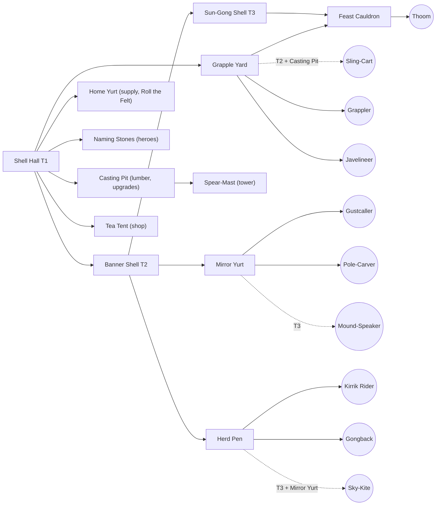

# Faction design: `clans` (the Tormai Clans)

*Design date: 2026-10-16. Status: full-game design, with the vertical-slice subset marked ✅.
Faction id: `clans` (data prefix `clans_`). Opponent in the slice: `kingdom`.*

**Read first:** `docs/research/ip-safety.md` (§0, §2, §3.2), `docs/research/gameplay-mechanics.md` (§11–§13).
This doc **supersedes** the faction-B placeholders in the research docs ("Thornborn" in the art/audio docs,
"Wildborn" B1–B8 in mechanics §13.4). Global rules (economy, upkeep, XP, damage matrix, day/night, creeps)
are the slice rules in mechanics §13.1–§13.2 and are not repeated here.

**Units of measure.** Distances in metres (1 m = 64 WC3 gu), speeds in m/s, times in seconds.
Sight is day / night. Damage and armour types use the slice matrix names (Blade, Pierce, Siege, Arcane,
Heroic, Pure, Spell; Light, Medium, Heavy, Fortified, Hero, Unarmored). Melee range is edge-to-edge, as in
`architecture.md`.

---

## 0. Summary

**What a Warcraft III fan should feel:** "This is the warrior-people race." The clans have tough, high-HP
infantry, a worker garrison for defence, a haste-buff caster, a ward-planting support, a defensive spirit
caster, a fast raider that pins flyers, a percussion war-beast, a flyer, a siege engine and a huge T3 melee
people. They have a blademaster-style duelist, a seer, a giant tank chieftain and a hex-and-heal support hero.
A fan can read every unit's job and the build-order logic at a glance.

**What must never be true:** nothing looks, sounds or reads like the WC3 Orcs. There are no green skins, tusks,
spiked pauldrons, red-brown leather, hide-and-bone huts, wolves, kodos, wyverns, trolls, lightning shamans
or broken-English grunts.

| | Choice |
|---|---|
| People | **Tormai**: big, slate-grey, heavy-jawed steppe nomads with pale "hail-speckles", and **no tusks** |
| Display name | **Tormai Clans** (formal: *the Nine Clans under the Gong-Ring*) |
| Ally people (the tauren-like slot) | **Thoom**: hill-sized, gentle cauldron-helmed giants who cook for the clans |
| Look | Felt yurts, lamellar, polished bronze, ancient tortoise-shell halls. Ink-teal and saffron felt, warm bronze, slate skin |
| Voice | Formal, courteous and slow. Comedy of **ferocious hospitality**: they apologise before hitting you |
| Signature WC3-derived mechanic (1 allowed) | Workers garrison the supply yurt and sling stones. Presented as the hall's gong ringing and the yurt's felt skirt **rolling up** |
| Gameplay identity | Durable units and strong heroes, mobile mid-game pushes (haste, riders), pull/trap/sleep disables, T3 giants. Weaknesses: fragile casters, few cheap detectors, slower early lumber trips |
| Slice subset ✅ | Worker **Yurtwright**. Combat: **Grappler**, **Javelineer**, **Gustcaller**, **Sling-Cart** (siege). Heroes: **Long-Braid**, **Skymirror**. Buildings: **Shell Hall (→ Banner Shell)**, **Home Yurt**, **Grapple Yard**, **Naming Stones**, **Casting Pit**, **Mirror Yurt**, **Spear-Mast** |

---

## 1. Identity

### 1.1 Names, and why not "orc"

- **People name: Tormai** (singular and plural "Tormai"; adjective "Tormai"). Say *TOR-my*.
  It is invented. "Tor" suggests a grey stone hill, which fits their skin and their hail myth.
- **Faction display name: Tormai Clans.** In lore they are *the Nine Clans under the Gong-Ring*.
- **Ally giants: Thoom** (singular and plural). The name is onomatopoeic for their footsteps.
- **Decision: the UI, data and VO never say "orc".** The word is legally free folklore (ip-safety §3.1).
  We still avoid it, for four reasons:
  1. Our roster deliberately mirrors the WC3 Orc *role slots*. Calling the people "orcs" as well would make the
     faction read as a 1:1 re-skin (rule 8 and the *Spry Fox* "focus on what is similar" test). A distinct
     people name is the cheapest strong signal of independent creation.
  2. To an RTS player, "orc" brings green skin and tusks. Every prompt or line that says "orc" pulls
     generated art toward that look (prompt hygiene, ip-safety §2.8).
  3. An original people name, with its own lore, is expression we can own. "Orc" is not.
  4. It sets up the voice: the Tormai speak formal, complete sentences, the opposite of the WC3 orc grunt-speak.
- **Naming rules for the faction** (so future names stay consistent and far from WC3):
  - Two-part English compounds for units and buildings ("Grapple Yard", "Sky-Kite").
  - Invented personal names use soft steppe-flavoured syllables (CV/CVC, doubled vowels allowed: *Ilaya, Ommet, Beluu*).
  - **No apostrophes**, and no Grom-/Gar-/Kar- or -tar/-ash name patterns.
  - Never "Horde", "clan of the X wolf", "Lok-", "Zug" or "Dabu".
  - No real ethnonyms, real clan names or real sacred terms.

### 1.2 Emblem: "the Gong and the Twin Winds"

- **Shape:** a saffron disc (the Sky-Gong) with a bronze rim. Below it, two thick ink-teal curls sweep in from
  left and right and meet under the disc like a heavy jaw. Flat, two colours plus a rim.
  It must still read at 32 px on a banner and at 16 px as a minimap or icon glyph.
- **Meaning in lore:** the Sky's gong (the sun, and the thunder that made the people) and the two seasonal
  winds that drive the herds. Children say the curls are "the Sky smiling with a big Tormai jaw".
- **Use:** on tall vertical felt banners (disc near the top, team-colour tassels below), on gong faces, shield
  bosses, doors and loading screens. A one-colour version is used for UI stamps.
- **Never:** a circle with spikes, crossed axes, tusks, skulls, a boar or wolf head, or any real-world sacred
  symbol or national emblem. No yurt crown-ring (a real national emblem), no real clan marks, no endless knot.

### 1.3 Lore (original)

> **Under the Long Sky.** The Tormai say the world began with a hailstorm. The Sky beat its great gong once,
> the clouds cracked, and the hailstones that struck the grass stood up, shook themselves, and asked who was
> cooking. That is why a Tormai's skin is the grey of a storm cloud, freckled with pale hail-marks. It is why
> they love bronze that rings, and why no guest leaves a Tormai fire hungry.
>
> For as long as their songs remember, the clans have walked the **Herd Road**: a great loop of grass between
> the Salt Lakes and the **Sleeping Hills**. Each autumn they stop below the hills and beat the gongs until the
> **Thoom** wake. The Thoom are giants older than the clans, who sleep inside the hills between feasts, wearing
> the cauldrons their grandmothers cast. A Thoom who wakes hungry is a natural disaster. A Thoom who wakes to
> stew is a friend for life. The clans call every Thoom "uncle".
>
> Each clan is a household of felt tents under one banner. The nine clans meet at the **Gong-Ring**, a council
> where anyone may raise a matter by striking the gong, and nothing is decided until everyone has eaten.
> Tormai law is hospitality: no guest may be harmed under your roof. A guest who refuses tea, however, is no
> longer a guest.
>
> Three summers ago the Kingdom raised a line of toll-towers across the Herd Road and fenced the river
> crossings. Its heralds sent a letter. The clans, being polite, sent tea. The Kingdom sent a bill.
> The clans are now coming to discuss the bill in person.

**Lore guardrails.** No demonic blood-curse, internment camps, portals, prophecy-driven exodus or redemption arc
(WC3 orc story beats). The Tormai are not villains, and the Kingdom is not evil: this is a border dispute
between proud neighbours, told with warmth and humour.

**World words** (use consistently in tooltips and VO):

| Word | Meaning |
|---|---|
| Long Sky / Long Grass | The open steppe and its sky |
| Herd Road | The migration loop; the reason for the war |
| Sleeping Hills | Where the Thoom sleep |
| sun-teeth | Gold ("sky-fire that fell and stuck in the ground") |
| lattice-wood | Lumber |
| guest / uninvited guest | Ally / enemy (in VO) |

### 1.4 Real-culture respect (required)

The Tormai draw on the **material culture** of the Eurasian steppe broadly: felt tents, lamellar armour, bronze
cauldrons, wrestling, horse-hair tassels and strong hospitality. They blend it with invented elements: the hail
myth, mirror-shamans, tortoise-shell halls, Kirrik birds and the Thoom. Rules:

- The Tormai are a **non-human fantasy people** (grey skin, giant jaw, hail-speckles). Do not draw human
  Central Asian facial features as monstrous, and do not stereotype them.
- **No real sacred objects or rites** depicted as such: no real deity names, spirit banners, sacred cairns, real
  shaman-costume replicas, real clan marks or national emblems.
- **VO and TTS never request a real-world ethnic accent.** Tormai English is slow, formal and standard.
- Portray them as sophisticated (law, poetry, craft, humour), never as "savage hordes".

---

## 2. Visual identity

### 2.1 Body and silhouette

| Element | Tormai | Why (vs WC3 Orc) |
|---|---|---|
| Skin | Slate blue-grey, with **pale hail-speckles** on the shoulders, forearms and scalp | WC3 orcs are green or brown |
| Head | A very heavy, square, forward-set **lower jaw with flat square teeth (no tusks)**, a broad flat nose, small deep-set amber eyes and small rounded ears | WC3 orcs have boar tusks |
| Hair | Blue-black. Warriors loop two thick braids up and bind them with bronze rings; workers hide theirs under felt hats | |
| Build | Upright and broad, with a thick neck and big forearms. They stand about 10% taller than the Kingdom's people at equal class (scale table below) | |
| Upper-third identity (art doc rule 2) | **Cone shapes on top:** conical bronze helmets with a long team-colour streamer, or tall peaked felt hats with ear-flaps. **Flat, layered rectangular shoulder-flaps** (lamellar or quilted felt) below. Seen from above, a soldier is a cone over a wide trapezoid | WC3 orcs have round spiked pauldrons |
| Weapons | Flanged bronze maces, javelin bundles, heavy curved sabres, ladles (Thoom), poles and bronze mirrors (casters). **No axes as the iconic weapon** | WC3 Grunt: axe |
| Shields | Few. Where used: small round felt-and-bronze bucklers | Leaves the tall rectangle to the Kingdom's pavises |

**Scale** (overrides the generic table in the research README for this faction):

| Class | Height | Collision radius | Tri budget |
|---|---|---|---|
| Yurtwright (worker) | 1.4 m | 0.35 m | 1.5–3k |
| Javelineer, Gustcaller, Pole-Carver | 1.7 m | 0.40 m | 2–4k |
| Grappler | 1.9 m | 0.50 m | 2–4k |
| Tormai heroes | 2.2–2.3 m | 0.55 m | 4–8k |
| Thoom (unit) | 2.8 m | 0.75 m | 4–6k |
| Cauldron-Father (hero) | 3.1 m | 0.80 m | 6–8k |
| Kirrik Rider (later) | 2.2 m | 0.60 m | 4–6k |
| Gongback (later) | 2.6 m tall, 3.2 m long | 1.00 m | 5–8k |
| Shell Hall | 7.5 m | 8×8 m footprint | 8–12k |

**64 px black-silhouette test (art doc §7.4).** Every unit must pass these checks:

| Unit | Must read as |
|---|---|
| Tormai infantry | A cone and a streamer over a wide flat trapezoid |
| Thoom | A big bronze bowl-dome plus a ladle |
| Gongback | A circle (the shell) carrying a smaller upright disc (the gong) |
| Sky-Kite | A diamond with two long tails |
| Kirrik Rider | A hooked beak forward, with the rider's cone above |
| Buildings | Low domes and masts. Never spikes |

### 2.2 Palette (albedo, before team colour)

| Role | Hex | Use |
|---|---|---|
| Ink teal (primary felt) | `#1E5A60` dark / `#2F7E7E` mid | Coats, yurt walls, banners. Keep it **dark and green-leaning, never violet** |
| Saffron (secondary felt) | `#E0A030` / ochre `#B7772A` | Trim, sashes, door hangings, emblem disc |
| Warm bronze | `#A8743A` / highlight `#D9A55E` | Helmets, gongs, mirrors, cauldrons, studs |
| Verdigris (sparingly) | `#5FA08E` | Old bronze, the Thoom's cauldrons |
| Slate skin | `#6F7C88` mid / `#4E5966` shadow / speckles `#C9D0D6` | Tormai skin |
| Thoom skin | `#B8916A` sandstone / `#8A6A4C` shadow | Thick, elephant-like hide |
| Felt cream (accent only) | `#E9DDBF` | Never a large mass (avoid white-and-gold) |
| Hair | `#1C2230` | |
| Magic VFX | Sun-glint gold `#FFD27A` (HDR), dust ochre `#C9A46A`, moon-silver `#C8D4E8` | Clan magic is **warm glints, dust and silver smoke**. No blue lightning, no fel green, no teal glow |

**Contrast with neighbours:**
- WC3 Orc is red, brown and green skin. WC3 Night Elf is violet, teal and silver. The Alliance is blue, white and gold.
- Ours is dark ink-teal, saffron, bronze and slate. Keep teal dark and never pair it with violet.
- Keep saffron orange-yellow, never pure gold on white.
- The Kingdom (burgundy, ivory, dark bronze) is near-complementary, so the slice matchup reads well.
- **Team colour** goes on:
  - helmet streamers, felt shoulder-mantles and sashes on units;
  - banner tassels;
  - the felt band around every yurt dome;
  - the hangings on the Shell Hall.

  Because the faction teal is dark and low-saturation, a bright teal team colour still separates. Check this
  in the night grade.

### 2.3 Materials and cultural sources

| Material | Where | Painting note |
|---|---|---|
| Thick felt (quilted, stitched in big chunky patterns) | Coats, yurts, hats, shoulder-mantles | Big soft color blocks with a few broad stitch lines. No fine embroidery |
| Lamellar (small rectangular plates laced in rows) | Warrior shoulders and chests | Paint 3–5 big rows, not hundreds of plates |
| Polished warm bronze | Helmets, gongs, mirrors, cauldrons, mace heads | Painted highlight streaks only. No PBR gloss |
| Lattice-wood (red-brown folding lattice) | Yurt walls, masts, carts | Readable diamond pattern at 2 m scale |
| Horn and lacquer-free wood | Bows, javelin shafts, poles, ladles | |
| Ancient tortoise shell | The Shell Hall (T1–T3), Gongback | Big hex plates, moss-free, sun-bleached ochre |
| Standing stones | Naming Stones | Carved faces, hung with small bronze mirrors |

### 2.4 Architecture: "domes and masts"

- Every clan building is a **round, low dome** (felt yurt, or an ancient tortoise shell) on a short stone ring,
  plus **masts**: carved poles with horse-hair tassels, banners and gongs on frames.
- There are no spikes, bones, hides or tusks. That rules out the WC3 Orc's hide-and-bone spiky huts.
- **Construction verb: Raising.**
  1. A folding lattice ring springs open.
  2. The roof poles lift into place.
  3. Felt unrolls upward and the dome ties shut.
  4. Team-colour bands wrap last.

  The `build_progress` shader reveals the building bottom-up in two passes: the lattice first, then the felt
  over it.
- **Destruction:** the felt tears away and the lattice folds flat in a dust burst. The gong falls last with a clang.
- **Night:** a warm glow comes through each dome's smoke-ring. Bronze mirrors catch moonlight.

### 2.5 Things the art must never do (squint-test list)

- Green, olive or brown-red skin. Tusks of any kind. Pointed ears.
- Spiked or round "pumpkin" pauldrons. Fur pauldrons. Red-brown leather straps as the main mass.
- Huts of hide, bone, spikes or tusks. Skull totems.
- Wolves as mounts. Kodo-like grey dinosaurs. Wyverns.
- Lightning-wielding shamans. Blue electric VFX.
- Gut-plates, rhino cavalry, "great maw" imagery. These belong to another wargame's steppe-ogre faction (Games Workshop), so avoid that trade dress as well.
- Slender, colourful, long-legged bird mounts. Kirriks are **heavy, short-legged, big-headed terror-birds** in grey-brown.
- Kegs, brewing or alcohol on the Thoom. They are cooks and hosts, not brewmasters.

### 2.6 Distinctness rubric (ip-safety §3.2) vs the nearest WC3 race (Orc)

| Axis | Tormai Clans | Differs? |
|---|---|---|
| 1. Silhouette | Cones and streamers over flat layered flaps; heavy jaws without tusks; domes and masts | ✅ (required) |
| 2. Palette | Dark ink-teal, saffron, warm bronze, slate | ✅ |
| 3. Materials | Felt, lamellar, polished bronze, lattice, tortoise shell | ✅ |
| 4. Cultural inspiration | Steppe material culture plus invented myth (hail, mirrors, Thoom) | ✅ |
| 5. Signature mechanic | One WC3-derived mechanic only (worker garrison), shown as gong plus rolling felt | ✅ |
| 6. Names and voice | All original; formal, courteous, hospitality comedy | ✅ |

**Result:** 6 of 6 axes differ, including silhouette.

**Residual risk:** the *role structure* is a deliberate slot-for-slot mirror (the user's direction). Mitigations:
- Every kit has original abilities (see the equivalence ledgers in §5.3 and §6.2).
- The building arrangement is changed where cheap: the Mound-Speaker trains at the Mirror Yurt, not beside the giants, and the flyer needs a caster building.
- A pre-release legal review should look at the **whole** faction (ip-safety §5.3).

---

## 3. Voice and audio

### 3.1 Speech style

- **Courteous menace.** The Tormai are formal and slow, and speak in complete sentences.
  - Enemies are "guests" or "uninvited guests".
  - They apologise before violence.
  - Their metaphors are weather, grass, tea, felt and stew.
- **Verbal tic:** a low throat-hum, "*Hm-hm*", before many lines. It doubles as a personality beat.
- **Humour is character comedy:** etiquette applied to war, pride in craft, family and in-law jokes, and
  giants who think about dinner. No pop culture, puns on WC3 lines or fourth-wall gags about "orcs".
- **Thoom:** very slow, very deep, long vowels; always slightly hungry. **Never** beef or cow puns (those belong to the WC3 tauren).
- **Line budget** (audio doc §3.2):
  - Regular unit: about 18 lines. Worker: about 19. Hero: about 26. Advisor: about 14.
  - Check every line against the WC3 Orc quote page before recording, and reject anything close
    (ip-safety §2.2). Never use the words "poke" or "poking" in annoyed lines.

### 3.2 Per-unit personalities (one tic each)

| Unit | Personality | Tic |
|---|---|---|
| Yurtwright | Fussy, warm craftsperson; hospitality under strain | Counts things ("eleven knocks") |
| Grappler | Courtly giant wrestler; treats combat as a formal bout | Wrestling etiquette |
| Javelineer | Boastful athletes who track their throwing distances | Quotes distances ("forty paces!") |
| Gustcaller | Breathy weather-gossip; talks about the wind like a neighbour | "The wind says…" |
| Pole-Carver | Deadpan carpenter of spirits | Complains about wood grain |
| Mound-Speaker | Speaks with an ancestor's second voice that interrupts | Two voices (chorus) |
| Kirrik Rider | Fast-talking; the bird shrieks over the ends of lines | Bird interruptions |
| Gongback rider | Half-deaf from the gong | "WHAT?" |
| Sky-Kite | Airy thrill-seeker | Whoops |
| Sling-Cart crew | Two bickering brothers | Finish each other's sentences wrongly |
| Thoom | Slow, gentle, always thinking about the next meal | Long "mmmm" |
| Long-Braid | Dry, clipped, competitive; her braid is her pride | Keeps a duel tally |
| Skymirror | Vain about his mirror's polish; prophecies about trivial things | Polishes mid-sentence |
| Cauldron-Father | Enormous, gentle host | Calls everyone "little one" |
| Omen-Mother | Sly grandmother and gambler | Rattles her knucklebones |

### 3.3 Sample lines (original; at least 3 per category)

**Yurtwright (worker).** Cast: `pqHfZKP75CvOlQylNhV4` (Bill), tags `[deep, courteous, unhurried]`,
post-chain `rubberband=pitch=0.9:formant=shifted`, warm EQ.

| Category | Lines |
|---|---|
| Ready | "Felt rolled, poles packed. Where do we raise?" · "A strong back for the clan." · "Hm-hm. I have tea in my boot. I am ready." |
| What (select) | "Hm-hm?" · "The wright is listening." · "You need a roof? I have a roof." |
| Yes (order) | "Gladly." · "Onward, with care." · "I go. Slowly, but I go." |
| Attack | "Forgive me. I must hit you now." · "With my good mallet, then." · "Very sorry. Very hard." |
| Warcry | "Out of my yurt!" · "Mind the felt!" · "Guests do not do this!" |
| Job done | "Raised, roped, and ready for guests." · "Another roof under the sky." · "Done. Somebody warm the kettle." |
| Annoyed (plays in order) | 1. "Hm. A guest who knocks twice is still welcome." 2. "A guest who knocks five times is… still welcome. Through my teeth." 3. "That is eleven knocks. My jaw is making a noise." 4. "Fine. Sit. Drink. I will pour, and you will stop." |
| Death (non-verbal) | A deep "*hhuff*", then a soft felt thump · a surprised "*Hm?*" cut short · a tired sigh and the clatter of a mallet |

**Grappler (heavy infantry).** Cast: `pNInz6obpgDQGcFmaJgB` (Adam), tags `[very deep, formal, amused]`,
post-chain `rubberband=pitch=0.84:formant=shifted`, +4 dB at 180 Hz, compressor.

| Category | Lines |
|---|---|
| Ready | "Grappler, oiled and braided." · "Show me something heavy." · "The ring is drawn. Who steps in?" |
| What | "Speak, chief." · "Hm-hm. Big ears, listening." · "Grappler." |
| Yes | "With pleasure." · "Shoulders first." · "I move like a hill moves. Surely." |
| Attack | "Down you go." · "Excuse my hands!" · "I will fold them like felt." |
| Warcry | "INTO THE GRASS WITH THEM!" · "GRIP AND THROW!" · "THE SKY IS WATCHING. LOOK GOOD!" |
| Annoyed (plays in order) | 1. "You grip my arm. In my clan, that is a challenge." 2. "Now you grip the other arm. That is a marriage proposal." 3. "…I must ask my mother." 4. "She says you are too small. I am sorry." |
| Death | A huge "*HNNGH*" and a ground-shaking thud · "…pinned." · a long exhale, then a gong-like body fall |

**Long-Braid (hero, AGI duelist).** Cast: `FGY2WhTYpPnrIDTdsKH5` (Laura), tags `[low, dry, confident]`,
post-chain `rubberband=pitch=0.9:formant=preserved`, small plate reverb.

| Category | Lines |
|---|---|
| Ready / revive | "My braid is uncut. Bring me someone who can change that." · "Long-Braid walks." · "One sabre, one braid, no regrets." |
| What | "Speak quickly. Steel gets bored." · "Hm." · "I am listening with my sword hand." |
| Yes | "Already gone." · "Lightly." · "Follow the dust." |
| Attack | "Draw, if you have something to draw." · "Their best. Send me their best." · "Count the cuts." |
| Warcry | "UNCUT!" · "FACE ME!" · "DUST AND STEEL!" |
| Annoyed (plays in order) | 1. "Hands off the braid." 2. "Tug it once more and we duel." 3. "You tugged it. Draw." 4. "…Whoever you are up there, I cannot reach you. Yet." |
| Abilities | Dust Veil: "Gone with the dust." · Braid Lash: "Come here." · ultimate: "Through the grass!" |
| Death | A sharp breath and her sabre ringing on stone · "Cut… at last." · a short laugh that breaks off |

**Advisor.** The clan's gong-keeper. Cast: `onwK4e9ZLuTAKqWW03F9` (Daniel), pitch 0.9, a bronze-plate reverb tail.

| Event | Line |
|---|---|
| Not enough gold | "The purse is thin. More sun-teeth, please." |
| Not enough lumber | "We are short of lattice-wood." |
| Not enough food | "Raise more yurts. Our guests are sleeping in the rain." |
| Can't build there | "The ground says no." |
| Hall under attack | "Someone is striking the Shell Hall!" |
| Units under attack | "Our kin are fighting!" |
| Hero fallen | "A name has fallen. The Stones will call it back." |
| Research complete | "The bronze has cooled." |
| Mine low | "The sun-teeth are wearing thin." |

### 3.4 Music and UI sound

- **Music: 3 tracks of 3–4 min**, rotated with 20–40 s gaps (audio doc §3.3).
  - **Instruments:** frame drums in a galloping 6/8 over 4/4; struck and bowed bronze gongs; a two-string
    bowed fiddle with a raspy horse-hair tone; jaw harp; long low bronze horns; wordless deep overtone chant;
    hand claps and stamps.
  - **Harmony:** Dorian or Mixolydian, 84–100 BPM. Proud, windswept and warm.
  - **Avoid** taiko with low brass and guitar (the WC3 Orc sound).
- **Compliant music prompt (ElevenLabs Music, `force_instrumental: true`):**
  > Instrumental, 3:30, fantasy steppe-inspired march: deep frame drums in a galloping 6/8 over 4/4, struck and
  > bowed bronze gongs, a raspy two-string bowed fiddle, jaw harp pulses, long low bronze horns, swelling
  > wordless deep male overtone chant, hand claps and stamps; D Dorian, 92 BPM; proud, windswept, warm;
  > intro, A, B, A-prime, resolving outro; no lyrics.
- **UI:**
  - click: a small bronze tap plus a felt thump;
  - complete: a soft gong swell;
  - error: a throat "*hm-mm*" plus a muffled felt thud;
  - hero level-up: the shared game cue, with a clan gong layer added.

---

## 4. Economy and faction rules

| Rule | Value |
|---|---|
| Start | Shell Hall, 5 Yurtwrights, 500 gold / 150 lumber (global) |
| Gold | Walked back to a Shell Hall: **10 per trip**, 1 worker inside the mine at a time (global) |
| Lumber | **15 per trip**, chopping 1 lumber per **0.9 s**. Fewer trips, slower chop (mechanics §13.1, faction B). Drop-off at the Shell Hall or Casting Pit |
| Supply | Shell Hall **+10 food** (all tiers). Home Yurt **+10 food**. 9 yurts reach the 100 cap |
| Upkeep, food cap | Global (100; 70% gold from 51 food, 40% from 81) |
| Construction | One Yurtwright raises a building. Others can **Mend** (repair) during or after construction |
| **Signature mechanic (WC3-derived, 1 of 1)** | **Sound the Gong / Roll the Felt.** Up to 4 Yurtwrights enter a Home Yurt; its felt skirt rolls up and each throws sling-stones. See §4.1 |
| Faction passives | None globally. Day/night matters only through Skymirror's Sunglint and Swallowed Sun |

### 4.1 Sound the Gong / Roll the Felt (presented differently from WC3's burrow battle stations)

- **Shell Hall ability "Sound the Gong"** (hotkey G, no cost, no cooldown):
  - The hall's gong rings, with a visible ripple and a 2D gong cue for the owner.
  - Every Yurtwright within **30 m** drops its load and runs to the nearest Home Yurt with a free slot.
  - Workers with no free slot run to the Shell Hall and wait there (they cannot be garrisoned in the hall).
  - **"All Clear"** (same button) sends them back to their previous jobs.
- **Home Yurt "Roll the Felt":** holds 4 Yurtwrights. A Yurtwright can also enter on its own (right-click the yurt, or the Enter command).
  - Garrisoned workers cannot be targeted and do not gather.
  - Each one adds a sling attack from the yurt: **Pierce 8–11, cooldown 1.8 s, range 7.0 m**, ground and air.
    The animation: the felt skirt rolls up to show the lattice, and the slings whirl through the gaps.
  - "Unload" empties the yurt instantly. If the yurt dies, its workers pop out with 50% HP.

---

## 5. Unit roster

### 5.1 Stats

Unit **level** sets XP value and creep-style difficulty. Organic units regenerate 0.25 HP/s. Casters start with
75 mana and regenerate 0.65 mana/s. G = ground, A = air.

| # | id / Name | WC3 role slot | Built at (needs) | Gold / lumber / food | Time | Lvl | HP | Mana | Armour | Attack: type, dmg | CD | Range (m) | Speed (m/s) | Sight (d/n) | Hits | Slice |
|---|---|---|---|---|---|---|---|---|---|---|---|---|---|---|---|---|
| 1 | `clans_yurtwright` **Yurtwright** | Worker | Shell Hall | 70 / 0 / 1 | 15 | 1 | 240 | – | 0 Medium | Blade 6–8 | 2.0 | 0.6 | 3.1 | 12.5 / 9.4 | G | ✅ |
| 2 | `clans_grappler` **Grappler** | Heavy melee infantry | Grapple Yard | 185 / 10 / 3 | 26 | 3 | 660 | – | 1 Heavy | Blade 17–22 | 1.55 | 0.8 | 4.2 | 21.9 / 12.5 | G | ✅ |
| 3 | `clans_javelineer` **Javelineer** | Ranged thrower | Grapple Yard | 140 / 20 / 2 | 21 | 2 | 370 | – | 0 Medium | Pierce 19–24 | 2.0 | 7.0 (8.6 with Throwing-Sticks) | 4.2 | 21.9 / 12.5 | G+A | ✅ |
| 3b | `clans_proven` **Proven Javelineer** | Upgraded tougher form | Proving Rite (T3) converts all Javelineers; later trains replace them | 140 / 20 / 2 | 21 | 3 | 540 | – | 1 Medium | Pierce 21–26 | 1.9 | 8.6 | 4.4 | 21.9 / 12.5 | G+A | later |
| 4 | `clans_kirrik_rider` **Kirrik Rider** | Fast beast-rider raider | Herd Pen (T2) | 185 / 45 / 3 | 28 | 3 | 590 | – | 1 Medium | Blade 16–21 | 1.6 | 0.8 | 5.6 | 21.9 / 12.5 | G | later |
| 5 | `clans_gustcaller` **Gustcaller** | Shaman-type buffer | Mirror Yurt (T2) | 130 / 25 / 2 | 28 | 2 | 320 | 200 | 0 Unarmored | Arcane 9–11 | 1.8 | 7.5 | 4.2 | 21.9 / 12.5 | G+A | ✅ |
| 6 | `clans_pole_carver` **Pole-Carver** | Witch-doctor-type ward support | Mirror Yurt (T2) | 145 / 25 / 2 | 30 | 2 | 320 | 200 | 0 Unarmored | Arcane 10–13 | 1.8 | 7.5 | 4.2 | 21.9 / 12.5 | G+A | later |
| 7 | `clans_mound_speaker` **Mound-Speaker** | Spirit-walker-type caster | Mirror Yurt (T3) | 190 / 45 / 3 | 38 | 3 | 520 | 225 | 1 Medium | Arcane 16–20 | 1.9 | 6.5 | 4.2 | 21.9 / 12.5 | G+A | later |
| 8 | `clans_sling_cart` **Sling-Cart** | Siege engine (wheeled) | Grapple Yard (T2 + Casting Pit) | 200 / 70 / 3 | 36 | 3 | 420 | – | 1 Heavy | Siege 60–74, splash full 0.6 m / half 1.9 m | 3.3 | 15.6 (min 3.9) | 3.3 | 21.9 / 12.5 | G only | ✅ |
| 9 | `clans_gongback` **Gongback** | Heavy war-beast with percussion platform | Herd Pen (T2) | 245 / 70 / 4 | 40 | 4 | 960 | – | 3 Heavy | Pierce 13–17 (rider's javelins) | 1.6 | 6.0 | 3.4 | 21.9 / 12.5 | G+A | later |
| 10 | `clans_sky_kite` **Sky-Kite** | Flyer | Herd Pen (T3 + Mirror Yurt) | 225 / 50 / 4 | 36 | 4 | 500 | – | 0 Light | Pierce 20–26 | 1.8 | 5.0 | 5.6 (flying) | 21.9 / 12.5 | G+A | later |
| 11 | `clans_thoom` **Thoom** | Big T3 melee people (tauren-like slot) | Feast Cauldron (T3) | 300 / 85 / 5 | 46 | 5 | 1300 | – | 2 Heavy | Blade 31–38 | 2.0 | 1.0 | 3.9 | 21.9 / 12.5 | G | later |

**Deliberately cut:** a second, suicide-style anti-air flyer. Anti-air comes from Javelineers, Sky-Kites,
Gongback riders, casters, Spear-Masts and Hobble-Bola instead. Leaving the slot empty also breaks the 1:1
roster count.

### 5.2 Unit descriptions and abilities

Abilities marked **≈WC3** are functional equivalents of a WC3 Orc unit ability. They are kept because they define
the role, but each has our own name, numbers and presentation. **Original** marks new mechanics.

**1. Yurtwright** (worker)

- **Look:** a stocky Tormai in a quilted ink-teal coat and a tall peaked felt hat with ear-flaps (team colour on the hat band). They carry a wooden mallet and a lattice bundle or gold sack on their back.
- **Abilities:**
  - Gather: 10 gold, or 15 lumber.
  - **Raise** (build).
  - **Mend** (repair, autocast): restores HP at 1.5× the building's build time; costs 30% of the building's cost, paid pro rata.
  - **Roll the Felt** (enter a Home Yurt; see §4.1).

**2. Grappler** (heavy melee infantry)

- **Look:** a broad wrestler-soldier.
  - Conical bronze helmet with a long team-colour streamer; bronze chin-guard over the big jaw.
  - Three rows of saffron-laced lamellar flaps on the shoulders.
  - Sleeveless felt coat, huge bronze wrist-guards, oversized flanged bronze mace.
- **Shove** (Original; unlocked by *Wrestler's Training*, which also gives +60 HP):
  - Every **4th consecutive attack** on the same target shoves it back **1.0 m** and **cancels its swing** if
    that attack has not reached its damage point. This uses the attack-timing system in mechanics §7.3.
  - Against heroes and units of 5 or more food: 0.5 m, and the swing is not cancelled.

**3. Javelineer** (ranged thrower) and **3b. Proven Javelineer** (upgraded form)

- **Look (Javelineer):** a lean Tormai athlete (an adult). Felt hood, a quiver-bundle of bronze-weighted javelins, and a spear-thrower stick.
- **Throwing-Sticks** (research): range 7.0 → 8.6 m (the atlatl).
- **Proving Rite** (T3 research) turns every Javelineer into a **Proven Javelineer**, a veteran who has thrown in nine battles. The Proven:
  - is 1.12× the size;
  - wears a bronze lamellar vest and a saffron sash;
  - gains +170 HP, +1 armour, +2 damage and +0.2 m/s;
  - gains **Heel-Seeker** (Original, passive): **+35% damage against units moving away from it**.
    This punishes the classic "pull the damaged unit back" micro (mechanics §11.4).
- **Production:** the Proven reuses the Javelineer mesh with a texture swap and scale. It costs no extra 3D.

**4. Kirrik Rider** (raider)

- **Look:** a Tormai outrider on a **Kirrik**, a heavy, short-legged flightless steppe bird with a huge hooked beak and grey-brown plumage. The rider carries a torch-pole and a bola belt.
- **Torch-Raid** (≈WC3: the raider's anti-building role, done through a passive instead of the Siege attack type): +60% damage against buildings.
- **Hobble-Bola** (≈WC3 ensnare; research at the Herd Pen):
  - Range 5.5 m, cooldown 12 s, no mana.
  - Ground targets are rooted for 4 s (heroes 2 s).
  - **Flying units are pulled to the ground for 8 s** and count as ground units, so melee can hit them.

**5. Gustcaller** (shaman-type buffer)

- **Look:** a Tormai weather-caster in a long saffron felt robe hung with ribbon-streamers. A small bronze mirror sits on the chest, and a forked staff carries more streamers.
- **Trainings:** Adept and Master training each give +60 HP, +100 mana and +2 damage.

| Ability | Unlock | Effect | Mana | CD | Range | Kind |
|---|---|---|---|---|---|---|
| **Wind at Your Back** (autocast) | Base | Ally gains +25% move speed and +30% attack speed for 40 s. Ribbons of dust spiral round it | 45 | 1 s | 9 m | ≈WC3 (haste buff) |
| **Unbind** | Adept (T2) | 3 m area. Removes buffs: positive ones from enemies, negative ones from allies. Deals 250 damage to summoned units. Slows enemies 40% for 3 s | 60 | 6 s | 8 m | ≈WC3 (dispel), made an area spell |
| **Dust Shroud** | Master (T3) | A 5 m dust cloud for 10 s: ranged attacks against units inside miss 60% of the time | 75 | 25 s | 9 m | Original |

**6. Pole-Carver** (witch-doctor-type ward support)

- **Look:** a Tormai carver with a tool-apron, a stack of carved poles strapped to the back, and a felt cap.
- **Poles:** wards with 5 HP that can be attacked. They are visible unless stated otherwise.

| Ability | Unlock | Effect | Mana | CD | Range | Kind |
|---|---|---|---|---|---|---|
| **Healing Pole** | Base | Allies within 6 m heal 1.8% of max HP per second for 25 s | 100 | 0 | 5 m | ≈WC3 (healing ward) |
| **Lookout Pole** | Adept (T2) | **Invisible** pole. Reveals a 14 m radius, including invisible units, for 8 min | 50 | 0 | 5 m | ≈WC3 (sentry ward) |
| **Hitching Pole** | Master (T3) | A 20 HP pole. Enemy ground units within 4 m when it is planted are **tethered**: they cannot move beyond 4 m of the pole for 7 s (heroes 3.5 s). The rope VFX ties each one to the pole | 90 | 22 s | 7 m | Original (replaces the WC3 stasis trap) |

**7. Mound-Speaker** (spirit-walker-type defensive caster)

- **Look:** a gaunt, very old Tormai in pale felt, carrying a bronze bowl of smoke. A translucent ancestor-face hovers over one shoulder, and the speaker talks in two voices.

| Ability | Unlock | Effect | Mana | CD | Range | Kind |
|---|---|---|---|---|---|---|
| **Between Breaths** (toggle) | Base | Becomes a spirit: immune to Blade, Pierce, Siege and Heroic attacks; takes +66% damage from Arcane and Spell; cannot attack | 0 | 2 s | self | ≈WC3 (ethereal) |
| **Kin-Thread** | Adept (T3) | Links up to 4 allies within 8 m for 60 s. 40% of the damage any linked unit takes is spread among the others | 75 | 2 s | 8 m | ≈WC3 (damage link) |
| **Hands from the Mound** | Master (T3) | 3 m area. After 0.75 s, ghostly hands root enemy ground units for 3 s (heroes 1.5 s) and deal 25 Spell damage per second | 100 | 20 s | 8 m | Original (replaces the WC3 resurrect) |

**8. Sling-Cart** (siege engine)

- **Look:** a two-wheeled lattice-wood cart with a long throwing arm and a felt sling, pushed by two Tormai crew (rigid props, so no rig is needed). Ammunition is clay pots.
- **Tallow Pots** (≈WC3 burning ammunition; T3 research): each impact leaves burning ground in a 1.5 m radius for 5 s, dealing 12 damage per second. It does not stack, and it also burns buildings.
- **Motion** is fully procedural (§10): the wheels roll, the arm swings, the cart recoils and the crew bob.

**9. Gongback** (heavy war-beast with a percussion platform)

- **Look:** a giant steppe tortoise. On its shell sits a felt-roofed platform holding a big bronze gong, a gong-beater and a javelin rider.
- **Rallying Gong** (≈WC3 percussion aura): allied units within 9 m deal +10% damage, or +18% with *Deep-Cast Gong*. The gong pulses visibly on each beat.
- **Withdraw** (Original; replaces the WC3 devour), cooldown 25 s, no mana:
  - The tortoise pulls into its shell for 6 s. It cannot move or attack, and takes 70% less damage.
  - Enemies within 5 m are forced to attack it.
  - The gong keeps playing, so the aura stays on.
- **Production:** this is the cheapest non-biped we have. The shell is rigid, the 4 legs and the head are pivoting segments, and the animation is procedural.

**10. Sky-Kite** (flyer)

- **Look:** a big hexagonal felt-and-cane kite with two long team-colour tails. A light Tormai rider hangs in a harness under it and throws javelins down.
  - In lore, a wind bound by the Gustcallers lifts the kite. That is why the Sky-Kite needs a Mirror Yurt.
  - There are no wings, so the motion is procedural: bank, sway and tail ribbons.
- **Ribbon Barbs** (≈WC3 poison; research): attacks make units bleed 4 damage per second for 4 s. It does not stack, and does not affect buildings.
- **Updraft** (Original, cooldown 25 s): +75% move speed for 3 s, and immune to Hobble-type pull-downs and roots while it lasts.

**11. Thoom** (big T3 melee people)

- **Look:** a 2.8 m hill-giant with sandstone, elephant-thick skin and tiny eyes.
  - The head is hidden under a huge upturned **bronze cauldron helm**; its two ring-handles stand up like ears.
  - It wears a felt apron and swings a **giant bronze ladle** as a mace.
  - No horns, no hooves, no kegs.
- **Heavy Ladle** (≈WC3 splash slam; research): every **3rd** attack is a **Ladle Slam** that deals 55 Spell damage to all enemies within 2.5 m. Deterministic, not a chance roll.
- **Big Appetite** (Original, passive): heals 80 HP when it kills a non-hero unit. In VO, a Thoom wonders aloud whether it is dinner yet.

### 5.3 Unit equivalence ledger (roles kept, kits mixed)

| Unit | WC3 equivalents kept | Original |
|---|---|---|
| Grappler | – (WC3's HP and attack-speed upgrade is replaced) | Shove |
| Javelineer / Proven | Range upgrade; a transform into a tougher form | Heel-Seeker |
| Kirrik Rider | Ensnare; anti-building role | Bird mount; the pull-down lasts longer than the root |
| Gustcaller | Haste buff, dispel | Dust Shroud |
| Pole-Carver | Healing and sentry wards | Hitching Pole |
| Mound-Speaker | Ethereal form, damage link | Hands from the Mound |
| Sling-Cart | Burning ammunition | – |
| Gongback | Damage aura | Withdraw, turtle body |
| Sky-Kite | Bleed (DoT) | Updraft, kite body |
| Thoom | Splash slam | Big Appetite, cauldron giants |

---

## 6. Heroes

All four heroes use the global hero rules:

| Rule | Value |
|---|---|
| Cost | First hero free (5 food, plus Homeward Felt in the slice); later ones 425 g / 100 l, 5 food, 55 s |
| Combat | Heroic attack type, Hero armour, 30% spell resistance |
| Inventory and revive | 6 item slots; revive at the Naming Stones (global formula) |
| Skills | Abilities learned at levels 1/3/5 (3 ranks each), ultimate at level 6. Hotkeys Q, W, E, R |
| Attributes | STR +25 HP and +0.05 HP/s; AGI +0.3 armour and +2% attack speed; INT +15 mana and +0.05 mana/s; primary attribute +1 damage |
| Formulas | Armour = base + 0.3 × AGI (base −2, Cauldron-Father −1). HP = 100 + 25 × STR. Mana = 15 × INT |

**Fidelity rule:** at most **2 of 4** abilities may be functional equivalents of the matching WC3 hero's
abilities. Ledger in §6.2.

### 6.1 Hero stats

| Hero (id) | WC3 archetype slot | Primary | STR (+/lvl) | AGI (+/lvl) | INT (+/lvl) | HP L1 | Mana L1 | Armour L1 | Damage L1 | Base CD (effective L1) | Range | Speed | Sight | Height | Slice |
|---|---|---|---|---|---|---|---|---|---|---|---|---|---|---|---|
| **Long-Braid** (`clans_hero_long_braid`) | AGI melee duelist | AGI | 19 (+2.0) | 22 (+1.9) | 14 (+1.5) | 575 | 210 | 4.6 | 24–33 | 2.0 (1.39 s) | 0.9 m melee | 5.0 | 28.1 / 12.5 | 2.2 m | ✅ |
| **Skymirror** (`clans_hero_skymirror`) | INT seer-caster (ranged) | INT | 16 (+1.7) | 14 (+1.0) | 22 (+2.9) | 500 | 330 | 2.2 | 23–31 | 2.3 (1.80 s) | 7.5 m (glint bolt) | 4.7 | 28.1 / 12.5 | 2.2 m | ✅ |
| **Cauldron-Father** (`clans_hero_cauldron_father`), a Thoom | STR tank chieftain | STR | 26 (+2.9) | 11 (+1.1) | 13 (+1.5) | 750 | 195 | 2.3 | 32–41 | 2.4 (1.97 s) | 1.2 m melee | 4.4 | 28.1 / 12.5 | 3.1 m | later |
| **Omen-Mother** (`clans_hero_omen_mother`) | INT support (hex, heal) | INT | 17 (+1.8) | 13 (+1.1) | 21 (+2.6) | 525 | 315 | 1.9 | 22–29 | 2.3 (1.83 s) | 7.0 m (bone-chip toss) | 4.7 | 28.1 / 12.5 | 2.1 m | later |

**Proper names** (one is picked at random for each hero, as in WC3):
- Long-Braid: *Ilaya, Teshe, Orsel, Nauri, Sabbet*.
- Skymirror: *Hodun Brightbowl, Sarvi Two-Skies, Ommet the Polished, Kelun Who-Squints*.
- Cauldron-Father: *Boomul, Ummoru, Gubbada, Lummaro*.
- Omen-Mother: *Grandmother Ezzi, Old Beluu, Auntie Ottu, Mother Halsi*.

#### Long-Braid: AGI duelist

**Look:**
- A lean, fast Tormai woman in a flared saffron riding coat; the skirt spins out in a wide silhouette.
- A bronze chin-guard, and a team-colour sash.
- An **oversized curved sabre**, and a single huge braid ending in a bronze weight that she uses as a second weapon.
- No mask.

**Lore:** a sworn duelist never cuts her braid until she loses a duel. Hers reaches the ground.

| Key | Ability | Rank 1 / 2 / 3 | Mana | Cooldown | Kind |
|---|---|---|---|---|---|
| Q | **Dust Veil**: she spins her braid, a dust devil swallows her and she vanishes. Invisible for up to **15 / 20 / 25 s** with **+20 / 35 / 50%** move speed (fade time 0.6 s). Her first attack out of it deals **+40 / 70 / 100** bonus Heroic damage and slows the target 30% for 2 s | see text | 75 | 8 s | ≈WC3 #1 (stealth opener) |
| W | **Braid Lash**: the weighted braid snaps out at a ground unit within 5.5 m. It deals **40 / 75 / 110** Spell damage, pulls the target **3 m** toward her (heroes 1.5 m) and roots it for **1.0 / 1.25 / 1.5 s** | see text | 70 | 14 / 12 / 10 s | Original |
| E | **Keen Edge** (passive): **15%** chance to deal **2× / 2.5× / 3×** damage. Each crit gives her +25% move speed for 1.5 s (hit-and-run) | see text | – | – | ≈WC3 #2 (critical strike) |
| R | **Through the Tall Grass** (ult, level 6): for **10 s** she gains +30% attack speed, and every attack also cuts a **6 m × 1.5 m line** behind the target for **60%** of the hit's damage, crits included. A crescent dust-slash VFX shows each cut | – | 125 | 120 s | Original (not a spin AoE) |

#### Skymirror: INT seer-caster

**Look:**
- An old, broad Tormai on foot in an ink-teal felt coat stitched with many small bronze mirrors.
- A large polished bronze mirror hangs over his eyes like a visor ("he sees through the bronze").
- He holds a long staff topped by a second mirror.
- He polishes constantly.

| Key | Ability | Rank 1 / 2 / 3 | Mana | Cooldown | Kind |
|---|---|---|---|---|---|
| Q | **Sunglint**: a reflected beam, **11 m × 1.6 m**, deals **75 / 125 / 175** Spell damage and **blinds** (35% miss chance) for **3 / 4 / 5 s**. **At night it becomes Moonglint:** 50% damage, but the blind lasts 2 s longer. Cast point 0.4 s | see text | 85 | 9 s | Original (a line, not a bounce) |
| W | **Far Mirror**: reveals a **10 / 14 / 18 m** radius anywhere on the map for 8 s. At rank 3 it also reveals invisible units | see text | 60 / 50 / 40 | 20 / 15 / 10 s | ≈WC3 #1 (remote reveal) |
| E | **Hail-Hawks**: summons **1 / 2 / 2** spectral hawks (level 2 / 2 / 3) for **45 s**. Each hawk: **230 / 270 / 320 HP**, Light 0, Pierce **9–11 / 11–13 / 13–15**, CD 1.5, range 4.5 m, **flying**, 5.5 m/s, sight 17 / 12.5. At rank 3, hawks detect invisible units within 9 m. Summons give 50% XP | see text | 100 | 30 s | ≈WC3 #2 (summon), changed to fragile air scouts |
| R | **Swallowed Sun** (ult, level 6): within 12 m, a **9 m radius** goes dark for **12 s**. Enemies inside have sight 3 m and a **40% miss chance**, and enemy vision cannot see into the area. Your units inside gain +15% move speed | – | 175 | 150 s | Original (it uses the day/night sight system) |

#### Cauldron-Father: STR tank chieftain (Thoom; a different people from the WC3 bull-folk)

**Look:**
- The biggest Thoom of the Sleeping Hills.
- An enormous verdigris cauldron helm with a lid-crest, and a felt apron.
- A **giant ladle**, and a bronze serving-tray pauldron.
- He walks slowly and gently; the ground shakes.

| Key | Ability | Rank 1 / 2 / 3 | Mana | Cooldown | Kind |
|---|---|---|---|---|---|
| Q | **Bowl Over**: he hurls his cauldron helm at a ground unit within 6 m. • It deals **70 / 120 / 170** Spell damage and lands **upside-down over the target**, trapping it for **3 / 4 / 5 s** (heroes 1.5 / 2 / 2.5 s; units of 5+ food half as long). • A trapped unit cannot move, attack or cast, and cannot be targeted or damaged. • While the helm is away (trap time + 0.5 s), he has −3 armour. Then the helm flies back | see text | 80 | 14 s | Original |
| W | **Cauldron Ring**: he punches his own helm. A ringing shock deals **30 / 60 / 90** Spell damage and stuns ground enemies within **3.5 / 4.0 / 4.5 m** for **2 / 2.5 / 3 s** (heroes 1 / 1.25 / 1.5 s). Without the helm, he stamps instead (same effect) | see text | 90 | 9 s | ≈WC3 #1 (AoE stun) |
| E | **Feast-Warmth** (aura, 9 m): allies gain **+8 / 14 / 20%** attack speed and **+1 / 2 / 3 HP/s** | see text | – | – | ≈WC3 #2 (attack-speed aura; move speed swapped for regeneration) |
| R | **Under My Roof** (ult, level 6), for **10 s**: • **40%** of the damage taken by allied non-building units within **8 m** is redirected to him; • he takes **40% less** damage from all sources; • when it ends, he heals for **25%** of the damage he redirected. VFX: a translucent felt roof spans the area | – | 150 | 150 s | Original (not a self-revive) |

#### Omen-Mother: INT support (hex and heal)

**Look:**
- A small, hunched, sly Tormai grandmother in a towering felt hat hung with knucklebones.
- A long carved spoon, and a pouch of polished ankle-bones.
- A fat felt shawl in team colour.

| Key | Ability | Rank 1 / 2 / 3 | Mana | Cooldown | Kind |
|---|---|---|---|---|---|
| Q | **Milk Blessing**: she flicks blessing-milk from her spoon. It heals **110 / 165 / 220**, then jumps to **3 / 4 / 5** more allies within 6 m (most damaged first), **−20%** per jump. Range 8 m | see text | 90 | 9 s | ≈WC3 #1 (bouncing heal) |
| W | **Marmot Curse**: turns a target within 8 m into a squeaking **marmot** for **12 / 18 / 24 s** (heroes **2 / 3 / 4 s**). A marmot has speed 2.2 m/s, armour 0, and cannot attack or cast; it keeps its HP | see text | 70 | 8 s | ≈WC3 #2 (polymorph) |
| E | **Knucklebone Omen**: she throws the bones. **One omen** (seeded sim RNG) applies to all allies within 7 m for 10 s. At rank 3 she throws twice and gets **two different omens**. The result shows as an icon over her head | Kirrik: **+20 / 30 / 40%** move speed · Shell: **+2 / 3 / 4** armour · Ewe: **+3 / 5 / 7 HP/s** · Ram: **+10 / 15 / 20%** attack speed | 75 | 20 s | Original |
| R | **Grandmother's Tale** (ult, level 6): in a **8 m radius** within 10 m, enemy non-hero units **fall asleep for 6 s** (any damage after 0.5 s wakes them). Enemy heroes become **drowsy** for 5 s (−40% move and attack speed). Cast time 1 s | – | 175 | 150 s | Original |

### 6.2 Hero equivalence ledger (maximum 2 per hero)

| Our hero | WC3 nearest | Equivalents kept (2) | Original (2) |
|---|---|---|---|
| Long-Braid | AGI melee duelist | Dust Veil (stealth opener), Keen Edge (crit) | Braid Lash (pull and root), Through the Tall Grass (line cleave) |
| Skymirror | INT seer | Far Mirror (reveal), Hail-Hawks (summon; flying instead of ground) | Sunglint (line and blind with a day/night twist), Swallowed Sun (area darkness) |
| Cauldron-Father | STR tank chieftain | Cauldron Ring (AoE stun), Feast-Warmth (attack-speed aura) | Bowl Over (pot trap), Under My Roof (damage redirect) |
| Omen-Mother | INT support | Milk Blessing (bouncing heal), Marmot Curse (polymorph) | Knucklebone Omen (random team buff), Grandmother's Tale (mass sleep) |

None of the four uses the WC3 hero's **ultimate**. That removes the most recognisable "signature" from each kit.

---

## 7. Buildings and tech tree

All clan buildings have Fortified armour 5 (+2 with *Bronze Banding*).

| Building (id) | WC3 slot | Tier / needs | Gold / lumber | Time | HP | Footprint | Food | Trains | Researches / function | Sight (d/n) | Slice |
|---|---|---|---|---|---|---|---|---|---|---|---|
| **Shell Hall** (`clans_shell_hall`): a council hall under a sun-bleached ancient tortoise shell, with felt hangings and a gong at the door | Town hall T1 | – | 375 / 190 | 150 | 1550 | 8×8 m | +10 | Yurtwright | Gold and lumber drop-off. **Sound the Gong**. Upgrade to Banner Shell | 18.0 / 12.5 | ✅ |
| **Banner Shell** (`clans_banner_shell`): adds tall felt banners, a second gong and a lattice gallery | T2 | Shell Hall + Naming Stones | +305 / 195 | 130 | 2050 | 8×8 m | +10 | Yurtwright | Unlocks tier 2 and the 2nd hero | 18.0 / 12.5 | ✅ |
| **Sun-Gong Shell** (`clans_sun_gong_shell`): crowned with a giant mirror-gong that flashes at noon | T3 | Banner Shell + Naming Stones | +330 / 215 | 145 | 2600 | 8×8 m | +10 | Yurtwright | Unlocks tier 3 and the 3rd hero | 18.0 / 12.5 | later |
| **Home Yurt** (`clans_home_yurt`) | Supply plus worker garrison | – | 150 / 40 | 45 | 620 | 4×4 m | +10 | – | **Roll the Felt** (4 Yurtwrights: Pierce 8–11 each, 7.0 m) | 12.5 / 9.4 | ✅ |
| **Grapple Yard** (`clans_grapple_yard`): a fenced wrestling ring beside a long yurt, with weapon racks | Barracks | – | 180 / 50 | 60 | 1150 | 8×8 m | – | Grappler, Javelineer, Sling-Cart (T2 + Casting Pit) | Wrestler's Training, Throwing-Sticks, Proving Rite, Tallow Pots | 12.5 / 9.4 | ✅ |
| **Casting Pit** (`clans_casting_pit`): a bronze-casting pit, a charcoal kiln and log stacks | War mill / lumber drop | – | 155 / 70 | 60 | 1000 | 6×6 m | – | – | **Lumber drop-off**. Bronze Edges, Bronze Points, Lamellar Plates, Bronze Banding, Burr Felt | 12.5 / 9.4 | ✅ |
| **Naming Stones** (`clans_naming_stones`): a ring of carved standing stones hung with small bronze mirrors | Altar | – | 170 / 60 | 60 | 900 | 6×6 m | – | Heroes | Revive heroes | 12.5 / 9.4 | ✅ |
| **Spear-Mast** (`clans_spear_mast`): a tall carved mast with a windbreak platform and a javelin thrower | Tower | Casting Pit | 115 / 60 | 45 | 500 | 2×2 m | – | – | Pierce 17–21, CD 1.0, range 10.9 m, hits ground and air | 25.0 / 14.0 | ✅ |
| **Tea Tent** (`clans_tea_tent`): a striped yurt with a steaming samovar-like urn and bronze cups | Faction shop | Shell Hall | 130 / 30 | 50 | 480 | 4×4 m | – | – | Sells items (§9) | 12.5 / 9.4 | later |
| **Herd Pen** (`clans_herd_pen`): a stone-walled pen, Kirrik perches, a tortoise wallow and kite poles | Beastiary | T2 | 150 / 140 | 60 | 1100 | 8×8 m | – | Kirrik Rider, Gongback (T2); Sky-Kite (T3 + Mirror Yurt) | Hobble-Bola, Ribbon Barbs, Deep-Cast Gong | 12.5 / 9.4 | later |
| **Mirror Yurt** (`clans_mirror_yurt`): a tall yurt hung all over with bronze mirrors that glint | Spirit lodge | T2 | 150 / 120 | 60 | 800 | 6×6 m | – | Gustcaller, Pole-Carver (T2); Mound-Speaker (T3) | Gustcaller, Pole-Carver and Mound-Speaker Adept and Master trainings | 12.5 / 9.4 | ✅ |
| **Feast Cauldron** (`clans_feast_cauldron`): a house-sized bronze cauldron on a stone fire-ring, with benches | Tauren-totem equivalent | T3 + Grapple Yard | 135 / 155 | 60 | 900 | 6×6 m | – | Thoom | Heavy Ladle. **Feast** (passive): allied units within 8 m regenerate +2 HP/s | 12.5 / 9.4 | later |

**Arrangement changes vs WC3** (made on purpose, to weaken the 1:1 structure):
- The spirit caster trains at the caster building (T3), not beside the giants.
- The giants' building has its own healing passive.
- The flyer needs the caster building.
- The shop sells a supply building (Folded Yurt), not a hall.

### 7.1 Tech tree

| Tier | Unlocks |
|---|---|
| T1 (Shell Hall) | Yurtwright, Grappler, Javelineer. Hero 1. Spear-Mast. Level-1 upgrades. Tea Tent stock T1 |
| T2 (Banner Shell) | Herd Pen, Mirror Yurt, Sling-Cart, Kirrik Rider, Gongback, Gustcaller, Pole-Carver. Hero 2. Level-2 upgrades. Adept trainings. Tea Tent stock T2 |
| T3 (Sun-Gong Shell) | Feast Cauldron, Thoom, Mound-Speaker, Sky-Kite. Hero 3. Level-3 upgrades. Master trainings. Proving Rite. Tallow Pots. Deep-Cast Gong |

---

## 8. Upgrades

Costs are our own. They sit in the WC3 bands but are deliberately not copied.

| Upgrade (id) | Building | Needs | Levels: cost (g / l), time | Effect |
|---|---|---|---|---|
| **Bronze Edges** (`clans_up_melee`) | Casting Pit | L2 needs T2, L3 needs T3 | 110/60, 60 s · 180/170, 75 s · 260/290, 90 s | +2 damage per level for melee units (Grappler, Kirrik Rider, Thoom) |
| **Bronze Points** (`clans_up_ranged`) | Casting Pit | as above | 110/60, 60 s · 180/170, 75 s · 260/290, 90 s | +2 damage per level for ranged units (Javelineer, Proven, Gongback rider, Sky-Kite) |
| **Lamellar Plates** (`clans_up_armor`) | Casting Pit | as above | 140/70, 60 s · 170/180, 75 s · 200/270, 90 s | +2 armour per level for all non-hero units except the Sling-Cart |
| **Bronze Banding** (`clans_up_banding`) | Casting Pit | T2 | 150/180, 60 s | Buildings +2 armour; Home Yurts and Spear-Masts +15% HP |
| **Burr Felt** (`clans_up_burr`) | Casting Pit | L2 needs T2 | 75/50, 45 s · 125/100, 60 s | Buildings deal 6 / 12 damage back to melee attackers |
| **Wrestler's Training** (`clans_up_wrestle`) | Grapple Yard | T2 | 150/125, 50 s | Grapplers +60 HP and gain **Shove** |
| **Throwing-Sticks** (`clans_up_atlatl`) | Grapple Yard | T2 | 80/110, 45 s | Javelineer range 7.0 → 8.6 m |
| **Proving Rite** (`clans_up_proving`) | Grapple Yard | T3 | 150/200, 60 s | Javelineers become **Proven Javelineers** (§5.2) |
| **Tallow Pots** (`clans_up_tallow`) | Grapple Yard | T3 | 125/175, 50 s | Sling-Cart burning ground (§5.2) |
| **Hobble-Bola** (`clans_up_bola`) | Herd Pen | T2 | 70/80, 45 s | Kirrik Riders gain Hobble-Bola |
| **Ribbon Barbs** (`clans_up_barbs`) | Herd Pen | T3 | 100/125, 45 s | Sky-Kite bleed |
| **Deep-Cast Gong** (`clans_up_gong`) | Herd Pen | T3 | 100/150, 50 s | Rallying Gong +10% → +18% |
| **Gustcaller Adept / Master Training** | Mirror Yurt | T2 / T3 | 100/50, 60 s · 150/100, 70 s | +60 HP, +100 mana, +2 damage per level; unlocks Unbind / Dust Shroud |
| **Pole-Carver Adept / Master Training** | Mirror Yurt | T2 / T3 | 100/50, 60 s · 150/100, 70 s | Same stat gains; unlocks Lookout Pole / Hitching Pole |
| **Mound-Speaker Adept / Master Training** | Mirror Yurt | T3 / T3 | 100/75, 60 s · 150/125, 70 s | Same stat gains; unlocks Kin-Thread / Hands from the Mound |
| **Heavy Ladle** (`clans_up_ladle`) | Feast Cauldron | T3 | 150/200, 50 s | Thoom Ladle Slam (every 3rd attack) |

---

## 9. Tea Tent items (faction shop)

| Item | Stock tier | Cost | Stock / restock | Effect |
|---|---|---|---|---|
| **Salt Tea** | T1 | 100 g | 3 / 30 s | Restores 300 HP over 12 s; stops if the drinker takes damage |
| **Brick-Tea Shavings** | T1 | 70 g | 3 / 30 s | Restores 120 mana over 10 s; stops if the drinker takes damage |
| **Hawk Feather** (2 charges) | T1 | 100 g | 2 / 60 s | Plants an invisible feather that reveals 14 m, including invisible units, for 6 min |
| **Homeward Felt** | T1 | 350 g | 2 / 120 s | After 3 s, the hero and up to 11 of your units within 6 m return to your nearest hall |
| **Folded Yurt** | T2 | 160 g / 40 l | 1 / 90 s | Unfolds into a finished Home Yurt (+10 food) at a target point in 4 s |
| **Glint Charm** | T2 | 450 g | 1 / 120 s | Permanent: +7 Arcane bonus damage per attack, and a 15% chance to blind the target (30% miss) for 2 s |

---

## 10. Opening build order (standard "hero-first creep" opening)

Food shows *used / cap*. Times are approximate, for AI tuning and playtests.

| Time | Food | Action |
|---|---|---|
| 0:00 | 5/10 | Queue a Yurtwright, and keep the hall producing until 14–16. Send 4 Yurtwrights to gold; 1 raises the **Naming Stones** (170/60) |
| 0:15 | 6/10 | New Yurtwright → lumber |
| 0:30 | 7/10 | New Yurtwright raises a **Home Yurt** (150/40) on the mine path, then goes to lumber |
| 0:45 | 8/10 | → gold. Five on gold saturates the mine |
| 1:00 | 9/10 | → lumber. The Naming Stones finish: start **hero 1** (free, 55 s). Default pick: Long-Braid for harass, or Skymirror for a safe creep and scouting with Hail-Hawks |
| 1:15 | 10/20 | Home Yurt done. Next Yurtwright raises the **Grapple Yard** (180/50) |
| 1:30–2:00 | 11–12/20 | Two more Yurtwrights to lumber. 2:00: Home Yurt 2 |
| ~1:55 | 17/20 | Hero 1 is out. Creep the nearest green camp (the hero is strong alone at level 1) |
| 2:15 | 20/20 | Grapple Yard done → **Grappler**, then a **Javelineer**. Rally to the hero |
| 2:45 | 23/30 | **Casting Pit** (155/70) at the tree line: shorter lumber walks. Then **Bronze Edges 1** or **Lamellar Plates 1** |
| 3:15 | 26/30 | Home Yurt 3. A second Grappler or Javelineer. Creep the second green camp |
| ~3:45 | 30/40 | Optional **Spear-Mast** at the mine if the enemy hero harasses. Use **Sound the Gong** against early raids |
| 4:15 | 33/40 | **Banner Shell** (T2, +305/195, 130 s). Keep training units and creeping |
| ~6:25 | 42/50 | T2 done → **hero 2** (425/100); **Mirror Yurt** (150/120); **Wrestler's Training**; **Throwing-Sticks** |
| ~7:30 | 50/60 | Mirror Yurt done → 2 **Gustcallers** (autocast Wind at Your Back on the Grapplers); 2 **Sling-Carts** |
| 9:00–10:00 | 50–60 | **Push:** 2 heroes, about 6 Grapplers and Javelineers, 2 Gustcallers, 2 Sling-Carts. The carts take out towers; the Grapplers' Shove interrupts the enemy front line. Stay at 50 food or less (No Upkeep), or commit to 51–80 if the push is trading well |

**Variants:**
- **Bird raid** (full game): T2 → Herd Pen → 3 Kirrik Riders with Hobble-Bola. Raid workers while the heroes creep.
- **Tank-and-hex** (full game): Cauldron-Father plus Omen-Mother as heroes 2 and 3, Thoom at T3.

**AI notes** (fits mechanics §13.7):
- The AI picks Long-Braid 60% and Skymirror 40% as hero 1.
- It presses **Sound the Gong** when 3 or more enemy combat units are within 15 m of its workers, and **All Clear** 10 s after they leave.
- It autocasts Wind at Your Back.
- It keeps the Sling-Carts behind the Grapplers and targets towers, then halls.

---

## 11. Vertical slice subset ✅

| Kind | In the slice | Not in the slice |
|---|---|---|
| Worker | Yurtwright (+ Roll the Felt, Sound the Gong) | – |
| Combat units (4) | **Grappler** (melee), **Javelineer** (ranged), **Gustcaller** (caster: Wind at Your Back + Unbind), **Sling-Cart** (siege) | Proven, Kirrik Rider, Pole-Carver, Mound-Speaker, Gongback, Sky-Kite, Thoom |
| Heroes (2) | **Long-Braid**, **Skymirror** (full kits; Hail-Hawks need the `is_flying` flag) | Cauldron-Father, Omen-Mother |
| Buildings (7) | **Shell Hall → Banner Shell**, **Home Yurt**, **Grapple Yard**, **Naming Stones**, **Casting Pit**, **Mirror Yurt**, **Spear-Mast** | Sun-Gong Shell, Tea Tent (the neutral Merchant covers items), Herd Pen, Feast Cauldron |
| Upgrades | Bronze Edges / Points / Lamellar Plates levels 1–2, Wrestler's Training, Throwing-Sticks, Gustcaller Adept Training | All T3 research, Bronze Banding, Burr Felt, Herd Pen and Feast Cauldron research |
| Hero slots | T1: 1, T2: 2 | T3 slot |

**Data mapping:** the slice replaces the faction-B placeholder ids (`placeholder_b` in `data/factions.json`)
with `clans`. Its units map to the old B1–B8 table as:

| Old placeholder | Our unit |
|---|---|
| B1 | Yurtwright |
| B2 | Grappler |
| B3 | Javelineer |
| B4 | Gustcaller |
| B5 | Sling-Cart |

The other slots (raider, heavy, flyer) are not in the slice.

---

## 12. Production plan (AI assets)

Budgets: Higgsfield 269.75 credits, Krea 1,766 CU (see `docs/asset-ledger.md`). The slice must leave about
half of the Higgsfield budget for the Kingdom.

### 12.1 Slice assets

| Asset | Method | Est. cost |
|---|---|---|
| Reference art: style anchors, 4 units, 2 heroes, hall, emblem (about 30 images with variants) | Higgsfield `gpt_image_2_5` at 0.25 cr each. Krea 2 Medium (9 CU) only for final style-anchored key art | ≈ 8 cr + ≈ 45 CU |
| Yurtwright, Grappler, Javelineer, Gustcaller | Image to 3D, Tripo H3.1 (9 cr each); **CPU Blender auto-rig** (README §6, 0 cr); shared procedural biped clips | 36 cr |
| Long-Braid, Skymirror | Tripo H3.1 (9 cr) plus **Higgsfield rig + 1 clip** (8 cr) each, for the best hero quality | 34 cr |
| Sling-Cart | **Procedural bpy**: wheels, frame and arm, with AI textures. The crew are the posed Yurtwright mesh | ≈ 0 cr (textures ≈ 1 cr) |
| Hail-Hawk summon | Procedural bpy rigid hawk, wing-flap in the vertex shader, translucent spirit shader | 0 |
| Shell Hall (T1, with T2/T3 add-on props) | Tripo H3.1 for the signature shell (9 cr). Banners, gongs and the mirror crown for T2/T3 are bpy props | 9 cr |
| Home Yurt, Mirror Yurt, Grapple Yard's yurt | **One procedural yurt kit in bpy**: lattice cylinder, dome, felt bands and team-colour band mask. Yurts are geometrically trivial | 0 (+ 4 textures ≈ 1 cr) |
| Naming Stones, Casting Pit, Spear-Mast, fence ring | Procedural bpy plus AI textures (stone, bronze, lattice-wood, felt) | ≈ 2 cr |
| Icons (about 28: units, hero portraits and abilities, buildings, upgrades) | Krea 2×2 icon sheets (9 CU each; sheet reliability unverified, pipeline §4.4) | ≈ 63–120 CU |
| **3D subtotal** | | **≈ 80–90 cr Higgsfield** |

**Voice (slice):**

| Speaker | Lines |
|---|---|
| Yurtwright | 19 |
| Grappler | 18 |
| Javelineer | 18 |
| Gustcaller | 18 |
| Sling-Cart crew | 8 |
| 2 heroes (26 each) | 52 |
| Advisor | 14 |
| **Total** | **≈ 147** |

TTS cost per line is not yet measured: run the 5-line probe first (audio doc §4.1). **Generate before
31 Dec 2026**, when the default voices expire.

### 12.2 Later assets and rigging risk

| Asset | Body type | Plan |
|---|---|---|
| Pole-Carver, Mound-Speaker, Omen-Mother, Proven (texture swap) | Biped | Same pipeline as the slice bipeds |
| Thoom, Cauldron-Father | Big biped | Rig well; the cauldron helm is rigid (skin it to the head bone) |
| Gongback | Quadruped tortoise | **Procedural segments** (rigid shell, 4 leg pivots, head pivot). No skinning, so it is the first non-biped to build |
| Sky-Kite | Flyer without wings | **Procedural** (bank, sway, tail ribbons via a vertex shader). The rider is a rigid harness pose |
| Kirrik Rider | Two-legged bird | The riskiest asset. Try a 2-leg digitigrade template rig (no arms) with the rider rigid on the saddle. Fallback: a procedural "hop-run" on rigid legs |

### 12.3 Compliant prompt examples

Each prompt gets the art-doc global style suffix appended.

**Grappler:**

> full body huge broad steppe wrestler-warrior with slate blue-grey skin and pale speckles on the shoulders, very
> heavy square lower jaw with flat square teeth and a bronze chin-guard, conical bronze helmet with a long solid
> magenta streamer, three rows of saffron-laced rectangular lamellar flaps on the shoulders, sleeveless deep teal
> quilted felt coat, magenta felt sash, thick bronze wrist-guards, oversized flanged bronze mace held clear of the
> body, standing A-pose, front three-quarter view, entire figure visible including feet, plain light-gray background

Negative: tusks, fangs, green skin, spikes, fur pauldrons, skulls, axe, red leather, text, logo.

**Shell Hall:**

> a large nomad council hall built beneath a gigantic sun-bleached ancient tortoise shell dome, big hexagonal shell
> plates, deep teal and saffron felt hangings, carved red-brown lattice-wood doorway, small felt yurts attached
> around the base, a bronze gong on a wooden frame by the door, solid magenta felt band around the dome, compact
> chunky proportions, viewed from a 45 degree high three-quarter angle, isolated on plain light-gray background

Negative: spikes, bones, hides, skulls, tusks, text, logo.

**Every Tormai prompt** must include:
- the slate skin, the heavy jaw with "no tusks", and the cone helmet or felt hat;
- a magenta team-colour key on the streamer, sash or mantle.

**Never** write "orc", any WC3 or Blizzard name, or a real ethnic or national descriptor. Log every generation in
the ledger, together with the squint-test result against the nearest WC3 unit.

---

## 13. IP and design checks, and open questions

**Name audit.** No name in this doc appears on the ip-safety §2.1 list.

| Name | Avoided collision | Action |
|---|---|---|
| Tailwind | A League of Legends passive | Renamed **Wind at Your Back** |
| Ghost Walk | A Dota 2 spell | Renamed **Between Breaths** |
| Hamstring | A WoW ability | Renamed **Heel-Seeker** |
| Proving Grounds | A WoW feature | Building renamed **Grapple Yard** |
| War Gong | Too close to the WC3 "War Drums" naming pattern | Renamed **Rallying Gong** |
| Javelin "Youth" | The child-soldier implication | All combat units are explicitly adult |

**Look-alike risks to watch at concept review:**

| Risk | Rule for the art |
|---|---|
| Gongback vs the Kodo | Same role by design. It must be a tortoise with a gong, never a grey dinosaur with a drum |
| Kirrik vs WoW's slender bird mounts | Kirriks must be heavy, short-legged terror-birds |
| Thoom vs the Pandaren brewmaster | No kegs, brewing or bear features |
| Thoom and the steppe theme vs Games Workshop's steppe ogres | No gut-plates, Great Maw or rhino mounts |
| Teal palette vs the Night Elf palette | Keep teal dark and never pair it with violet |

**Open questions:**
1. The Kingdom faction's display names are not known yet. This doc uses "the Kingdom" (`kingdom`) only.
   Cross-check the two docs for name collisions once both exist.
2. Balance is untested. Watch these first in scripted playtests (godot-rts-tech §12):
   - Grappler Shove (swing cancel every 4th hit);
   - Long-Braid's crit plus Through the Tall Grass;
   - Swallowed Sun's 40% miss chance;
   - Grandmother's Tale's area sleep.
3. Does Knucklebone Omen's randomness feel good, or should rank 1 let the player pick from two bones?
   Keep it seeded and deterministic either way.
4. Is the Kirrik two-leg bird rig feasible with the CPU auto-rigger? Test before committing the raider design;
   the fallback is the procedural hop-run.
5. TTS and music cost per line and per clip are still unmeasured (audio doc §4.1).
6. Pre-release: a legal review of the whole faction, given the deliberate role-structure mirror (§2.6).
