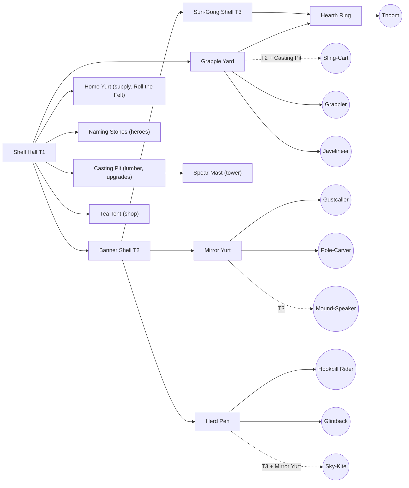

# Faction design: `clans` (the Tormai Clans)

*Design date: 2026-10-16, revised the same day after the IP-safety and WC3-fidelity reviews (see the Review log at the end).
Status: full-game design, with the vertical-slice subset marked ✅. Faction id: `clans` (data prefix `clans_`). Opponent in the
slice: `kingdom`.*

**Read first:** `docs/research/ip-safety.md` (§0, §2, §3.2), `docs/research/gameplay-mechanics.md` (§11–§13) and
`docs/design/rules.md`. This doc **supersedes** the faction-B placeholders in the research docs ("Thornborn" in the art/audio
docs, "Wildborn" B1–B8 in mechanics §13.4). Global rules live in **`docs/design/rules.md`** (start §3, economy §4, heroes §6,
combat and the damage matrix §7, day/night §13, creeps §15), which supersedes mechanics §13.1–§13.2. They are not repeated here.

**Units of measure.** Distances in metres (1 m = 64 WC3 gu), speeds in m/s, times in seconds. **Footprints in 0.5 m pathing
cells** (`architecture.md`), in step with `kingdom.md`. Sight is day / night. Damage and armour types use the rules §7.1 names
(Blade, Pierce, Siege, Arcane, Heroic, Pure, Spell; Light, Medium, Heavy, Fortified, Hero, Unarmored); data ids are lower-case
(`heroic`, `pure`; rules §20.4). Melee range is edge-to-edge, as in `architecture.md`.

---

## 0. Summary

**What a Warcraft III fan should feel:** "This is the warrior-people race." The clans have tough, high-HP infantry, a worker
garrison for defence, a haste-buff caster, a ward-planting support, a defensive spirit caster, a fast siege-type raider that pins
flyers, an aura-carrying war-beast, a flyer, a siege engine and a huge T3 melee people. They have a stealth-and-crit sword
duelist, a seer, a giant tank chieftain and a hex-and-heal support hero. A fan can read every unit's job and the build-order
logic at a glance.

**What must never be true:** nothing looks, sounds or reads like the WC3 Orcs. There are no green skins, tusks, spiked
pauldrons, red-brown leather, hide-and-bone huts, wolves, kodos, wyverns, trolls, lightning shamans, drum-carrying beasts or
broken-English grunts. Nothing reads like another game's hungry steppe giants either.

| | Choice |
|---|---|
| People | **Tormai**: big, slate-grey, heavy-jawed steppe nomads with pale "hail-speckles", and **no tusks** |
| Display name | **Tormai Clans** (formal: *the Clans under the Gong-Ring*) |
| Ally people (the tauren-like slot) | **Thoom**: hill-sized, gentle cauldron-helmed giants who keep the clans' hearths and serve their guests. Hosts, never eaters |
| Look | Felt yurts, lamellar, polished bronze, ancient tortoise-shell halls. Ink-teal and saffron felt, warm bronze, slate skin |
| Voice | Formal, courteous and slow. Comedy of **ferocious hospitality**: they apologise before hitting you |
| Signature WC3-derived mechanic (1 allowed) | Workers garrison the supply yurt and sling stones. Presented as the hall's gong ringing and the yurt's felt skirt **rolling up** |
| Gameplay identity | Durable units and strong heroes, mobile mid-game pushes (haste, riders), pull/trap/sleep disables, T3 giants. Weaknesses: fragile casters, few cheap detectors (true sight only from the T2 Pole-Carver and a level-5 Skymirror), slower early lumber trips |
| Slice subset ✅ | Worker **Yurtwright**. Combat: **Grappler**, **Javelineer**, **Gustcaller**, **Sling-Cart** (siege). Heroes: **the Uncut**, **Skymirror**. Buildings: **Shell Hall (→ Banner Shell)**, **Home Yurt**, **Grapple Yard**, **Naming Stones**, **Casting Pit**, **Mirror Yurt**, **Spear-Mast**, **Tea Tent** |

---

## 1. Identity

### 1.1 Names, and why not "orc"

- **People name: Tormai** (singular and plural "Tormai"; adjective "Tormai"). Say *TOR-my*.
  - It is invented. "Tor" suggests a grey stone hill, which fits their skin and their hail myth.
  - **Clearance:** the review's web search found no game or IP collision. "Torma" is a real Tibetan and Mongolian Buddhist
    ritual offering, so a cultural-consultant check of "Tormai" is open (§13, Q7). Fallbacks: **Tormun** or **Torvai**, cleared
    with the same search as the public title.
- **Faction display name: Tormai Clans.** In lore they are *the Clans under the Gong-Ring*.
- **Ally giants: Thoom** (singular and plural). The name is onomatopoeic for their footsteps.
- **Decision: the UI, data and VO never say "orc".** The word is legally free folklore (ip-safety §3.1).
  We still avoid it, for four reasons:
  1. Our roster deliberately mirrors the WC3 Orc *role slots*. Calling the people "orcs" as well would make the
     faction read as a 1:1 re-skin (rule 8 and the *Spry Fox* "focus on what is similar" test). A distinct
     people name is the cheapest strong signal of independent creation.
  2. To an RTS player, "orc" brings green skin and tusks. Every prompt or line that says "orc" pulls
     generated art toward that look (prompt hygiene, ip-safety §2.8).
  3. An original people name, with its own lore, is expression we can own. "Orc" is not.
  4. It sets up the voice: the Tormai speak formal, complete sentences, the opposite of the WC3 orc grunt-speak.
- **Naming rules for the faction** (so future names stay consistent and far from WC3):
  - Two-part English compounds for units and buildings ("Grapple Yard", "Sky-Kite").
  - Invented personal names use soft steppe-flavoured syllables (CV/CVC, doubled vowels allowed: *Ilaya, Ommet, Beluu*).
  - **No apostrophes**, and no Grom-/Gar-/Kar- or -tar/-ash name patterns.
  - **No "Far-" prefix** on any clans name (the token of a WC3 Orc hero and of its reveal spell).
  - **No one-word swaps** of a WC3 coined name on the same role slot ("Healing Ward" → "Healing Pole" is a swap, not a new
    name). Name the object by what it *is* in our world.
  - Never "Horde", "clan of the X wolf", "Lok-", "Zug" or "Dabu".
  - No real ethnonyms, real clan names, real sacred terms or sacred numbers.
  - **Search every new proper name** against WoW, Warhammer and other Blizzard and Games Workshop coinages, not only the
    ip-safety §2.1 list. (The first draft's "Kirrik" and "Long-Braid" were both Blizzard names; see §13.)

### 1.2 Emblem: "the Gong and the Twin Winds"

- **Shape:** a saffron disc (the Sun-Gong) with a bronze rim. Two thick ink-teal **horizontal wind-strokes** cross the disc at
  mid-height and run past its rim on both sides. Flat, two colours plus a rim. Concept-review alternative: the disc hanging from
  a teal lattice-arch lintel.
  - **Nothing cups the disc from below.** A disc cradled by two curls reads as the sun-over-crescent of the Soyombo, the symbol
    on Mongolia's flag and coat of arms.
  - At concept review, compare the 16 px glyph with the Soyombo and with the Kazakh and Kyrgyz state emblems.
  - It must still read at 32 px on a banner and at 16 px as a minimap or icon glyph.
- **Meaning in lore:** the sun, and the thunder-gong of the first hailstorm; the two strokes are the two seasonal winds that
  drive the herds. Children call them "the winds' two arms, carrying the sun home".
- **Use:** on tall vertical felt banners (disc near the top, team-colour felt ribbons below), on gong faces, shield bosses,
  doors and loading screens. A one-colour version is used for UI stamps.
- **Never:** a circle with spikes, crossed axes, tusks, skulls, a boar or wolf head, or any real-world sacred symbol or national
  emblem. No yurt crown-ring (a real national emblem), no sun-over-crescent, no real clan marks, no endless knot.

### 1.3 Lore (original)

> **Under the Long Sky.** The Tormai say the world began with a hailstorm. Thunder rolled across the steppe like a struck gong,
> the clouds cracked, and the hailstones that struck the grass stood up, shook themselves, and asked who was cooking. That is
> why a Tormai's skin is the grey of a storm cloud, freckled with pale hail-marks. It is why they love bronze that rings, and
> why no guest leaves a Tormai fire hungry. (To the Tormai the sky is weather, not a god. It hails, it clears, and nobody
> prays to it; they just complain about it.)
>
> For as long as their songs remember, the clans have walked the **Herd Road**: a great loop of grass between
> the Salt Lakes and the **Sleeping Hills**. Each autumn they stop below the hills and beat the gongs until the
> **Thoom** wake. The Thoom are giants older than the clans, who sleep inside the hills between seasons, wearing
> the cauldrons their grandmothers cast. A Thoom woken too early is a landslide. A Thoom woken gently, with a song and a kettle
> already steaming, is a friend for life, and spends the whole season making sure everyone else is warm. The clans call every
> Thoom "uncle".
>
> Each clan is a household of felt tents under one banner. The clans meet at the **Gong-Ring**, a council where anyone may
> raise a matter by striking the gong, and nothing is decided until everyone has been served tea. Tormai law is hospitality:
> no guest may be harmed under your roof. A guest who refuses tea, however, is no longer a guest.
>
> Three summers ago the Kingdom raised a line of toll-towers across the Herd Road and fenced the river
> crossings. Its heralds sent a letter. The clans, being polite, sent tea. The Kingdom sent a bill.
> The clans are now coming to discuss the bill in person.

**Lore guardrails.** No demonic blood-curse, internment camps, portals, prophecy-driven exodus or redemption arc
(WC3 orc story beats). No sky deity and no sacred numbers. The Tormai are not villains, and the Kingdom is not evil: this is a
border dispute between proud neighbours, told with warmth and humour.

**World words** (use consistently in tooltips and VO):

| Word | Meaning |
|---|---|
| Long Sky / Long Grass | The open steppe and its sky (landscape, not a deity) |
| Herd Road | The migration loop; the reason for the war |
| Sleeping Hills | Where the Thoom sleep |
| Gong-Ring / Ring-Elder | The clan council / its elder. Units address the player as "Ring-Elder" |
| sun-teeth | Gold ("sky-fire that fell and stuck in the ground") |
| lattice-wood | Lumber |
| guest / uninvited guest | Ally / enemy (in VO) |

### 1.4 Real-culture respect (required)

The Tormai draw on the **everyday material culture** of the Eurasian steppe broadly: felt tents, lamellar armour, bronze
cauldrons and kettles, wrestling, tea and strong hospitality. They blend it with **invented** elements: the hail myth,
bronze sun-mirrors used as tools (signalling, reading the sky, the Skymirror's visor), tortoise-shell halls, Hookbill birds,
the Thoom and the Gong-Ring council.

**Real sacred items we do not use.** The first draft labelled several of these "invented". They are real, and were removed:

| Real sacred item or rite | Where the draft had it | Now |
|---|---|---|
| Bronze mirrors and ribbon fringes sewn on a shaman's robe (Mongolian, Buryat and Siberian practice) | Gustcaller and Skymirror costumes | Mirrors are **tools only**: a visor, a staff-top, pole-tops, sun-mirrors on posts and masts. Robes are plain felt; ribbons hang only from staffs |
| Milk sprinkled from a carved spoon as a blessing (Mongolian milk libation) | Omen-Mother's heal | She splashes hot sweet tea from a kettle (**Kettle Blessing**) |
| Carved-face standing stones (Turkic funerary stelae, deer stones) | Naming Stones | Rough stones carved with hail and wind glyphs; no faces, nothing hung on them; a frame of small gongs beside them |
| Horse-hair tassels below a spearhead, and a sacred count of nine banners (steppe war-standards) | Masts; "the Nine Clans" | Masts carry felt ribbon streamers and gong frames. "The Clans under the Gong-Ring", with no number |
| A watching creator-Sky (Tengri) | Lore; the Grappler warcry "The Sky is watching" | The sky is weather. The warcry is "THE WHOLE GRASS IS WATCHING. LOOK GOOD!" |

Rules:

- The Tormai are a **non-human fantasy people** (grey skin, giant jaw, hail-speckles). Do not draw human
  Central Asian facial features as monstrous, and do not stereotype them.
- **No real sacred objects or rites** depicted as such: no real deity names, spirit banners or war-standards, sacred cairns,
  funerary stelae, shaman-costume elements (mirror robes, fringes), libations, real clan marks or national emblems. Before adding
  any steppe-inspired object, ask "is this sacred or ritual in a real culture?" and drop it if the answer is yes or unsure.
- **VO and TTS never request a real-world ethnic accent.** Tormai English is slow, formal and standard.
- Portray them as sophisticated (law, poetry, craft, humour), never as "savage hordes".

---

## 2. Visual identity

### 2.1 Body and silhouette

| Element | Tormai | Why (vs WC3 Orc) |
|---|---|---|
| Skin | Slate blue-grey, with **pale hail-speckles** on the shoulders, forearms and scalp | WC3 orcs are green or brown |
| Head | A very heavy, square, forward-set **lower jaw with flat square teeth (no tusks)**, a broad flat nose, small deep-set amber eyes and small rounded ears | WC3 orcs have boar tusks |
| Hair | Blue-black. Warriors loop two thick braids up and bind them with bronze rings; workers hide theirs under felt hats | |
| Build | Upright and broad, with a thick neck and big forearms. They stand about 10% taller than the Kingdom's people at equal class (scale table below) | |
| Upper-third identity (art doc rule 2) | **Cone shapes on top:** conical bronze helmets with a long team-colour streamer, or tall peaked felt hats with ear-flaps. **Flat, layered rectangular shoulder-flaps** (lamellar or quilted felt) below. Seen from above, a soldier is a cone over a wide trapezoid | WC3 orcs have round spiked pauldrons |
| Weapons | Flanged bronze maces, javelin bundles, **straight horse-sabres**, ladles (Thoom), poles and bronze mirrors used as tools (casters). **No axes as the iconic weapon; no oversized curved blades** | WC3 Grunt: axe. WC3 sword-duelist: giant curved blade |
| Shields | Few. Where used: small round felt-and-bronze bucklers | Leaves the tall rectangle to the Kingdom's pavises |

**Scale** (overrides the generic table in the research README for this faction):

| Class | Height | Collision radius / footprint | Tri budget |
|---|---|---|---|
| Yurtwright (worker) | 1.4 m | 0.35 m | 1.5–3k |
| Javelineer, Gustcaller, Pole-Carver | 1.7 m | 0.40 m | 2–4k |
| Grappler | 1.9 m | 0.50 m | 2–4k |
| Tormai heroes | 2.2–2.3 m | 0.55 m | 4–8k |
| Thoom (unit) | 2.8 m | 0.75 m | 4–6k |
| Cauldron-Father (hero) | 3.1 m | 0.80 m | 6–8k |
| Hookbill Rider (later) | 2.2 m | 0.60 m | 4–6k |
| Glintback (later) | 2.6 m tall to the shell, 4.0 m to the mirror top; 3.2 m long | 1.00 m | 5–8k |
| Shell Hall | 7.5 m tall; the mesh may overhang the footprint up to 6 m wide | Footprint **10×10 cells (5 m)** | 8–12k |

**64 px black-silhouette test (art doc §7.4).** Every unit must pass these checks:

| Unit | Must read as |
|---|---|
| Tormai infantry | A cone and a streamer over a wide flat trapezoid |
| Thoom / Cauldron-Father | A big bronze bowl-dome with **one** central knob or short smoke-vent, plus a ladle. **No paired upward protrusions above the head; it must not read as horned.** The cauldron's ring-handles hang as horizontal rings at the sides, below the crown line |
| Glintback | A circle (the shell) carrying an upright disc on a mast (the sun-mirror) |
| Sky-Kite | A diamond with two long tails |
| Hookbill Rider | A hooked beak forward, with the rider's cone above |
| The Uncut | A flared coat circle with a braid line whirled overhead. The sabre is short and carried low; never a long curved blade |
| Buildings | Low domes and masts. Never spikes |

### 2.2 Palette (albedo, before team colour)

| Role | Hex | Use |
|---|---|---|
| Ink teal (primary felt) | `#1E5A60` dark / `#2F7E7E` mid | Coats, yurt walls, banners. Keep it **dark and green-leaning, never violet** |
| Saffron (secondary felt) | `#E0A030` / ochre `#B7772A` | Trim, sashes, door hangings, emblem disc |
| Warm bronze | `#A8743A` / highlight `#D9A55E` | Helmets, gongs, mirrors, cauldrons, kettles, studs |
| Verdigris (sparingly) | `#5FA08E` | Old bronze, the Thoom's cauldrons |
| Slate skin | `#6F7C88` mid / `#4E5966` shadow / speckles `#C9D0D6` | Tormai skin |
| Thoom skin | `#B8916A` sandstone / `#8A6A4C` shadow | Thick, elephant-like hide |
| Felt cream (accent only) | `#E9DDBF` | Never a large mass (avoid white-and-gold) |
| Hair | `#1C2230` | |
| Magic VFX | Sun-glint gold `#FFD27A` (HDR), dust ochre `#C9A46A`, moon-silver `#C8D4E8`, hail white `#EEF3F6` | Clan magic is **warm glints, dust, hail and silver smoke**. No blue lightning, no fel green, no teal glow, no ghostly blue-white |

**Contrast with neighbours:**
- WC3 Orc is red, brown and green skin. WC3 Night Elf is violet, teal and silver. The Alliance is blue, white and gold.
- Ours is dark ink-teal, saffron, bronze and slate. Keep teal dark and never pair it with violet.
- Keep saffron orange-yellow, never pure gold on white.
- The Kingdom (burgundy, ivory, dark bronze) is near-complementary, so the slice matchup reads well.
- **Team colour** goes on:
  - helmet streamers, felt shoulder-mantles and sashes on units;
  - banner ribbons;
  - the felt band around every yurt dome;
  - the hangings on the Shell Hall.

  Because the faction teal is dark and low-saturation, a bright teal team colour still separates. Check this
  in the night grade.

### 2.3 Materials and cultural sources

| Material | Where | Painting note |
|---|---|---|
| Thick felt (quilted, stitched in big chunky patterns) | Coats, robes, yurts, hats, shoulder-mantles | Big soft colour blocks with a few broad stitch lines. No fine embroidery |
| Lamellar (small rectangular plates laced in rows) | Warrior shoulders and chests | Paint 3–5 big rows, not hundreds of plates |
| Polished warm bronze | Helmets, gongs, mirror tools, cauldrons, kettles, mace heads | Painted highlight streaks only. No PBR gloss |
| Lattice-wood (red-brown folding lattice) | Yurt walls, masts, carts | Readable diamond pattern at 2 m scale |
| Horn and lacquer-free wood | Bows, javelin shafts, poles, ladles | |
| Ancient tortoise shell | The Shell Hall (T1–T3), Glintback | Big hex plates, moss-free, sun-bleached ochre |
| Standing stones | Naming Stones | Rough-hewn, carved with hail and wind glyphs. **No faces, nothing hung on them** |

### 2.4 Architecture: "domes and masts"

- Every clan building is a **round, low dome** (felt yurt, or an ancient tortoise shell) on a short stone ring,
  plus **masts**: carved poles with felt ribbon streamers, banners and gongs on frames. **No horse-hair tassels.**
- There are no spikes, bones, hides or tusks. That rules out the WC3 Orc's hide-and-bone spiky huts.
- **Construction verb: Raising.**
  1. A folding lattice ring springs open.
  2. The roof poles lift into place.
  3. Felt unrolls upward and the dome ties shut.
  4. Team-colour bands wrap last.

  The `build_progress` shader reveals the building bottom-up in two passes: the lattice first, then the felt
  over it.
- **Destruction:** the felt tears away and the lattice folds flat in a dust burst. The gong falls last with a clang.
- **Night:** a warm glow comes through each dome's smoke-ring. Bronze sun-mirrors catch moonlight.

### 2.5 Things the art must never do (squint-test list)

- Green, olive or brown-red skin. Tusks of any kind. Pointed ears.
- Spiked or round "pumpkin" pauldrons, **or any big round disc on a shoulder**. Fur pauldrons. Red-brown leather straps as the
  main mass.
- Huts of hide, bone, spikes or tusks. Skull totems.
- Wolves as mounts. Kodo-like grey dinosaurs. Wyverns. **Any percussion instrument (drum or gong) carried on a beast.**
- Lightning-wielding shamans. Blue electric VFX.
- **Paired upward points on a giant's helm** (reads as horns).
- **An oversized curved sword on the duelist hero; a translucent wind-whirl vanish.**
- **Games Workshop's Ogre Kingdoms trade dress:** hungry steppe giants, big bellies or gut-plates, cleavers and gore, cauldron
  priests who heal through eating, "great maw" imagery, rhino cavalry. The Thoom are hosts who serve; they never eat on screen,
  and no mechanic is tied to eating, kills-as-food or feasting.
- Slender, colourful, long-legged bird mounts. Hookbills are **heavy, short-legged, big-headed terror-birds** in grey-brown.
- Kegs, brewing or alcohol on the Thoom. They are hosts who pour tea, not brewers.
- Real sacred items (§1.4): mirror-hung robes, ribbon fringes on robes, milk libations, carved-face stones, horse-hair standards.

### 2.6 Distinctness rubric (ip-safety §3.2) vs the nearest WC3 race (Orc)

| Axis | Tormai Clans | Differs? |
|---|---|---|
| 1. Silhouette | Cones and streamers over flat layered flaps; heavy jaws without tusks; giant helms with one central knob (never horned); domes and masts | ✅ (required) |
| 2. Palette | Dark ink-teal, saffron, warm bronze, slate | ✅ |
| 3. Materials | Felt, lamellar, polished bronze, lattice, tortoise shell | ✅ |
| 4. Cultural inspiration | Everyday steppe material culture (sacred items excluded, §1.4) plus invented myth (hail, sun-mirror tools, Thoom) | ✅ |
| 5. Signature mechanic | One WC3-derived mechanic only (worker garrison), shown as gong plus rolling felt | ✅ |
| 6. Names and voice | All original and searched beyond the §2.1 list; formal, courteous, hospitality comedy | ✅ |

**Result: passes after the 2026-10-16 review fixes** (6 of 6 axes differ, including silhouette). The first draft also claimed
6 of 6 while carrying a Blizzard-coined bird name, a WoW hero-class name, two one-word ward swaps, a percussion war-beast, a
horned-looking giant helm and real sacred items. All are fixed; see the Review log.

**Residual risk:** the *role structure* is a deliberate slot-for-slot mirror (the user's direction). Mitigations:
- Every kit has original abilities (see the equivalence ledgers in §5.3 and §6.2). The four heroes keep 8 functional
  equivalents of the 16 WC3 Orc hero abilities (2 per hero, the policy maximum), all with our names, visuals and numbers.
- No hero number equals its WC3 analogue (§6, fidelity rule 2), and unit, item and building numbers were moved off WC3 values
  where the review found matches.
- The building arrangement is changed where cheap: the Mound-Speaker trains at the Mirror Yurt, not beside the giants, and the
  flyer needs a caster building.
- A pre-release legal review should look at the **whole** faction (ip-safety §5.3).

---

## 3. Voice and audio

### 3.1 Speech style

- **Courteous menace.** The Tormai are formal and slow, and speak in complete sentences.
  - Enemies are "guests" or "uninvited guests".
  - They apologise before violence.
  - Their metaphors are weather, grass, tea, felt and stew.
- **Verbal tic:** a low throat-hum, "*Hm-hm*", before many lines. It doubles as a personality beat.
- **Humour is character comedy:** etiquette applied to war, pride in craft, family and in-law jokes, and
  giants who fuss over their guests. No pop culture, puns on WC3 lines or fourth-wall gags about "orcs".
- **Thoom:** very slow, very deep, long vowels; anxious hosts who worry that somebody is cold or has not had tea. They **never**
  talk about being hungry, eating or dinner (that keeps them far from other games' hungry steppe giants), and never make beef
  or cow puns (those belong to the WC3 tauren).
- **Address and phrasing bans:**
  - Units address the player as **"Ring-Elder"**, never "chief", "chieftain" or "warchief" (WC3 Orc address forms).
  - Skymirror describes what his mirror *shows*. He never gives yes/no fortune answers: no answer-ball phrasing in the style of
    "outlook good", "reply hazy" or "it is certain".
  - No "[someone] has fallen" phrasing, no "for the [faction]!" template and no "build more [supply]" template.
- **Line budget** (audio doc §3.2):
  - Regular unit: about 18 lines. Worker: about 19. Hero: about 26. Advisor: about 19 (one per rules §17.3 trigger).
  - Check every line against the WC3 Orc quote page before recording, and reject anything close
    (ip-safety §2.2). Never use the words "poke" or "poking" in annoyed lines.

### 3.2 Per-unit personalities (one tic each)

| Unit | Personality | Tic |
|---|---|---|
| Yurtwright | Fussy, warm craftsperson; hospitality under strain | Counts things ("eleven knocks") |
| Grappler | Courtly giant wrestler; treats combat as a formal bout | Wrestling etiquette (bows, footing, the ring) |
| Javelineer | Boastful athletes who track their throwing distances | Quotes distances ("forty paces!") |
| Gustcaller | Breathy weather-gossip; talks about the wind like a neighbour | "The wind says…" |
| Pole-Carver | Deadpan carpenter of poles | Complains about wood grain |
| Mound-Speaker | Speaks with an ancestor's second voice that interrupts (the shoulder-mask's jaw clacks) | Two voices (chorus) |
| Hookbill Rider | Fast-talking; the bird shrieks over the ends of lines | Bird interruptions |
| Glintback rider | Sun-dazzled mirror-tender who squints at everything | "Hold still, you're too bright." |
| Sky-Kite | Airy thrill-seeker | Whoops |
| Sling-Cart crew | Two bickering brothers | Finish each other's sentences wrongly |
| Thoom | Slow, gentle, anxious host; checks that everyone is warm and comfortable | Long "mmmm" |
| The Uncut | Dry, clipped, competitive; her uncut braid is her pride | Keeps a duel tally |
| Skymirror | Vain about his mirror's polish; narrates tiny far-off things the mirror shows ("a goat, two hills away, is wearing a hat"), never fortunes | Polishes mid-sentence |
| Cauldron-Father | Enormous, gentle host | Calls everyone "little one" |
| Omen-Mother | Sly grandmother and gambler | Rattles her knucklebones |

### 3.3 Sample lines (original; at least 3 per category)

**Yurtwright (worker).** Cast: `pqHfZKP75CvOlQylNhV4` (Bill), tags `[deep, courteous, unhurried]`,
post-chain `rubberband=pitch=0.9:formant=shifted`, warm EQ.

| Category | Lines |
|---|---|
| Ready | "Felt rolled, poles packed. Where do we raise?" · "Strong back, hot tea. Ready." · "Hm-hm. I have tea in my boot. I am ready." |
| What (select) | "Hm-hm?" · "The wright is listening." · "You need a roof? I have a roof." |
| Yes (order) | "Gladly." · "Onward, with care." · "I go. Slowly, but I go." |
| Attack | "Forgive me. I must hit you now." · "With my good mallet, then." · "Very sorry. Very hard." |
| Warcry | "Out of my yurt!" · "Mind the felt!" · "Guests do not do this!" |
| Job done | "Raised, roped, and ready for guests." · "Another roof under the sky." · "Done. Somebody warm the kettle." |
| Annoyed (plays in order) | 1. "Hm. A guest who knocks twice is still welcome." 2. "A guest who knocks five times is… still welcome. Through my teeth." 3. "That is eleven knocks. My jaw is making a noise." 4. "Fine. Sit. Drink. Tell me about your day." |
| Death (non-verbal) | A deep "*hhuff*", then a soft felt thump · a surprised "*Hm?*" cut short · a tired sigh and the clatter of a mallet |

**Grappler (heavy infantry).** Cast: `pNInz6obpgDQGcFmaJgB` (Adam), tags `[very deep, formal, amused]`,
post-chain `rubberband=pitch=0.84:formant=shifted`, +4 dB at 180 Hz, compressor.

| Category | Lines |
|---|---|
| Ready | "Grappler, oiled and braided." · "Show me something heavy." · "The ring is drawn. Who steps in?" |
| What | "Speak, Ring-Elder." · "Hm-hm. Big ears, listening." · "Grappler." |
| Yes | "With pleasure." · "Shoulders first." · "I move like a hill moves. Surely." |
| Attack | "Down you go." · "Excuse my hands!" · "I will fold them like felt." |
| Warcry | "INTO THE GRASS WITH THEM!" · "GRIP AND THROW!" · "THE WHOLE GRASS IS WATCHING. LOOK GOOD!" |
| Annoyed (plays in order) | 1. "You test my footing. Good." 2. "Again? In the ring, that earns a bow." 3. "I bow. You push. This is rude in every clan." 4. "Fine. You win. Your prize is my disappointment." |
| Death | A huge "*HNNGH*" and a ground-shaking thud · "…pinned." · a long exhale, then a heavy body fall |

**The Uncut (hero, AGI duelist).** Cast: `FGY2WhTYpPnrIDTdsKH5` (Laura), tags `[low, dry, confident]`,
post-chain `rubberband=pitch=0.9:formant=preserved`, small plate reverb.

| Category | Lines |
|---|---|
| Ready / revive | "My braid is uncut. Bring me someone who can change that." · "The Uncut walks." · "One sabre, one braid, no regrets." |
| What | "Speak quickly. Steel gets bored." · "Hm." · "I am listening with my sword hand." |
| Yes | "Already gone." · "Lightly." · "Follow the dust." |
| Attack | "Draw, if you have something to draw." · "Their best. Send me their best." · "Count the cuts." |
| Warcry | "UNCUT!" · "FACE ME!" · "DUST AND STEEL!" |
| Annoyed (plays in order) | 1. "Hands off the braid." 2. "Tug it once more and we duel." 3. "You tugged it. Draw." 4. "…Whoever you are up there, I cannot reach you. Yet." |
| Abilities | Dust Veil: "Gone with the dust." · Braid Lash: "Come here." · ultimate: "Through the grass!" |
| Death | A sharp breath and her sabre ringing on stone · "Cut… at last." · a short laugh that breaks off |

**Advisor.** The clan's gong-keeper. Cast: `onwK4e9ZLuTAKqWW03F9` (Daniel), pitch 0.9, a bronze-plate reverb tail.
One line per rules §17.3 trigger (the hero level-up uses the shared cue with a clan gong layer).

| Event (rules §17.3) | Line |
|---|---|
| Not enough gold | "The purse is thin. More sun-teeth, please." |
| Not enough lumber | "We are short of lattice-wood." |
| Not enough food | "Every yurt is full. Our guests are sleeping in the rain." |
| Hero slot unavailable | "The Stones can hold no more names yet." |
| Can't build there | "The ground says no." |
| Hall attacked | "Someone is striking the Shell Hall!" |
| Units attacked | "Our kin are fighting!" |
| Workers attacked | "Our wrights are being struck!" |
| Hero died | "A name has gone quiet. The Stones will call it back." |
| Hero revived | "The Stones have called a name back." |
| Building finished | "The felt is tied. It stands." |
| Unit trained (idle queue) | "A new guest of the clan stands ready." |
| Research finished | "The bronze has cooled." |
| Gold mine low (1,500) | "The sun-teeth are wearing thin." |
| Gold mine exhausted | "The sun-teeth are gone from this hill." |
| Upkeep rises to 30 % | "More mouths, thinner purse. Our gold comes slower now." |
| Upkeep rises to 60 % | "The clan eats more than it earns." |
| Cripple countdown started | "Without a hall the whole steppe will see us. Raise one!" |
| Cripple reveal | "Too late. Every roof we own is in plain sight." |

### 3.4 Music and UI sound

- **Music: 3 tracks of 3–4 min**, rotated with 20–40 s gaps (audio doc §3.3).
  - **Instruments:** frame drums in a galloping 6/8 over 4/4; struck and bowed bronze gongs; a two-string
    bowed fiddle with a raspy horse-hair tone; jaw harp; long low bronze horns; wordless deep overtone chant;
    hand claps and stamps.
  - **Harmony:** Dorian or Mixolydian, 84–100 BPM. Proud, windswept and warm.
  - **Avoid** taiko with low brass and guitar (the WC3 Orc sound).
- **Compliant music prompt (ElevenLabs Music, `force_instrumental: true`):**
  > Instrumental, 3:30, fantasy steppe-inspired march: deep frame drums in a galloping 6/8 over 4/4, struck and
  > bowed bronze gongs, a raspy two-string bowed fiddle, jaw harp pulses, long low bronze horns, swelling
  > wordless deep male overtone chant, hand claps and stamps; D Dorian, 92 BPM; proud, windswept, warm;
  > intro, A, B, A-prime, resolving outro; no lyrics.
- **UI:**
  - click: a small bronze tap plus a felt thump;
  - complete: a soft gong swell;
  - error: a throat "*hm-mm*" plus a muffled felt thud;
  - hero level-up: the shared game cue, with a clan gong layer added.

---

## 4. Economy and faction rules

| Rule | Value |
|---|---|
| Start | Shell Hall, 5 idle Yurtwrights, 500 gold / 150 lumber (rules §3.2) |
| Gold | Walked back to a Shell Hall: **10 per trip**, 1 worker inside the mine at a time (rules §4.1) |
| Lumber | **15 per trip**, chopping 1 lumber per **0.9 s**. Fewer trips, slower chop (rules §4.3). Drop-off at the Shell Hall or Casting Pit |
| Supply | Shell Hall **+10 food** (all tiers). Home Yurt **+10 food**. 9 yurts reach the 100 cap |
| Upkeep, food cap | Global (rules §4.4–§4.5: cap 100; Upkeep 30 % from 51 food, Upkeep 60 % from 81) |
| Construction | One Yurtwright raises a building; extra Yurtwrights cannot speed it up (rules §4.3). **Mend** (repair) works on finished buildings and on Sling-Carts (rules §4.8) |
| **Signature mechanic (WC3-derived, 1 of 1)** | **Sound the Gong / Roll the Felt.** Up to 4 Yurtwrights enter a Home Yurt; its felt skirt rolls up and each throws sling-stones. See §4.1 |
| Faction passives | None globally. Day/night matters only through Skymirror's Sunglint and Swallowed Sun (rules §13) |

### 4.1 Sound the Gong / Roll the Felt (presented differently from WC3's burrow battle stations)

- **Shell Hall ability "Sound the Gong"** (hotkey G, no cost, no cooldown):
  - The hall's gong rings, with a visible ripple and a 2D gong cue for the owner.
  - Every Yurtwright within **30 m** stops work and runs to the nearest Home Yurt with a free slot. It **keeps its cargo** and
    delivers it on its next return after All Clear (the rules §4.3 default).
  - Workers with no free slot run to the Shell Hall and wait there (they cannot be garrisoned in the hall).
  - **"All Clear"** (same button) sends them back to their previous jobs.
- **Home Yurt "Roll the Felt":** holds 4 Yurtwrights. A Yurtwright can also enter on its own (right-click the yurt, or the
  Enter command).
  - Garrisoned workers cannot be targeted and do not gather.
  - Each one adds a sling attack from the yurt: **Pierce 8–11, cooldown 1.8 s, range 7.0 m**, ground and air (sling stone,
    18 m/s). The animation: the felt skirt rolls up to show the lattice, and the slings whirl through the gaps.
  - "Unload" empties the yurt instantly. If the yurt dies, its workers pop out with 50% HP.

---

## 5. Unit roster

### 5.1 Stats

Unit **level** sets XP value and creep-style difficulty. Organic units regenerate 0.25 HP/s (rules §9). Casters start with
75 mana and regenerate 0.65 mana/s. G = ground, A = air.

| # | id / Name | WC3 role slot | Built at (needs) | Gold / lumber / food | Time | Lvl | HP | Mana | Armour | Attack: type, dmg | CD | Range (m) | Speed (m/s) | Sight (d/n) | Hits | Slice |
|---|---|---|---|---|---|---|---|---|---|---|---|---|---|---|---|---|
| 1 | `clans_yurtwright` **Yurtwright** | Worker | Shell Hall | 70 / 0 / 1 | 15 | 1 | 240 | – | 0 Medium | Blade 6–8 | 2.0 | 0.6 | 3.1 | 12.5 / 9.4 | G | ✅ |
| 2 | `clans_grappler` **Grappler** | Heavy melee infantry | Grapple Yard | 185 / 10 / 3 | 26 | 3 | 660 | – | 1 Heavy | Blade 17–22 | 1.55 | 0.8 | 4.2 | 21.9 / 12.5 | G | ✅ |
| 3 | `clans_javelineer` **Javelineer** | Ranged thrower | Grapple Yard | 140 / 20 / 2 | 21 | 2 | 370 | – | 0 Medium | Pierce 19–24 | 2.0 | 7.0 (8.6 with Throwing-Sticks) | 4.2 | 21.9 / 12.5 | G+A | ✅ |
| 3b | `clans_proven` **Proven Javelineer** | Upgraded tougher form | Proving Rite (T3) converts all Javelineers; later trains replace them | 140 / 20 / 2 | 21 | 3 | 540 | – | 1 Medium | Pierce 21–26 | 1.9 | 7.0 (8.6 with Throwing-Sticks) | 4.4 | 21.9 / 12.5 | G+A | later |
| 4 | `clans_hookbill_rider` **Hookbill Rider** | Fast beast-rider raider | Herd Pen (T2) | 185 / 45 / 3 | 30 | 3 | 590 | – | 1 Medium | **Siege 21–26** | 1.75 | 0.8 | 5.6 | 21.9 / 12.5 | G | later |
| 5 | `clans_gustcaller` **Gustcaller** | Shaman-type buffer | Mirror Yurt (T2) | 135 / 25 / 2 | 28 | 2 | 320 | 200 | 0 Unarmored | Arcane 9–11 | 1.8 | 7.5 | 4.2 | 21.9 / 12.5 | G+A | ✅ |
| 6 | `clans_pole_carver` **Pole-Carver** | Witch-doctor-type ward support | Mirror Yurt (T2) | 150 / 30 / 2 | 30 | 2 | 320 | 200 | 0 Unarmored | Arcane 10–13 | 1.8 | 7.5 | 4.2 | 21.9 / 12.5 | G+A | later |
| 7 | `clans_mound_speaker` **Mound-Speaker** | Spirit-walker-type caster | Mirror Yurt (T3) | 190 / 45 / 3 | 40 | 3 | 520 | 225 | 1 Medium | Arcane 16–20 | 1.9 | 6.5 | 4.2 | 21.9 / 12.5 | G+A | later |
| 8 | `clans_sling_cart` **Sling-Cart** | Siege engine (wheeled, mechanical) | Grapple Yard (T2 + Casting Pit) | 200 / 70 / 3 | 36 | 3 | 420 | – | 1 Heavy | Siege 60–74, splash full 0.6 m / half 1.9 m (2.5 m with Packed Clay Pots) | 3.3 | 15.6 (min 3.9) | 3.3 | 21.9 / 12.5 | G only | ✅ |
| 9 | `clans_glintback` **Glintback** | Heavy war-beast carrying an aura (a sun-mirror) | Herd Pen (T2) | 245 / 70 / 4 | 40 | 4 | 960 | – | 3 Heavy | Pierce 13–17 (rider's javelins) | 1.6 | 6.0 | 3.4 | 21.9 / 12.5 | G+A | later |
| 10 | `clans_sky_kite` **Sky-Kite** | Flyer | Herd Pen (T3 + Mirror Yurt) | 225 / 50 / 4 | 36 | 4 | 500 | – | 0 Light | Pierce 20–26 | 1.8 | 5.0 | 5.6 (flying) | 21.9 / 12.5 | G+A | later |
| 11 | `clans_thoom` **Thoom** | Big T3 melee people (tauren-like slot) | Hearth Ring (T3) | 300 / 85 / 5 | 46 | 5 | 1300 | – | 2 Heavy | Blade 31–38 | 2.0 | 1.0 | 3.9 | 21.9 / 12.5 | G | later |

**Deliberately cut:** a second, suicide-style anti-air flyer. Anti-air comes from Javelineers, Sky-Kites,
Glintback riders, casters, Spear-Masts and Hobble-Bola instead. Leaving the slot empty also breaks the 1:1
roster count.

**Projectile speeds** (rules §7.7; damage rolled at launch, homing):

| Attack | Speed (m/s) | Arc |
|---|---|---|
| Javelin (Javelineer, Proven, Glintback rider, Sky-Kite) | 20 | Low arc |
| Spear-Mast javelin | 22 | Low arc |
| Sling stone (Home Yurt garrison) | 18 | Low arc |
| Clay pot (Sling-Cart) | 12 | High arc |
| Arcane bolt (Gustcaller, Pole-Carver, Mound-Speaker) | 15 | — |
| Glint bolt (Skymirror) / bone-chip (Omen-Mother) | 15 | — |
| Ice pellet (Hail-Swift summon) | 18 | — |

**Raider damage check** (Hookbill Rider, Siege 23.5 average every 1.75 s, before armour): ≈ 6.7 DPS against Medium (workers,
Javelineers, Hookgunners), ≈ 20.1 against Unarmored casters, ≈ 20.1 against Fortified (≈ 15.5 after armour 5, plus 6 from
Roof-Burner). Its job is buildings and casters, as in the WC3 raider slot, not worker hunting.

### 5.2 Unit descriptions and abilities

Abilities marked **≈WC3** are functional equivalents of a WC3 Orc unit ability. They are kept because they define
the role, but each has our own name, numbers and presentation. **Original** marks new mechanics. Ability damage is Spell
damage unless a row says otherwise.

**1. Yurtwright** (worker)

- **Look:** a stocky Tormai in a quilted ink-teal coat and a tall peaked felt hat with ear-flaps (team colour on the hat band).
  They carry a wooden mallet and a lattice bundle or gold sack on their back.
- **Abilities:**
  - Gather: 10 gold, or 15 lumber.
  - **Raise** (build). One Yurtwright per site.
  - **Mend** (repair; autocast, **default off**, 8 m when on): repairs **finished** buildings and **Sling-Carts** (mechanical;
    they have no natural regeneration). A full repair takes 1.5× the target's build time and costs 30% of its cost, paid pro rata
    (rules §4.8). Mend cannot speed up an unfinished site.
  - **Roll the Felt** (enter a Home Yurt; see §4.1).

**2. Grappler** (heavy melee infantry)

- **Look:** a broad wrestler-soldier.
  - Conical bronze helmet with a long team-colour streamer; bronze chin-guard over the big jaw.
  - Three rows of saffron-laced lamellar flaps on the shoulders.
  - Sleeveless felt coat, huge bronze wrist-guards, oversized flanged bronze mace.
- **Shove** (Original; unlocked by *Wrestler's Training*, which also gives +60 HP):
  - Every **4th consecutive attack** on the same target shoves it back **1.0 m** and **cancels its swing** if
    that attack has not reached its damage point. This uses the attack-timing system (rules §7.5).
  - Against heroes and units of 5 or more food: 0.5 m, and the swing is not cancelled.

**3. Javelineer** (ranged thrower) and **3b. Proven Javelineer** (upgraded form)

- **Look (Javelineer):** a lean Tormai athlete (an adult). Felt hood, a quiver-bundle of bronze-weighted javelins, and a
  spear-thrower stick.
- **Throwing-Sticks** (research): range 7.0 → 8.6 m (the atlatl). It applies to the Proven too.
- **Proving Rite** (T3 research) turns every Javelineer into a **Proven Javelineer**, a veteran of a dozen battles. The Proven:
  - is 1.12× the size;
  - wears a bronze lamellar vest and a saffron sash;
  - gains +170 HP, +1 armour, +2 damage and +0.2 m/s;
  - gains **Heel-Seeker** (Original, passive): **+35% damage against units moving away from it** (a percent bonus, step 2 of
    the rules §7.4 pipeline). "Moving away" means: at impact, the target's speed is above **0.5 m/s** and its velocity has a
    **positive component along the attacker → target vector**. This punishes the classic "pull the damaged unit back" micro
    (mechanics §11.4).
- **Production:** the Proven reuses the Javelineer mesh with a texture swap and scale. It costs no extra 3D.

**4. Hookbill Rider** (raider)

- **Look:** a Tormai outrider on a **Hookbill**, a heavy, short-legged flightless steppe bird with a huge hooked beak and
  grey-brown plumage. The rider carries a torch-pole and a bola belt.
- **Siege attack** (≈WC3: the raider's anti-building and anti-caster role comes from its attack type, as in the WC3 slot):
  Siege 21–26, cooldown 1.75 s. Strong against buildings and Unarmored casters, weak against workers and Medium ranged units.
- **Roof-Burner** (Original in this form; passive): its attacks on a **building** set it alight for 5 s, dealing 6 Spell damage
  per second. The burn refreshes and never stacks (one burn per building, however many riders). Repair still works on a burning
  building.
- **Shriek-Scatter** (Original; active, no mana, cooldown 30 s): the bird's shriek makes every enemy worker within **5 m** drop
  the gold or lumber it carries (the load is lost) and flinch for 0.5 s. VFX: a ring of grey feathers and spilled sacks and
  sticks.
- **Hobble-Bola** (≈WC3 ensnare, including its air pull-down; research at the Herd Pen):
  - Range 5.5 m, cooldown 12 s, no mana.
  - Ground targets are rooted for 4 s (heroes **1.5 s**, `hero_duration`).
  - Flying units are **grounded** for 8 s (rules §12.3), so melee can hit them.

**5. Gustcaller** (shaman-type buffer)

- **Look:** a Tormai weather-caster in a long, **plain** saffron felt robe. They carry a tall **wind-vane staff** (a bronze vane
  on a pivot) with felt ribbons tied to the staff only, and a folding felt fan at the belt. No mirror on the body and no ribbons
  sewn on the robe.
- **Trainings:** **Second Ribbon** (T2) and **Elder Ribbon** (T3) each give +60 HP, +100 mana and +2 damage. Each ties one more
  ribbon to the staff.

| Ability | Unlock | Effect | Mana | CD | Range | Kind |
|---|---|---|---|---|---|---|
| **Unbind** | Base | 3 m area. Removes buffs **selectively** (`dispel_mode: "selective"`): positive buffs from enemies, negative buffs from allies. Deals **220** damage to enemy summoned units (`summon_damage`). Slows enemies 40% for 3 s (heroes 1.5 s) | 60 | 6 s | 8 m | ≈WC3 (dispel), made an area spell |
| **Wind at Your Back** (autocast, default on) | Second Ribbon (T2) | Ally gains **+20%** move speed and **+30%** attack speed for 40 s. Ribbons of dust spiral round it. Dispellable | 45 | **1.5 s** | 9 m | ≈WC3 (haste buff) |
| **Dust Shroud** | Elder Ribbon (T3) | A 5 m dust cloud for 10 s: ranged attacks against units inside miss 60% of the time | 75 | 25 s | 9 m | Original |

**6. Pole-Carver** (witch-doctor-type ward support)

- **Look:** a Tormai carver with a tool-apron, a stack of carved poles strapped to the back, and a felt cap.
- **Poles:** wards (`ward` flag) with **8 HP** that can be attacked. They are visible unless stated otherwise.

| Ability | Unlock | Effect | Mana | CD | Range | Kind |
|---|---|---|---|---|---|---|
| **Mirror Pole** | Base | An **invisible** pole topped with a small bronze mirror that shows what is hidden. Reveals a 14 m radius, including invisible units, for **9 min** | **45** | 0 | 5 m | ≈WC3 (sentry ward) |
| **Hitching Pole** | Second Ribbon (T2) | A 20 HP pole. Enemy ground units within 4 m when it is planted are **tethered**: they cannot move beyond 4 m of the pole for 7 s (heroes 3.5 s). The rope VFX ties each one to the pole | 90 | 22 s | 7 m | Original (replaces the WC3 stasis trap) |
| **Kettle Pole** | Elder Ribbon (T3) | A steaming bronze kettle hangs from the pole; its steam heals allies within 6 m for 1.8% of max HP per second for 25 s. Skips mechanical units | 100 | 0 | 5 m | ≈WC3 (healing ward) |

**7. Mound-Speaker** (spirit-walker-type defensive caster)

- **Look:** a gaunt, very old Tormai in **dark ink-teal felt**, carrying a bronze bowl of smoke. A small bronze ancestor-mask hangs
  at one shoulder; its jaw clacks when the second voice speaks. Nothing about the Mound-Speaker glows or turns translucent.

| Ability | Unlock | Effect | Mana | CD | Range | Kind |
|---|---|---|---|---|---|---|
| **Between Breaths** (toggle) | Base | Applies the rules **`spectral`** flag verbatim (rules §7.2: immune to Blade, Pierce, Siege, Heroic and **Pure** attacks; cannot attack), with this ability's own magic multiplier: it takes **+60%** (×1.60) from Arcane and Spell instead of the flag's ×1.66. Presentation: a cocoon of ochre-silver smoke rises from the bowl and wraps it; the body stays **opaque** and greys out. No blue-white glow | 0 | 2 s | self | ≈WC3 (ethereal) |
| **Kin-Thread** | Second Ribbon (T3) | Links up to **3** allies within 8 m for 60 s. 40% of the damage any linked unit takes is spread among the others | **70** | 2 s | 8 m | ≈WC3 (damage link) |
| **Hands from the Mound** | Elder Ribbon (T3) | 3 m area. After 0.75 s, clay-and-smoke hands rise and root enemy ground units for 3 s (heroes 1.5 s), dealing 25 Spell damage per second | 100 | 20 s | 8 m | Original (replaces the WC3 resurrect) |

**8. Sling-Cart** (siege engine)

- **Look:** a two-wheeled lattice-wood cart with a long throwing arm and a felt sling, pushed by two Tormai crew (rigid props, so
  no rig is needed). Ammunition is clay pots.
- **Mechanical:** no natural regeneration; Yurtwrights **Mend** it (rules §4.8). It scales with **Bronze Points** and
  **Lamellar Plates** like the other ranged and armoured units (§8).
- **Packed Clay Pots** (T2 research, in the slice): half-damage splash radius 1.9 → 2.5 m. The counterpart of the Kingdom's
  Scatter Shot.
- **Tallow Pots** (≈WC3 burning ammunition; T3 research): each impact leaves burning ground in a 1.5 m radius for 5 s, dealing
  12 damage per second. It does not stack, and it also burns buildings.
- **Motion** is fully procedural (§12.2): the wheels roll, the arm swings, the cart recoils and the crew bob.

**9. Glintback** (heavy war-beast carrying a sun-mirror)

- **Look:** a giant steppe tortoise. On its shell sits a felt-roofed platform with a javelin rider and a **lattice mast** topped
  by a big, tilting, **polished bronze sun-mirror** (about 1.6 m across) that a mirror-tender angles with ropes.
  **No drum, gong or other instrument rides on the beast.** The gong stays a hall and emblem motif only.
- **Sun on the Blades** (≈WC3 damage aura, presented as light instead of music): allied units within **8 m** deal **+8%** damage,
  or **+15%** with *Burnished Face*. Each pulse the mirror tilts and a glint runs along the allies' weapons (a visible flash every
  2 s; the aura itself re-applies every 0.5 s, rules §10.3). At night the glint is moon-silver; the effect is unchanged.
- **Withdraw** (Original; replaces the WC3 devour), cooldown 25 s, no mana:
  - The tortoise pulls into its shell for 6 s. It cannot move or attack, and takes 70% less damage.
  - Enemies within 5 m are forced to attack it.
  - The mirror-tender keeps the mirror turning, so the aura stays on.
- **Production:** this is the cheapest non-biped we have. The shell is rigid, the 4 legs and the head are pivoting segments,
  the mast and mirror are rigid with a procedural tilt, and the animation is procedural.

**10. Sky-Kite** (flyer)

- **Look:** a big hexagonal felt-and-cane kite with two long team-colour tails. A light Tormai rider hangs in a harness under it
  and throws javelins down.
  - In lore, a wind bound by the Gustcallers lifts the kite. That is why the Sky-Kite needs a Mirror Yurt.
  - There are no wings, so the motion is procedural: bank, sway and tail ribbons.
- **Ribbon Barbs** (≈WC3 poison; research): attacks make units bleed 4 damage per second for 4 s. It does not stack, and does
  not affect buildings.
- **Updraft** (Original, cooldown 25 s): +75% move speed for 3 s, and immune to Hobble-type pull-downs and roots while it lasts.

**11. Thoom** (big T3 melee people)

- **Look:** a 2.8 m hill-giant with sandstone, elephant-thick skin and tiny eyes.
  - The head is hidden under a huge upturned **bronze cauldron helm** topped by **one central lid-knob** (or a short
    smoke-vent). The two ring-handles **hang at the sides as horizontal rings, below the crown line**. Nothing points upward in
    pairs (§2.1).
  - It wears a long quilted **felt robe** with a sash (no apron, no bare belly) and swings a **giant bronze ladle** as a mace.
  - No horns, no hooves, no kegs, no cleavers, no gore.
- **Heavy Ladle** (≈WC3 splash slam; research): every **3rd** attack is a **Ladle Slam** that deals 55 Spell damage to all
  enemies within 2.5 m. Deterministic, not a chance roll.
- **Shelter** (Original, passive): when an allied non-hero unit within **6 m** drops below **30% HP**, the Thoom gains
  **+3 armour for 6 s** (cooldown 20 s). It plays a sheltering pose, the ladle raised over the hurt ally like a roof (animation
  only; no movement). In VO a Thoom frets over the hurt guest, never about food.

### 5.3 Unit equivalence ledger (roles kept, kits mixed)

| Unit | WC3 equivalents kept | Original |
|---|---|---|
| Grappler | – (WC3's HP and attack-speed upgrade is replaced) | Shove |
| Javelineer / Proven | Range upgrade; a transform into a tougher form | Heel-Seeker |
| Hookbill Rider | Ensnare, **including** the flyer pull-down (WC3's ensnare also grounds air units); the Siege-type raider role | Shriek-Scatter (cargo drop); Roof-Burner (building burn, no repair lock); the bird mount |
| Gustcaller | Dispel (base), haste buff (T2) | Dust Shroud (T3) |
| Pole-Carver | Invisible sentry-type ward (base), healing ward (T3) | Hitching Pole (T2) |
| Mound-Speaker | Ethereal form, damage link | Hands from the Mound |
| Sling-Cart | Burning ammunition | Packed Clay Pots (splash radius) |
| Glintback | Damage aura | Withdraw, turtle body, the aura shown as light (no instrument) |
| Sky-Kite | Bleed (DoT) | Updraft, kite body |
| Thoom | Splash slam | Shelter, cauldron-helmed host giants |

---

## 6. Heroes

All four heroes use the global hero rules (rules §6):

| Rule | Value |
|---|---|
| Cost | First hero free (5 food), plus one **Homeward Felt** (rules §3.2); later ones 425 g / 100 l, 5 food, 55 s (rules §6.1) |
| Combat | Heroic attack type (`heroic`), Hero armour (×0.7 from Spell damage, rules §7.2) |
| Inventory and revive | 6 item slots; revive at the Naming Stones (rules §6.7) |
| Skills | Abilities learned at levels 1/3/5 (3 ranks each), ultimate at level 6. Hotkeys Q, W, E, R (rules §6.5) |
| Attributes | STR +25 HP and +0.05 HP/s; AGI +0.3 armour and +2% attack speed; INT +15 mana and +0.05 mana/s; primary attribute +1 damage (rules §6.6) |
| Formulas | Armour = base + 0.3 × AGI. HP = 100 + 25 × STR. Mana = 15 × INT. Effective attribute = floor(base + growth × (level − 1)) |
| Control on heroes | Every control effect below states its hero value (`hero_duration`). Polymorph and remove-from-play effects that may hit heroes set **`allow_heroes: true`** (rules §6.5 needs the matching clause; §13, Q8) |

**Fidelity rules:**
1. At most **2 of 4** abilities may be functional equivalents of the matching WC3 hero's abilities. Ledger in §6.2.
2. **No hero value (damage, heal, mana, cooldown, duration, jumps, chance, multiplier) may equal the WC3 analogue's value at the
   same rank.** The reference values the review checked are listed in §6.2 so later reviews can see the deltas.

### 6.1 Hero stats

| Hero (id) | WC3 archetype slot | Primary | STR (+/lvl) | AGI (+/lvl) | INT (+/lvl) | Base damage (+primary) | Base armour | Base CD | Range | Speed | Sight | Height | Slice |
|---|---|---|---|---|---|---|---|---|---|---|---|---|---|
| **The Uncut** (`clans_hero_uncut`; title "Uncut Duelist") | AGI melee duelist | AGI | 19 (+2.0) | 22 (+1.9) | 14 (+1.5) | 2–11 | −2 | 2.0 | 0.9 m melee | 5.0 | 28.1 / 12.5 | 2.2 m | ✅ |
| **Skymirror** (`clans_hero_skymirror`) | INT seer-caster (ranged) | INT | 16 (+1.7) | 14 (+1.0) | 22 (+2.9) | 1–9 | −2 | 2.3 | 7.5 m (glint bolt, 15 m/s) | 4.7 | 28.1 / 12.5 | 2.2 m | ✅ |
| **Cauldron-Father** (`clans_hero_cauldron_father`), a Thoom | STR tank chieftain | STR | 26 (+2.9) | 11 (+1.1) | 13 (+1.5) | 6–15 | −1 | 2.4 | 1.2 m melee | 4.4 | 28.1 / 12.5 | 3.1 m | later |
| **Omen-Mother** (`clans_hero_omen_mother`) | INT support (hex, heal) | INT | 17 (+1.8) | 13 (+1.1) | 21 (+2.6) | 1–8 | −2 | 2.3 | 7.0 m (bone-chip toss, 15 m/s) | 4.7 | 28.1 / 12.5 | 2.1 m | later |

**Derived values** (HP / mana / armour / damage / effective attack cooldown; `test_hero_attributes` asserts these):

| Hero | Level 1 | Level 5 | Level 10 |
|---|---|---|---|
| The Uncut | 575 / 210 / 4.6 / 24–33 / 1.39 s | 775 / 300 / 6.7 / 31–40 / 1.27 s | 1025 / 405 / 9.7 / 41–50 / 1.12 s |
| Skymirror | 500 / 330 / 2.2 / 23–31 / 1.80 s | 650 / 495 / 3.4 / 34–42 / 1.69 s | 875 / 720 / 4.9 / 49–57 / 1.58 s |
| Cauldron-Father | 750 / 195 / 2.3 / 32–41 / 1.97 s | 1025 / 285 / 3.5 / 43–52 / 1.85 s | 1400 / 390 / 5.0 / 58–67 / 1.71 s |
| Omen-Mother | 525 / 315 / 1.9 / 22–29 / 1.83 s | 700 / 465 / 3.1 / 32–39 / 1.72 s | 925 / 660 / 4.6 / 45–52 / 1.60 s |

**Proper names** (one is picked at random for each hero, shown as "Title: Name", rules §6.1):
- The Uncut ("Uncut Duelist"): *Ilaya, Teshe, Orsel, Nauri, Sabbet*.
- Skymirror: *Hodun Brightbowl, Sarvi Two-Skies, Ommet the Polished, Kelun Who-Squints*.
- Cauldron-Father: *Boomul, Ummoru, Gubbada, Lummaro*.
- Omen-Mother: *Grandmother Ezzi, Old Beluu, Auntie Ottu, Mother Halsi*.

#### The Uncut: AGI duelist

**Look:**
- A lean, fast Tormai woman in a flared saffron riding coat; the skirt spins out in a wide silhouette.
- A bronze chin-guard, and a team-colour sash.
- A **normal-length straight horse-sabre**, carried low and back-handed. Never an oversized or curved blade.
- Her **single huge braid**, ending in a bronze weight, is the silhouette hook: she whirls it overhead in idle and uses it as a
  second weapon in combat.
- No mask, no topknot.

**Lore:** a Tormai duelist never cuts her braid until she loses a duel. Hers reaches the ground; hence the title.

| Key | Ability | Rank 1 / 2 / 3 | Mana | Cooldown | Kind |
|---|---|---|---|---|---|
| Q | **Dust Veil**: she spins her braid; an **ochre dust column** rises around her, then collapses into ground dust, and she is gone. Invisible (`fade`, rules §11) for up to **15 / 20 / 25 s** with **+20 / 35 / 50%** move speed (fade time **0.5 s**). Her first attack out of it deals **+45 / 80 / 115** bonus Heroic damage and slows the target 30% for 2 s (heroes **1 s**, `hero_duration`). VFX: no translucent fade-out and no wind streaks; the dust column sells the vanish (her owner then sees her through the global invisibility shader) | see text | 70 | 8 s | ≈WC3 #1 (stealth opener) |
| W | **Braid Lash**: the weighted braid snaps out at a ground unit within 5.5 m. It deals **40 / 75 / 110** Spell damage, pulls the target **3 m** toward her (heroes 1.5 m) and roots it for **1.0 / 1.25 / 1.5 s** (heroes **0.75 / 1.0 / 1.25 s**, `hero_duration`) | see text | 70 | 14 / 12 / 10 s | Original |
| E | **Keen Edge** (passive): **18%** chance to deal **1.8× / 2.4× / 3.0×** damage. Each crit gives her +25% move speed for 1.5 s (hit-and-run) | see text | – | – | ≈WC3 #2 (critical strike) |
| R | **Through the Tall Grass** (ult, level 6): for **10 s** she gains +30% attack speed, and every attack also cuts a **6 m × 1.5 m line** behind the target for **60%** of the hit. The cut deals **Heroic** damage, takes the hit's **post-crit, pre-armour** value (each victim's own type and armour then apply), and **does not hit structures**. A crescent dust-slash VFX shows each cut | – | 125 | 120 s | Original (not a spin AoE) |

#### Skymirror: INT seer-caster

**Look:**
- An old, broad Tormai on foot in a **plain quilted ink-teal felt coat with bronze studs**.
- A large polished bronze mirror hangs over his eyes like a visor ("he sees through the bronze").
- He holds a long staff topped by a second mirror.
- He polishes constantly. The two mirrors are his **tools**; nothing is sewn on as costume (§1.4).

| Key | Ability | Rank 1 / 2 / 3 | Mana | Cooldown | Kind |
|---|---|---|---|---|---|
| Q | **Sunglint**: he tilts the staff-mirror and flashes a **50° cone, 7 m long**. The **blind** is the main effect: 35% miss chance for **3 / 4 / 5 s** (heroes **2 / 2.5 / 3 s**, `hero_duration`). It also deals **50 / 85 / 120** Spell damage. **At night it becomes Moonglint:** 50% damage, but the blind lasts 2 s longer (heroes 1 s longer). Cast point 0.4 s | see text | 80 | 9 s | Original (a cone blind, not a line nuke) |
| W | **Bronze Window**: he lifts the visor-mirror and looks through it. Reveals a **10 / 14 / 18 m** radius anywhere on the map for **10 s**. At rank 3 it also reveals invisible units | see text | 60 / 50 / 40 | 20 / 15 / 10 s | ≈WC3 #1 (remote reveal) |
| E | **Hail-Swifts**: summons **2 / 2 / 3** hail-cloud birds (level 2 / 2 / 3) for **45 s**: opaque, icy-white swifts of packed hail, with no ghost glow. Each: **160 / 200 / 240 HP**, Light 0, Pierce **7–9 / 9–11 / 10–12** (ice pellets), CD 1.5, range 4.5 m, **flying**, 5.5 m/s, sight 17 / 12.5. **No true sight at any rank.** On death or expiry each bursts into a **2 m hail patch**: 15 Spell damage and a 20% slow for 2 s to enemy ground units. As flyers they cannot be hit by melee creeps, so they add damage and scout but never tank. Summons give 50% XP (rules §10.6) | see text | 100 | 35 s | ≈WC3 #2 (summon), changed to flying hail birds |
| R | **Swallowed Sun** (ult, level 6): within 12 m, a **9 m radius** goes dark for **12 s**. Enemies inside have sight 3 m and a **40% miss chance**, and enemy vision cannot see into the area. Your units inside gain +15% move speed. It is an **area state, not a timed control**: it applies in full to heroes while they are inside and lingers the rules aura time (2 s) after they leave | – | 175 | 150 s | Original (it uses the day/night sight system) |

#### Cauldron-Father: STR tank chieftain (Thoom; a different people from the WC3 bull-folk)

**Look:**
- The biggest Thoom of the Sleeping Hills.
- An enormous verdigris cauldron helm with **one central lid-knob**; its ring-handles hang at the sides (no paired upward
  points, §2.1).
- A long quilted felt robe (no apron), and a **bronze serving-tray worn as a breast-disc** on his chest. It is never on a
  shoulder: round shoulder discs are banned (§2.5).
- A **giant ladle**.
- He walks slowly and gently; the ground shakes.

| Key | Ability | Rank 1 / 2 / 3 | Mana | Cooldown | Kind |
|---|---|---|---|---|---|
| Q | **Bowl Over**: he hurls his cauldron helm at a ground unit within 6 m. • It deals **70 / 120 / 170** Spell damage and lands **upside-down over the target**, trapping it for **3 / 4 / 5 s** (heroes **1.5 / 2 / 2.5 s**, `hero_duration`; units of 5+ food half as long). `allow_heroes: true`. • A trapped unit cannot move, attack or cast, and cannot be targeted or damaged. • While the helm is away (trap time + 0.5 s), he has −3 armour. Then the helm flies back | see text | 80 | 14 s | Original |
| W | **Cauldron Ring**: he punches his own helm. A ringing shock deals **30 / 60 / 90** Spell damage and stuns ground enemies within **3.5 / 4.0 / 4.5 m** for **2 / 2.5 / 3 s** (heroes **1 / 1.25 / 1.5 s**). Without the helm, he stamps instead (same effect) | see text | 100 | 9 s | ≈WC3 #1 (AoE stun) |
| E | **Hearth-Warmth** (aura, 9 m): allies gain **+8 / 14 / 20%** attack speed and **+1 / 2 / 3 HP/s**. This is the clans' only regeneration aura | see text | – | – | ≈WC3 #2 (attack-speed aura; move speed swapped for regeneration) |
| R | **Under My Roof** (ult, level 6), for **10 s**: • **40%** of the damage taken by allied non-building units within **8 m** is redirected to him; • he takes **40% less** damage from all sources; • when it ends, he heals for **25%** of the damage he redirected. VFX: a felt roof of warm saffron light spans the area | – | 150 | 150 s | Original (not a self-revive) |

#### Omen-Mother: INT support (hex and heal)

**Look:**
- A small, hunched, sly Tormai grandmother in a towering felt hat hung with knucklebones.
- A **dented bronze tea-kettle** on a long chain, and a pouch of polished ankle-bones.
- A fat felt shawl in team colour.

| Key | Ability | Rank 1 / 2 / 3 | Mana | Cooldown | Kind |
|---|---|---|---|---|---|
| Q | **Kettle Blessing**: she swings the kettle and splashes hot sweet tea. It heals **115 / 170 / 225**, then jumps to **2 / 3 / 4** more allies within 6 m (most damaged first), **−15%** per jump. Range 8 m. Skips mechanical units | see text | 85 | 10 s | ≈WC3 #1 (bouncing heal) |
| W | **Marmot Curse**: turns a target within 8 m into a squeaking **marmot** for **12 / 18 / 24 s** (heroes **2 / 3 / 4 s**, `hero_duration`; `allow_heroes: true`, as WC3's own hex works on heroes). A marmot has speed 2.2 m/s, armour 0, and cannot attack or cast; it keeps its HP | see text | 80 | 9 s | ≈WC3 #2 (polymorph) |
| E | **Knucklebone Omen**: she throws the bones. **One omen** (seeded sim RNG) applies to all allies within 7 m for 10 s. At rank 3 she throws twice and gets **two different omens**. The result shows as an icon over her head | Hookbill: **+20 / 30 / 40%** move speed · Shell: **+2 / 3 / 4** armour · Ewe: **+3 / 5 / 7 HP/s** · Ram: **+10 / 15 / 20%** attack speed | 75 | 20 s | Original |
| R | **Grandmother's Tale** (ult, level 6): in a **8 m radius** within 10 m, enemy non-hero units **fall asleep for 6 s** (any damage after 0.5 s wakes them). Enemy heroes become **drowsy** for 5 s (−40% move and attack speed; this is the explicit hero effect). Cast time 1 s | – | 175 | 150 s | Original |

### 6.2 Hero equivalence ledger (maximum 2 per hero)

| Our hero | WC3 nearest | Equivalents kept (2) | Original (2) |
|---|---|---|---|
| The Uncut | AGI melee duelist | Dust Veil (stealth opener), Keen Edge (crit) | Braid Lash (pull and root), Through the Tall Grass (line cleave) |
| Skymirror | INT seer | Bronze Window (remote reveal), Hail-Swifts (summon; flying hail birds that burst into slowing hail) | Sunglint (cone blind with a day/night twist), Swallowed Sun (area darkness) |
| Cauldron-Father | STR tank chieftain | Cauldron Ring (AoE stun), Hearth-Warmth (attack-speed aura) | Bowl Over (pot trap), Under My Roof (damage redirect) |
| Omen-Mother | INT support | Kettle Blessing (bouncing heal), Marmot Curse (polymorph) | Knucklebone Omen (random team buff), Grandmother's Tale (mass sleep) |

None of the four uses the WC3 hero's **ultimate**. That removes the most recognisable "signature" from each kit. Across the four
heroes, 8 of the 16 WC3 Orc hero abilities have a functional equivalent (2 per hero, the policy maximum). Sunglint used to be a
line nuke like another WC3 Orc hero's; it is now a cone blind.

**Numeric deltas vs the WC3 analogue** (fidelity rule 2). The WC3 values are those the 2026-10-16 review cited from the
classic.battle.net hero pages; values marked * are from memory and need checking. They are recorded for review only and must
never be entered as data.

| Our ability | WC3 analogue | WC3 reference value | Ours |
|---|---|---|---|
| Dust Veil | Stealth opener | +40 / 70 / 100 bonus damage, 75 mana, 0.6 s fade* | +45 / 80 / 115, 70 mana, 0.5 s fade |
| Keen Edge | Critical strike | 15% chance, 2× at rank 1 (3× / 4× at ranks 2–3*) | 18%, 1.8× / 2.4× / 3.0× |
| Bronze Window | Remote reveal | 8 s duration | 10 s |
| Hail-Swifts | Summoned beasts | 30 s cooldown at rank 1 | 35 s; 2 / 2 / 3 flying birds, 160 / 200 / 240 HP |
| Sunglint | Line nuke of another Orc hero | 75 damage at rank 1 | 50 / 85 / 120, cone, blind first |
| Cauldron Ring | AoE stun | 90 mana | 100 mana |
| Kettle Blessing | Bouncing heal | 3 / 4 / 5 jumps, 90 mana, 9 s cooldown | 2 / 3 / 4 jumps at −15%, 85 mana, 10 s |
| Marmot Curse | Polymorph | 70 mana | 80 mana, 9 s cooldown |
| Hearth-Warmth | Attack-speed aura | not checked yet | +8 / 14 / 20% attack speed, +1 / 2 / 3 HP/s |

---

## 7. Buildings and tech tree

All clan buildings have Fortified armour 5 (+2 with *Bronze Banding*; rules §8). **Footprints are in 0.5 m cells**, in step with
`kingdom.md` §7.2 (hall 10×10, barracks 8×8, supply 4×4, tower 4×4). Halls keep their footprint when upgraded.

| Building (id) | WC3 slot | Tier / needs | Gold / lumber | Time | HP | Footprint (cells) | Food | Trains | Researches / function | Sight (d/n) | Slice |
|---|---|---|---|---|---|---|---|---|---|---|---|
| **Shell Hall** (`clans_shell_hall`): a council hall under a sun-bleached ancient tortoise shell, with felt hangings and a gong at the door | Town hall T1 | – | 375 / 190 | 150 | 1550 | 10×10 (16×16 only if the 8 m hall is adopted for both factions) | +10 | Yurtwright | Gold and lumber drop-off. **Sound the Gong**. Upgrade to Banner Shell | 18.0 / 12.5 | ✅ |
| **Banner Shell** (`clans_banner_shell`): adds tall felt banners, a second gong and a lattice gallery | T2 | Shell Hall + Naming Stones | +305 / 195 | 130 | 2050 | 10×10 | +10 | Yurtwright | Unlocks tier 2 and the 2nd hero | 18.0 / 12.5 | ✅ |
| **Sun-Gong Shell** (`clans_sun_gong_shell`): crowned with a giant mirror-gong that flashes at noon | T3 | Banner Shell + Naming Stones | +330 / 215 | 145 | 2600 | 10×10 | +10 | Yurtwright | Unlocks tier 3 and the 3rd hero | 18.0 / 12.5 | later |
| **Home Yurt** (`clans_home_yurt`) | Supply plus worker garrison | – | 150 / 40 | 45 | 620 | 4×4 | +10 | – | **Roll the Felt** (4 Yurtwrights: Pierce 8–11 each, 7.0 m) | 12.5 / 9.4 | ✅ |
| **Grapple Yard** (`clans_grapple_yard`): a fenced wrestling ring beside a long yurt, with weapon racks | Barracks | – | 180 / 50 | 60 | 1150 | 8×8 | – | Grappler, Javelineer, Sling-Cart (T2 + Casting Pit) | Wrestler's Training, Throwing-Sticks, Packed Clay Pots, Proving Rite, Tallow Pots | 12.5 / 9.4 | ✅ |
| **Casting Pit** (`clans_casting_pit`): a bronze-casting pit, a charcoal kiln and log stacks | War mill / lumber drop | – | 155 / 70 | 60 | 1000 | 6×6 | – | – | **Lumber drop-off**. Bronze Edges, Bronze Points, Lamellar Plates, Bronze Banding, Burr Felt | 12.5 / 9.4 | ✅ |
| **Naming Stones** (`clans_naming_stones`): a ring of rough standing stones carved with hail and wind glyphs, with a frame of small bronze gongs beside them (no faces, nothing hung on the stones) | Altar | – | 170 / 60 | 60 | 900 | 6×6 | – | Heroes | Revive heroes | 12.5 / 9.4 | ✅ |
| **Spear-Mast** (`clans_spear_mast`): a tall carved mast with felt ribbon streamers, a windbreak platform and a javelin thrower | Tower | Casting Pit | 115 / 60 | 45 | 500 | 4×4 | – | – | Pierce 17–21, CD 1.0, range 10.9 m, hits ground and air (javelin, 22 m/s) | 25.0 / 14.0 | ✅ |
| **Tea Tent** (`clans_tea_tent`): a striped yurt with a steaming urn and bronze cups | Faction shop | Shell Hall | 130 / 30 | 50 | 480 | 6×6 | – | – | Sells items (§9) | 12.5 / 9.4 | ✅ |
| **Herd Pen** (`clans_herd_pen`): a stone-walled pen, Hookbill perches, a tortoise wallow and kite poles | Beastiary | T2 | 150 / 140 | 60 | 1100 | 8×8 | – | Hookbill Rider, Glintback (T2); Sky-Kite (T3 + Mirror Yurt) | Hobble-Bola, Ribbon Barbs, Burnished Face | 12.5 / 9.4 | later |
| **Mirror Yurt** (`clans_mirror_yurt`): a tall yurt ringed by bronze sun-mirrors on tilting posts, used to read the sky | Spirit lodge | T2 | 150 / 120 | 60 | 800 | 8×8 | – | Gustcaller, Pole-Carver (T2); Mound-Speaker (T3) | Second Ribbon and Elder Ribbon trainings for all three casters | 12.5 / 9.4 | ✅ |
| **Hearth Ring** (`clans_hearth_ring`): a stone hearth-ring around a house-sized bronze kettle-cauldron, with felt benches where the Thoom serve tea to guests | Tauren-totem equivalent | T3 + Grapple Yard | 135 / 155 | 60 | 900 | 6×6 | – | Thoom | Heavy Ladle. **Hearthside** (passive aura): allied units within 8 m gain **+1 armour** | 12.5 / 9.4 | later |

**Arrangement changes vs WC3** (made on purpose, to weaken the 1:1 structure):
- The spirit caster trains at the caster building (T3), not beside the giants.
- The giants' building has its own armour aura (Hearthside).
- The flyer needs the caster building.
- The shop sells a supply building (Folded Yurt), not a hall.

### 7.1 Tech tree

| Tier | Unlocks |
|---|---|
| T1 (Shell Hall) | Yurtwright, Grappler, Javelineer. Hero 1. Spear-Mast. Tea Tent stock T1. Level-1 upgrades |
| T2 (Banner Shell) | Herd Pen, Mirror Yurt, Sling-Cart, Hookbill Rider, Glintback, Gustcaller, Pole-Carver. Hero 2. Level-2 upgrades. Second Ribbon trainings. Packed Clay Pots. Tea Tent stock T2 |
| T3 (Sun-Gong Shell) | Hearth Ring, Thoom, Mound-Speaker, Sky-Kite. Hero 3. Level-3 upgrades. Elder Ribbon trainings. Proving Rite. Tallow Pots. Burnished Face |

---

## 8. Upgrades

Costs and times are our own. They sit in the WC3 bands, and the review moved the ones that matched WC3 exactly (the caster
trainings and the 60 / 75 / 90 s weapon and armour times). Weapon increments follow rules §5.4 (`upgrade_damage` = 10% of the
unit's base average damage, rounded, at least 1). Casters scale only through their Ribbon trainings.

| Upgrade (id) | Building | Needs | Levels: cost (g / l), time | Effect |
|---|---|---|---|---|
| **Bronze Edges** (`clans_up_melee`) | Casting Pit | L2 needs T2, L3 needs T3 | 110/60, 55 s · 180/170, 70 s · 260/290, 85 s | Damage per level: Grappler +2, Hookbill Rider +2, Thoom +3 |
| **Bronze Points** (`clans_up_ranged`) | Casting Pit | as above | 110/60, 55 s · 180/170, 70 s · 260/290, 85 s | Damage per level: Javelineer +2, Proven +2, Glintback rider +2, Sky-Kite +2, **Sling-Cart +7** |
| **Lamellar Plates** (`clans_up_armor`) | Casting Pit | as above | 140/70, 55 s · 170/180, 70 s · 200/270, 85 s | +2 armour per level for: Grappler, Javelineer, Proven, Hookbill Rider, **Sling-Cart**, Glintback, Sky-Kite, Thoom. Not workers, casters, summons or heroes |
| **Bronze Banding** (`clans_up_banding`) | Casting Pit | T2 | 150/180, 60 s | Buildings +2 armour; Home Yurts and Spear-Masts +15% HP |
| **Burr Felt** (`clans_up_burr`) | Casting Pit | L2 needs T2 | 75/50, 45 s · 125/100, 60 s | Buildings deal 6 / 12 damage back to melee attackers |
| **Wrestler's Training** (`clans_up_wrestle`) | Grapple Yard | T2 | 150/125, 50 s | Grapplers +60 HP and gain **Shove** |
| **Throwing-Sticks** (`clans_up_atlatl`) | Grapple Yard | T2 | 80/110, 45 s | Javelineer and Proven range 7.0 → 8.6 m |
| **Packed Clay Pots** (`clans_up_packed_pots`) | Grapple Yard | T2 | 100/100, 45 s | Sling-Cart half-damage splash radius 1.9 → 2.5 m |
| **Proving Rite** (`clans_up_proving`) | Grapple Yard | T3 | 150/200, 60 s | Javelineers become **Proven Javelineers** (§5.2) |
| **Tallow Pots** (`clans_up_tallow`) | Grapple Yard | T3 | 125/175, 50 s | Sling-Cart burning ground (§5.2) |
| **Hobble-Bola** (`clans_up_bola`) | Herd Pen | T2 | 70/80, 45 s | Hookbill Riders gain Hobble-Bola |
| **Ribbon Barbs** (`clans_up_barbs`) | Herd Pen | T3 | 100/125, 45 s | Sky-Kite bleed |
| **Burnished Face** (`clans_up_burnished`) | Herd Pen | T3 | 100/150, 50 s | Sun on the Blades +8% → +15% |
| **Gustcaller: Second Ribbon / Elder Ribbon** (`clans_up_gust_r2`, `clans_up_gust_r3`) | Mirror Yurt | T2 / T3 | 90/60, 55 s · 140/110, 70 s | +60 HP, +100 mana, +2 damage per level; unlocks Wind at Your Back / Dust Shroud |
| **Pole-Carver: Second Ribbon / Elder Ribbon** (`clans_up_pole_r2`, `clans_up_pole_r3`) | Mirror Yurt | T2 / T3 | 90/60, 55 s · 140/110, 70 s | Same stat gains; unlocks Hitching Pole / Kettle Pole |
| **Mound-Speaker: Second Ribbon / Elder Ribbon** (`clans_up_mound_r2`, `clans_up_mound_r3`) | Mirror Yurt | T3 / T3 | 100/80, 55 s · 150/120, 70 s | Same stat gains; unlocks Kin-Thread / Hands from the Mound |
| **Heavy Ladle** (`clans_up_ladle`) | Hearth Ring | T3 | 150/200, 50 s | Thoom Ladle Slam (every 3rd attack) |

---

## 9. Tea Tent items (faction shop)

Prices were nudged off the common WC3 race-shop values (unverified, so moved to be safe). Stock is per player (rules §16).

| Item | Stock tier | Cost | Stock / restock | Effect | Slice |
|---|---|---|---|---|---|
| **Salt Tea** | T1 | 110 g | 3 / 30 s | Restores 300 HP over 12 s; stops if the drinker takes damage | ✅ |
| **Brick-Tea Shavings** | T1 | 65 g | 3 / 30 s | Restores 120 mana over 10 s; stops if the drinker takes damage | ✅ |
| **Hawk Feather** (2 charges) | T1 | 90 g | 2 / 60 s | Plants an invisible feather within 5 m: **14 m vision for 5 min**. It does **not** see invisible units (vision only) | ✅ |
| **Homeward Felt** | T1 | 325 g | 2 / 100 s | After a 3 s channel, the hero and up to 11 of your units within 6 m return to your nearest hall (rules §6.8). The first hero also gets one free (rules §3.2) | ✅ |
| **Folded Yurt** | T2 | 170 g / 35 l | 1 / 90 s | Unfolds into a finished Home Yurt (+10 food) at a target point in 4 s | later |
| **Glint Charm** | T2 | 450 g | 1 / 120 s | Permanent: +7 Arcane bonus damage per attack, and a 15% chance to blind the target (30% miss) for 2 s | later |

---

## 10. Opening build order (standard "hero-first creep" opening)

Food shows *used / cap*; units in training count (rules §4.4). Times are approximate, for AI tuning and playtests. Every row
was checked for supply: **the hero never waits on food**, and no production building idles for want of a yurt. `test_ai`
asserts this per row (no "stalled for food" event before the push).

| Time | Food | Action |
|---|---|---|
| 0:00 | 5/10 | Queue a Yurtwright, and keep the hall producing until about 16 workers. Send 4 Yurtwrights to gold; 1 raises the **Naming Stones** (170/60, done ≈1:05) |
| 0:15 | 6/10 | The new Yurtwright raises **Home Yurt 1** (150/40, done ≈1:05), then goes to lumber |
| 0:30 | 7/10 | New Yurtwright → lumber |
| 0:45 | 8/10 | → gold. Five on gold saturates the mine |
| 1:00 | 9/10 | → lumber (the next Yurtwright in training makes 10/10) |
| ≈1:05 | 10/20 | Naming Stones and Home Yurt 1 are done. Start **hero 1** (free token, 55 s) → 15/20; it is out at ≈2:00. The Stones' builder goes to lumber |
| 1:15 | 16/20 | The next Yurtwright raises the **Grapple Yard** (180/50, done ≈2:20) |
| 1:30 | ≈17/20 | **Home Yurt 2** (done ≈2:20) |
| ≈2:00 | 19/20 | Hero 1 is out. **The Uncut** creeps the nearest green camp at once. **Skymirror** scouts with Hail-Swifts and waits for the first Grappler (the swifts fly, so they never tank melee creeps) |
| 2:20 | 20/30 → 23/30 | Grapple Yard and Home Yurt 2 done → **Grappler**, then a **Javelineer**. Rally to the hero |
| ≈2:30 | 24/30 | **Home Yurt 3** (done ≈3:20) |
| 2:45 | ≈26/30 | The 16th Yurtwright is out: stop workers. **Casting Pit** (155/70) at the tree line (shorter lumber walks; done ≈3:50). From ≈2:50 Skymirror creeps with the Grappler tanking; the swifts add damage and scout |
| 3:07–4:15 | 29 → 33/40 | Grappler 2, Javelineers 2 and 3. Creep the second green camp |
| ≈3:40 | ≈31/40 | **Tea Tent** (130/30) by the hall: Salt Tea for the hero, and a second Homeward Felt when gold allows. Optional **Spear-Mast** (115/60) at the mine if the enemy hero harasses. Use **Sound the Gong** against early raids |
| ≈3:50 | 31/40 | Casting Pit done → **Lamellar Plates 1** (or Bronze Edges 1) if gold allows; otherwise after the Banner Shell |
| 4:15 | 33/40 | **Banner Shell** (T2, +305/195, 130 s; done ≈6:25). The hall cannot train while upgrading |
| ≈4:30 | 33/40 | **Home Yurt 4** (cap 50 at ≈5:20). Javelineer 4 → 35/50. Keep creeping; aim for hero level 3 by ≈5:30 |
| 6:25 | 35/50 → 40/50 | T2 done → **hero 2** (425/100, out ≈7:20). **Mirror Yurt** (150/120, done ≈7:25). **Throwing-Sticks**. Stop T1 unit production |
| ≈7:25 | 40/50 | Mirror Yurt done → **Gustcaller: Second Ribbon** (90/60, 55 s; done ≈8:20) and 2 **Gustcallers** |
| 7:30–8:45 | 44 → 50/50 | 2 **Sling-Carts** (Grapple Yard); **Packed Clay Pots** (100/100); Bronze Points 1 if not done yet. Wrestler's Training when gold allows |
| 9:15–10:00 | 50/50 | **Push:** 2 heroes, 2 Grapplers, 4 Javelineers, 2 Gustcallers (autocast Wind at Your Back on the Grapplers), 2 Sling-Carts. The carts take out towers; Shove interrupts the enemy front line; Unbind strips enemy buffs and kills summons. Stay at 50 food or less (**Upkeep 0 %**). Add a **5th Home Yurt** only when committing to 51–80 food (Upkeep 30 %) because the push is trading well |

**Variants:**
- **Bird raid** (full game): T2 → Herd Pen → 3 Hookbill Riders with Hobble-Bola. Their Siege attacks burn outlying buildings
  and catch casters; Shriek-Scatter makes enemy workers drop their loads while the heroes creep.
- **Tank-and-hex** (full game): Cauldron-Father plus Omen-Mother as heroes 2 and 3, Thoom at T3.

**AI notes** (rules §19):
- The AI picks the Uncut 60% and Skymirror 40% as hero 1. A Skymirror AI scouts until the first Grappler is out, then creeps.
- It presses **Sound the Gong** when 3 or more enemy combat units are within 15 m of its workers, and **All Clear** 10 s after
  they leave.
- It autocasts Wind at Your Back once Second Ribbon is done, and casts Unbind on enemy summons and on buffed enemy heroes.
- It keeps the Sling-Carts behind the Grapplers and targets towers, then halls.
- `test_ai` checks the food column of every row above.

---

## 11. Vertical slice subset ✅

| Kind | In the slice | Not in the slice |
|---|---|---|
| Worker | Yurtwright (+ Roll the Felt, Sound the Gong, Mend) | – |
| Combat units (4) | **Grappler** (melee), **Javelineer** (ranged), **Gustcaller** (caster: Unbind; Wind at Your Back after Second Ribbon), **Sling-Cart** (siege) | Proven, Hookbill Rider, Pole-Carver, Mound-Speaker, Glintback, Sky-Kite, Thoom |
| Heroes (2) | **The Uncut**, **Skymirror** (full kits; Hail-Swifts need the `is_flying` flag) | Cauldron-Father, Omen-Mother |
| Buildings (8) | **Shell Hall → Banner Shell**, **Home Yurt**, **Grapple Yard**, **Naming Stones**, **Casting Pit**, **Mirror Yurt**, **Spear-Mast**, **Tea Tent** | Sun-Gong Shell, Herd Pen, Hearth Ring |
| Items (Tea Tent T1 stock) | Salt Tea, Brick-Tea Shavings, Homeward Felt, Hawk Feather | Folded Yurt, Glint Charm |
| Upgrades | Bronze Edges / Bronze Points / Lamellar Plates levels 1–2 (the Sling-Cart included), Wrestler's Training, Throwing-Sticks, Packed Clay Pots, Gustcaller Second Ribbon | All T3 research, Bronze Banding, Burr Felt, Herd Pen and Hearth Ring research |
| Hero slots | T1: 1, T2: 2 | T3 slot |

**Shop symmetry:** both slice factions keep a race shop, so the WC3 habit of buying salves and a second recall item at home
(mechanics §11.4) survives; the neutral Weighstall sits at the map centre behind an amber camp. `kingdom.md` §11 must keep its
Curio Cabinet in the slice too (its working copy already marks it [SLICE]).

**Data mapping:** the slice replaces the faction-B placeholder ids (`placeholder_b` in `data/factions.json`)
with `clans`. Its units map to the old B1–B8 table as:

| Old placeholder | Our unit |
|---|---|
| B1 | Yurtwright |
| B2 | Grappler |
| B3 | Javelineer |
| B4 | Gustcaller |
| B5 | Sling-Cart |

The other slots (raider, heavy, flyer) are not in the slice.

---

## 12. Production plan (AI assets)

Budgets: Higgsfield 269.75 credits, Krea 1,766 CU (see `docs/asset-ledger.md`). The slice must leave about
half of the Higgsfield budget for the Kingdom.

### 12.1 Slice assets

| Asset | Method | Est. cost |
|---|---|---|
| Reference art: style anchors, 4 units, 2 heroes, hall, emblem (about 30 images with variants) | Higgsfield `gpt_image_2_5` at 0.25 cr each. Krea 2 Medium (9 CU) only for final style-anchored key art | ≈ 8 cr + ≈ 45 CU |
| Yurtwright, Grappler, Javelineer, Gustcaller | Image to 3D, Tripo H3.1 (9 cr each); **CPU Blender auto-rig** (README §6, 0 cr); shared procedural biped clips | 36 cr |
| The Uncut, Skymirror | Tripo H3.1 (9 cr) plus **Higgsfield rig + 1 clip** (8 cr) each, for the best hero quality | 34 cr |
| Sling-Cart | **Procedural bpy**: wheels, frame and arm, with AI textures. The crew are the posed Yurtwright mesh | ≈ 0 cr (textures ≈ 1 cr) |
| Hail-Swift summon | Procedural bpy rigid swift, wing-flap in the vertex shader, opaque icy-white hail material (no spirit glow); the burst is a particle hail patch | 0 |
| Shell Hall (T1, with T2/T3 add-on props) | Tripo H3.1 for the signature shell (9 cr). Banners, gongs and the mirror crown for T2/T3 are bpy props | 9 cr |
| Home Yurt, Mirror Yurt, Grapple Yard's yurt, **Tea Tent** | **One procedural yurt kit in bpy**: lattice cylinder, dome, felt bands and team-colour band mask. Yurts are geometrically trivial. The Tea Tent is the kit with a striped felt swatch and an urn prop; the Mirror Yurt adds sun-mirror posts | 0 (+ 5 textures ≈ 1.25 cr) |
| Naming Stones (rough glyph stones and a gong frame), Casting Pit, Spear-Mast, fence ring | Procedural bpy plus AI textures (stone, bronze, lattice-wood, felt) | ≈ 2 cr |
| Icons (about 32: units, hero portraits and abilities, buildings, upgrades, 4 Tea Tent items) | Krea 2×2 icon sheets (9 CU each; sheet reliability unverified, pipeline §4.4) | ≈ 72–135 CU |
| **3D subtotal** | | **≈ 80–90 cr Higgsfield** |

**Voice (slice):**

| Speaker | Lines |
|---|---|
| Yurtwright | 19 |
| Grappler | 18 |
| Javelineer | 18 |
| Gustcaller | 18 |
| Sling-Cart crew | 8 |
| 2 heroes (26 each) | 52 |
| Advisor | 19 |
| **Total** | **≈ 152** |

TTS cost per line is not yet measured: run the 5-line probe first (audio doc §4.1). **Generate before
31 Dec 2026**, when the default voices expire.

### 12.2 Later assets and rigging risk

| Asset | Body type | Plan |
|---|---|---|
| Pole-Carver, Mound-Speaker, Omen-Mother, Proven (texture swap) | Biped | Same pipeline as the slice bipeds |
| Thoom, Cauldron-Father | Big biped | Rig well; the cauldron helm and its side ring-handles are rigid (skin them to the head bone) |
| Glintback | Quadruped tortoise | **Procedural segments** (rigid shell, 4 leg pivots, head pivot) plus a rigid mast whose sun-mirror tilts procedurally on the aura pulse. No skinning, so it is the first non-biped to build |
| Sky-Kite | Flyer without wings | **Procedural** (bank, sway, tail ribbons via a vertex shader). The rider is a rigid harness pose |
| Hookbill Rider | Two-legged bird | The riskiest asset. Try a 2-leg digitigrade template rig (no arms) with the rider rigid on the saddle. Fallback: a procedural "hop-run" on rigid legs |

### 12.3 Compliant prompt examples

Each prompt gets the art-doc global style suffix appended.

**Grappler:**

> full body huge broad steppe wrestler-warrior with slate blue-grey skin and pale speckles on the shoulders, very
> heavy square lower jaw with flat square teeth and a bronze chin-guard, conical bronze helmet with a long solid
> magenta streamer, three rows of saffron-laced rectangular lamellar flaps on the shoulders, sleeveless deep teal
> quilted felt coat, magenta felt sash, thick bronze wrist-guards, oversized flanged bronze mace held clear of the
> body, standing A-pose, front three-quarter view, entire figure visible including feet, plain light-gray background

Negative: tusks, fangs, green skin, spikes, fur pauldrons, skulls, axe, red leather, text, logo.

**Shell Hall:**

> a large nomad council hall built beneath a gigantic sun-bleached ancient tortoise shell dome, big hexagonal shell
> plates, deep teal and saffron felt hangings, carved red-brown lattice-wood doorway, small felt yurts attached
> around the base, a bronze gong on a wooden frame by the door, solid magenta felt band around the dome, compact
> chunky proportions, viewed from a 45 degree high three-quarter angle, isolated on plain light-gray background

Negative: spikes, bones, hides, skulls, tusks, text, logo.

**Every Tormai prompt** must include:
- the slate skin, the heavy jaw with "no tusks", and the cone helmet or felt hat;
- a magenta team-colour key on the streamer, sash or mantle.

**Every Thoom prompt** must include "one central knob on top of the cauldron helm, ring handles hanging low at the sides" and
"long quilted felt robe"; negative: horns, upward handles, cleaver, apron, big belly, gore.

**Never** write "orc", any WC3 or Blizzard name, or a real ethnic or national descriptor. Log every generation in
the ledger, together with the squint-test result against the nearest WC3 unit.

---

## 13. IP and design checks, and open questions

**Name audit.** Every name is checked against the ip-safety §2.1 list **and**, since the 2026-10-16 review, by web search
against WoW, Warhammer and other Blizzard and Games Workshop coinages (§1.1). The first draft's audit checked only the §2.1 list
and missed the rows marked "review".

| Name | Avoided collision | Action |
|---|---|---|
| Tailwind | A League of Legends passive | Renamed **Wind at Your Back** |
| Ghost Walk | A Dota 2 spell | Renamed **Between Breaths** |
| Hamstring | A WoW ability | Renamed **Heel-Seeker** |
| Proving Grounds | A WoW feature | Building renamed **Grapple Yard** |
| War Gong | Too close to the WC3 "War Drums" naming pattern | Was "Rallying Gong"; now **Sun on the Blades** (no instrument at all, see below) |
| Javelin "Youth" | The child-soldier implication | All combat units are explicitly adult |
| Kirrik (review) | A Blizzard-coined WoW name (Kirrik the Awakened; Dawn-Seeker Kirrik) | Bird renamed **Hookbill** (unit **Hookbill Rider**, `clans_hookbill_rider`); omen face renamed |
| Long-Braid (review) | WoW NPC "Longbraid the Grim"; the hyphen gives no distance | Hero class renamed **the Uncut** ("Uncut Duelist", `clans_hero_uncut`). "-sworn" names avoided too (a WoW naming pattern) |
| Far Mirror (review) | Keeps the "Far" token of the WC3 seer hero and its reveal spell | Renamed **Bronze Window**; §1.1 bans the "Far-" prefix |
| Healing Pole / Lookout Pole (review) | One-word swaps of WC3's healing and sentry wards on the same slot | Renamed **Kettle Pole** / **Mirror Pole** |
| Adept / Master Training (review) | WC3's own caster-upgrade naming | Renamed **Second Ribbon / Elder Ribbon** |
| Torch-Raid (review) | Leaks the WC3 raider's unit name into its signature ability | Renamed **Roof-Burner** (and reworked, §5.2) |
| Gongback, Rallying Gong, Deep-Cast Gong (review) | A percussion war-beast powering a damage aura: the *Spry Fox* substitution of the WC3 drum beast | **Glintback**, **Sun on the Blades**, **Burnished Face**; no instrument on any beast |
| Feast Cauldron, Feast-Warmth, Big Appetite (review) | Ogre Kingdoms' trade dress (hungry steppe giants, cauldron priests, healing through eating) | **Hearth Ring**, **Hearth-Warmth**, **Shelter** |
| Hail-Hawks (review) | A hawk summon with true sight at rank 3 lands on the WC3 beast hero's hawk | **Hail-Swifts**: hail birds, no true sight |
| Milk Blessing (review) | A real Mongolian milk libation | **Kettle Blessing** |
| "the Nine Clans" (review) | A real sacred number (the nine white war-standards) | "the Clans under the Gong-Ring" |

**Banned-terms list.** `tools/ip/banned_terms.txt` now also lists: `kirrik`, `longbraid`, `long-braid`, `far sight`,
`healing ward`, `sentry ward`, `adept training`, `war drums`, `spirit link`. (`far seer` was already there.) The checker covers
`src`, `data`, `assets`, `tests` and `tools/prompts`; design docs are exempt because they compare against WC3 on purpose.

**Number checks (tooling follow-ups):**
- **WC3 value-echo check** (to write, e.g. `tools/ip/check_value_echo.py`): compare every clans def value (cost, build time,
  HP, damage, cooldown, mana, duration, chance, charges, stock) with a hand-entered table of WC3 analogue values taken from wiki
  reading (never from game files, ip-safety §2.7) and flag every equal value for review. Global rules (food cap, hero cost,
  upkeep tiers, the XP table) are exempt.
- `test_ai`: the §10 food check (the hero never waits on food).
- `test_hero_attributes`: the §6.1 derived table.

**Look-alike risks to watch at concept review:**

| Risk | Rule for the art |
|---|---|
| Glintback vs the Kodo | Same role by design. **No percussion instrument on any beast**: the aura comes from a sun-mirror on a mast. A tortoise, never a grey dinosaur |
| Hookbill vs WoW's slender bird mounts | Hookbills must be heavy, short-legged terror-birds |
| Thoom helm vs a horned giant (the WC3 bull-folk) | One central knob or vent; side ring-handles hang low. No paired upward protrusions in the 64 px test |
| Thoom vs the Pandaren brewmaster | No kegs, brewing or bear features |
| Thoom and the steppe theme vs Games Workshop's Ogre Kingdoms (hungry steppe giants plus cauldron priests whose magic is eating) | The Thoom are hosts who serve, never eaters: no hunger mechanics or VO, no heal-on-kill, no feasting names, no big bellies or gut-plates, no cleavers or gore, no Great Maw, no rhino mounts, never Butcher / Tyrant / Maneater / Gorger / Slaughtermaster-style names. Felt robes, not aprons |
| The Uncut vs the WC3 sword-duelist hero | A normal straight sabre carried low; the braid is the silhouette hook; the vanish is a dust column, never a translucent fade with wind streaks |
| Emblem vs the Soyombo and the Kazakh and Kyrgyz state emblems | Nothing cups the disc from below; compare the 16 px glyph at concept review |
| Steppe sacred items (§1.4) | Mirrors only as tools; no mirror robes, milk libations, carved-face stones, horse-hair standards, sky deity or sacred numbers |
| Teal palette vs the Night Elf palette | Keep teal dark and never pair it with violet |
| Mound-Speaker vs the WC3 spirit caster | Dark ink-teal felt; Between Breaths is opaque smoke, never a pale translucent glow |

**Open questions:**
1. Cross-check names with `kingdom.md` (the Kingdom of Brennmark). The shared "Homeward" prefix of the two recall items is
   deliberate (rules §3.2).
2. Balance is untested. Watch these first in scripted playtests (godot-rts-tech §12):
   - Grappler Shove (swing cancel every 4th hit);
   - the Uncut's crit plus Through the Tall Grass;
   - Swallowed Sun's 40% miss chance;
   - Grandmother's Tale's area sleep;
   - Gustcaller haste now arriving with Second Ribbon (≈8:20) against the Kingdom's push (8:30–9:30).
3. Does Knucklebone Omen's randomness feel good, or should rank 1 let the player pick from two bones?
   Keep it seeded and deterministic either way.
4. Is the Hookbill two-leg bird rig feasible with the CPU auto-rigger? Test before committing the raider design;
   the fallback is the procedural hop-run.
5. TTS and music cost per line and per clip are still unmeasured (audio doc §4.1).
6. Pre-release: a legal review of the whole faction, given the deliberate role-structure mirror (§2.6).
7. **"Tormai" cultural check.** "Torma" is a real Tibetan and Mongolian Buddhist ritual offering. Ask a cultural consultant
   whether "Tormai" reads as a reference to it. If flagged, use **Tormun** or **Torvai**, cleared with the same search as the
   public title.
8. **Follow-ups in `rules.md`** (not edited from this doc):
   - §6.5: add "unless the ability sets `allow_heroes`" to the polymorph and remove-from-play line (Marmot Curse, Bowl Over).
   - §7.2: make the `spectral` magic multiplier a per-source field (Between Breaths uses ×1.60; the flag default is ×1.66).
   - §10.4: add `dispel_mode: "selective"` (Unbind removes only enemy positives and ally negatives).
   - §4.8 needs no change: Mend works on finished buildings and mechanical units only.
   - §11's "few cheap detectors" stays true: the Hawk Feather is now vision-only.
   - §23 #10 (footprint units) is resolved for this doc: cells.
9. **Other docs that still use the old names** (update when their owners next edit them): `art-and-audio-bible.md`
   (Long-Braid, Kirrik Rider, Gongback rider, the crescent sabre), `juice/combat-and-units.md` and
   `juice/heroes-abilities-vfx.md` (Long-Braid, the Dust Veil dust-devil and 0.6 s fade, Far Mirror, Milk Blessing),
   `slice-plan.md` (hero 1 "Long-Braid"), `kingdom.md` §10 and §13 (Long-Braid), `neutrals.md` (the Flour Bomb note).

---

## Review log (2026-10-16: IP-safety and WC3-fidelity reviews)

| # | Severity | Issue | Change |
|---|---|---|---|
| 1 | Blocker | "Kirrik" is a Blizzard-coined WoW name | Bird renamed **Hookbill**, unit **Hookbill Rider** (`clans_hookbill_rider`) everywhere, including the omen face and the Herd Pen; `kirrik` added to the banned terms and the §13 audit |
| 2 | Major | "Long-Braid" is a WoW NPC and a duelist clone signal | Hero class renamed **the Uncut** ("Uncut Duelist", `clans_hero_uncut`); VO "The Uncut walks."; braid kept as costume and lore |
| 3 | Major | Gongback = Kodo with a gong for a drum (Spry Fox substitution) | **Glintback** with a sun-mirror on a mast; aura **Sun on the Blades** +8% / +15%, 8 m; research **Burnished Face**; "no percussion instrument on any beast" in §2.5 and §13 |
| 4 | Major | Thoom handles read as horns; Cauldron-Father's round tray pauldron | Side ring-handles below the crown line, one central lid-knob; new 64 px rule; the tray is a breast-disc |
| 5 | Major | Ogre Kingdoms trade dress (hungry giants, cauldrons, eating-heals) | Big Appetite → **Shelter** (+3 armour, 6 s, CD 20 s); Feast Cauldron → **Hearth Ring** (+1 armour aura); Feast-Warmth → **Hearth-Warmth** (sole regen aura); lore "a landslide"; felt robes; dinner VO cut; §2.5 and §13 rows |
| 6 | Major | Hero values equal WC3's | All eight values changed as specified; fidelity rule 2 added to §6; WC3 reference values recorded in §6.2 |
| 7 | Major | "Far Mirror" keeps the WC3 "Far" token | **Bronze Window**, 10 s; "no Far- prefix" rule in §1.1; `far sight` banned |
| 8 | Major | Healing / Lookout Pole are synonym swaps; numbers echo | **Kettle Pole** / **Mirror Pole**; poles 8 HP; Mirror Pole 45 mana, 9 min; Pole-Carver 150/30/2 |
| 9 | Major | Real sacred items labelled "invented" | Mirrors are tools only (plain coats and robes); **Kettle Blessing** (tea, no spoon); glyph stones without faces or mirrors; ribbon masts without horse-hair; no "Nine"; the sky is weather; new warcry; §1.4 rewritten with a table of what was removed |
| 10 | Minor | Emblem reads as the Soyombo | Horizontal wind-strokes across the disc; "nothing cups the disc from below"; 16 px check against the Soyombo and the Kazakh and Kyrgyz emblems |
| 11 | Minor | Lines echo WC3 Orc patterns | All replacement lines used; "Ring-Elder" address; §3.1 bans chief/chieftain/warchief, answer-ball phrasing, "has fallen" and "build more" templates |
| 12 | Minor | Adept / Master Training naming and costs | **Second Ribbon / Elder Ribbon**; 90/60, 55 s and 140/110, 70 s (Mound-Speaker 100/80 and 150/120) |
| 13 | Minor | "Torch-Raid" leaks the WC3 unit name | **Roof-Burner**, reworked by #27 into a building burn |
| 14 | Minor | Unit, item and building numbers equal WC3 | All listed values changed (Hookbill 30 s and 1.5 s root; Mound-Speaker 40 s, +60%, 3 allies, 70 mana; Unbind 220; Wind at Your Back +20% move, 1.5 s; Gustcaller 135 g; Homeward Felt 325 g, 2 / 100 s; Folded Yurt 170/35); upgrade times moved off 60/75/90 s; shop prices nudged; value-echo check planned (§13) |
| 15 | Minor | Ledger called the flyer pull-down original | Ledger corrected; new Original **Shriek-Scatter** (workers within 5 m drop their cargo, CD 30 s) |
| 16 | Minor | Hail-Hawks mash up a WC3 hawk summon | **Hail-Swifts**: opaque icy-white hail birds, rank 3 adds a 3rd bird (no true sight), 2 m hail patch on death or expiry (15 damage, 20% slow, 2 s) |
| 17 | Minor | Oversized curved sabre and wind-whirl vanish | Normal straight horse-sabre carried low; the braid whirl is the silhouette hook; Dust Veil is an ochre dust column, no fade or wind streaks |
| 18 | Minor | Mound-Speaker repeats the pale ghostly spirit caster | Dark ink-teal felt; opaque ochre-silver smoke cocoon; bronze shoulder-mask instead of a translucent face |
| 19 | Minor | Sunglint = a line nuke on a clans hero | 50° cone, 7 m; blind first; 50 / 85 / 120 damage, 80 mana |
| 20 | Minor | "Tormai" vs "torma" unchecked | Open question 7 with fallbacks Tormun / Torvai; noted in §1.1 |
| 21 | Minor | Name audit too narrow | §13 audit rebuilt with every rename; wider search rule in §1.1; rubric restated as "passes after these fixes"; banned terms added |
| 22 | Major | Build order broke its own supply maths | §10 rewritten to the review's rows: the hero starts at 1:05 with 15/20, four yurts before the push, push at 50/50 with the stated army; `test_ai` food check |
| 23 | Major | Caster signature spells free at T2 | Gustcaller: Unbind (base), Wind at Your Back (Second Ribbon, T2), Dust Shroud (Elder Ribbon). Pole-Carver: Mirror Pole, Hitching Pole, Kettle Pole. Ledger, §10 (research ≈7:25, push 9:15–10:00) and §11 updated |
| 24 | Major | Sling-Cart missing from upgrade lines | Sling-Cart in **Bronze Points** (+7 per level, the rules §5.4 rounding of 10% of 67; the review suggested +6) and **Lamellar Plates**; new slice research **Packed Clay Pots** (100/100, 45 s, half-splash 1.9 → 2.5 m) |
| 25 | Major | Footprints in metres, 4× the Kingdom's areas | All footprints in 0.5 m cells: hall 10×10, yards and pens 8×8, Casting Pit / Stones / Tea Tent / Hearth Ring 6×6, Home Yurt and Spear-Mast 4×4; §2.1 scale row updated |
| 26 | Major | Tea Tent cut from the slice | **Tea Tent [SLICE]** with T1 stock (Salt Tea, Brick-Tea Shavings, Homeward Felt, Hawk Feather); +4 icons; slice note asks `kingdom.md` to keep its Curio Cabinet (its working copy already does). `kingdom.md` was not edited from here |
| 27 | Major | Blade-type raider flips the WC3 raider's job | **Siege 21–26, CD 1.75 s**; Roof-Burner is now an Original building burn (6 per second for 5 s, no repair lock); ledger "Ensnare; Siege-type raider"; DPS check added in §5.1 |
| 28 | Minor | Advisor missing rules §17.3 triggers; "No Upkeep" wording | 10 advisor lines added (19 total, budget and voice count updated); §10 says "Upkeep 0 %" |
| 29 | Minor | Armour line covered workers and casters; flat weapon bonus | Explicit unit lists; per-unit weapon increments per rules §5.4 (Glintback +2, the rounding of the suggested +1.5); casters scale only through trainings |
| 30 | Minor | Mend and Sound the Gong conflict with rules | Mend only on finished buildings and Sling-Carts, autocast default off, 8 m; Sound the Gong keeps cargo |
| 31 | Minor | Status effects conflict with rules | Between Breaths uses the `spectral` flag (Pure included) with a ×1.60 override; Unbind `dispel_mode: "selective"`; Marmot Curse and Bowl Over `allow_heroes: true` with `hero_duration`; rules follow-ups listed in §13 Q8 |
| 32 | Minor | Second list of kit numbers | Merged with #6 (where the two lists differed, the major issue's value was used: Kettle Blessing 85 mana and −15% per jump, Marmot Curse 80 mana); Dust Veil fade 0.5 s; heals 115 / 170 / 225 |
| 33 | Minor | Missing implementation values | Base damage and base armour columns; L1 / L5 / L10 table; `hero_duration` on every control; Tall Grass cut rules; Heel-Seeker definition; Proven range; projectile speeds |
| 34 | Minor | Cheap true sight contradicts "few cheap detectors" | Hawk Feather is vision-only (90 g); true sight only from the Pole-Carver (T2) and a level-5 Skymirror |
| 35 | Minor | Flying summons cannot tank creeps | Rank 1 = 2 birds; §10 and the AI notes: Skymirror creeps behind the first Grappler; the Uncut creeps at once |
| 36 | Minor | Header pointed to superseded mechanics sections | Header, §4 and §6 point to `rules.md`; the recall item is "one Homeward Felt (rules §3.2)" |
