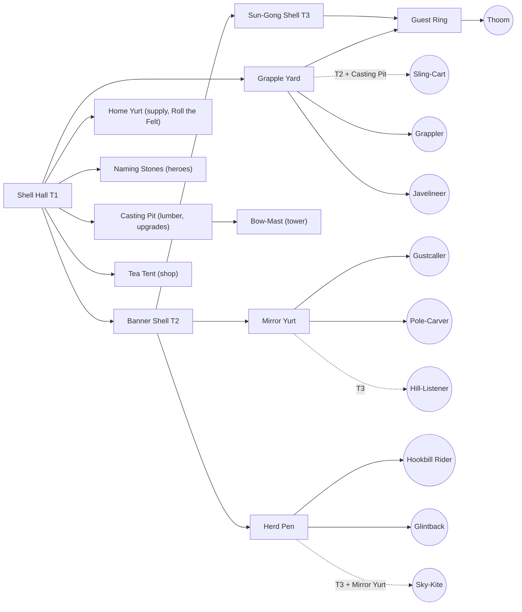

# Faction design: `clans` (the Tormai)

*Design date: 2026-10-16, revised after two rounds of IP-safety and WC3-fidelity reviews (2026-10-16 and 2026-10-17; see the two Review logs at the end).
Status: full-game design, with the vertical-slice subset marked ✅. Faction id: `clans` (data prefix `clans_`). Opponent in the
slice: `kingdom`.*

**Read first:** `docs/research/ip-safety.md` (§0, §2, §3.2), `docs/research/gameplay-mechanics.md` (§11–§13) and
`docs/design/rules.md`. This doc **supersedes** the faction-B placeholders in the research docs ("Thornborn" in the art/audio
docs, "Wildborn" B1–B8 in mechanics §13.4). Global rules live in **`docs/design/rules.md`** (start §3, economy §4, heroes §6,
combat and the damage matrix §7, day/night §13, creeps §15), which supersedes mechanics §13.1–§13.2. They are not repeated here.

**Units of measure.** Distances in metres (1 m = 64 WC3 gu), speeds in m/s, times in seconds. **Footprints in 0.5 m pathing
cells** (`architecture.md`), in step with `kingdom.md`. Sight is day / night. Damage and armour types use the rules §7.1 names
(Blade, Pierce, Siege, Arcane, Heroic, Pure, Spell; Light, Medium, Heavy, Fortified, Hero, Unarmored); data ids are lower-case
(`heroic`, `pure`; rules §20.4). Melee range is edge-to-edge, as in `architecture.md`.

---

## 0. Summary

**What a Warcraft III fan should feel:** "This is the warrior-people race." The Tormai have tough, high-HP infantry, a worker
garrison for defence, a haste-buff caster, a ward-planting support, a defensive spirit caster, a fast siege-type raider that pins
flyers, an aura-carrying war-beast, a flyer, a siege engine and a huge T3 melee people. They have a stealth-and-crit sword
duelist, a seer, a giant tank chieftain and a hex-and-heal support hero. A fan can read every unit's job and the build-order
logic at a glance.

**What must never be true:** nothing looks, sounds or reads like the WC3 Orcs. There are no green skins, tusks, spiked
pauldrons, red-brown leather, hide-and-bone huts, wolves, kodos, wyverns, trolls, lightning shamans, drum-carrying beasts or
broken-English grunts. Nothing reads like another game's hungry steppe giants either.

| | Choice |
|---|---|
| People | **Tormai**: big, slate-grey, heavy-jawed steppe nomads with pale "hail-speckles", and **no tusks** |
| Display name | **the Tormai** (formal: *the Gong-Ring Tormai*). `clans` is the internal data id only; the UI never shows "Clans" (§1.1) |
| Ally people (the tauren-like slot) | **Thoom**: hill-sized, gentle cauldron-helmed giants with pink-granite hides who keep the households' fires and serve their guests. Hosts, never eaters |
| Look | Felt yurts, lamellar, polished bronze, ancient tortoise-shell halls. Ink-teal and saffron felt, warm bronze, slate skin |
| Voice | Formal, courteous and slow. Comedy of **ferocious hospitality**: they apologise before hitting you |
| Signature WC3-derived mechanic (1 allowed) | Workers garrison the supply yurt (3 per yurt) and sling stones. Presented as any hall's gong ringing and the yurt's felt skirt **rolling up**. It is the only one: the war-mill slot has no thorns or burrow-armour research (§8) |
| Gameplay identity | Durable units and strong heroes, mobile mid-game pushes (haste, riders), pull/trap/sleep disables, T3 giants. Weaknesses: fragile casters, few cheap detectors (true sight only from the T2 Pole-Carver's Mirror Pole and a level-5 Skymirror), slower early lumber trips |
| Slice subset ✅ | Worker **Yurtwright**. Combat: **Grappler**, **Javelineer**, **Gustcaller**, **Sling-Cart** (siege). Heroes: **the Uncut**, **Skymirror**. Buildings: **Shell Hall (→ Banner Shell)**, **Home Yurt**, **Grapple Yard**, **Naming Stones**, **Casting Pit**, **Mirror Yurt**, **Bow-Mast**, **Tea Tent** |

---

## 1. Identity

### 1.1 Names, and why not "orc"

- **People name: Tormai** (singular and plural "Tormai"; adjective "Tormai"). Say *TOR-my*.
  - It is invented. "Tor" suggests a grey stone hill, which fits their skin and their hail myth.
  - **Clearance:** the review's web search found no game or IP collision. "Torma" is a real Tibetan and Mongolian Buddhist
    ritual offering, so a cultural-consultant check of "Tormai" is open (§13, Q7). Fallbacks: **Tormun** or **Torvai**, cleared
    with the same search as the public title.
- **Faction display name: the Tormai** (formal: *the Gong-Ring Tormai*).
  - **Why not "Clans":** clans are the core social word of the reference game's orcs, whose named clans are its lore (one of them is on
    the ip-safety §2.1 list). On the orc-slot faction, with its steppe inspiration, "Clans" was the strongest orc-lore word still on screen.
  - **The UI never shows "Clans".** The faction id `clans` is fixed by the brief and stays an internal data id. Lore and VO say
    "households" or "felt-houses".
- **Ally giants: Thoom** (singular and plural). The name is onomatopoeic for their footsteps.
- **Decision: the UI, data and VO never say "orc".** The word is legally free folklore (ip-safety §3.1).
  We still avoid it, for four reasons:
  1. Our roster deliberately mirrors the WC3 Orc *role slots*. Calling the people "orcs" as well would make the
     faction read as a 1:1 re-skin (rule 8 and the *Spry Fox* "focus on what is similar" test). A distinct
     people name is the cheapest strong signal of independent creation.
  2. To an RTS player, "orc" brings green skin and tusks. Every prompt or line that says "orc" pulls
     generated art toward that look (prompt hygiene, ip-safety §2.8).
  3. An original people name, with its own lore, is expression we can own. "Orc" is not.
  4. It sets up the voice: the Tormai speak formal, complete sentences, the opposite of the WC3 orc grunt-speak.
- **Naming rules for the faction** (so future names stay consistent and far from WC3):
  - Two-part English compounds for units and buildings ("Grapple Yard", "Sky-Kite").
  - Invented personal names use soft steppe-flavoured syllables (CV/CVC, doubled vowels allowed: *Ilaya, Ubbet, Beluu*).
  - **No apostrophes**, and no Grom-/Gar-/Kar- or -tar/-ash name patterns.
  - **No "Far-" prefix** on any clans name (the token of a WC3 Orc hero and of its reveal spell).
  - **No one-word swaps** of a WC3 coined name on the same role slot ("Healing Ward" → "Healing Pole" is a swap, not a new
    name). Name the object by what it *is* in our world.
  - Never "Horde", "clan of the X wolf", "Lok-", "Zug" or "Dabu".
  - **Never "Hearth"** in any name: it sits next to Blizzard's *Hearthstone* mark (same goods) and WoW's recall item; `kingdom.md` §1.1
    and the neutrals name audit already retired it. Avoid "Fireside" too (Hearthstone's own event branding).
  - **No eye or squint jokes** in names, tics or lines, and **no Native-American-style epithets** ("Two-X", "Who-Y"), the naming
    register WoW uses for its bull-folk. A Central-Asian-inspired people must never be drawn through eye-shape humour (§1.4).
  - No real ethnonyms, real clan names, real sacred terms or sacred numbers, **even by sound**: check new names against the religious
    vocabulary of the source cultures and their neighbours (the first revision had *Sabbet* ≈ "Sabbath" and *Ommet* ≈ Turkish *ümmet*).
  - **Search every new proper name** against WoW, Warhammer and other Blizzard and Games Workshop coinages, not only the
    ip-safety §2.1 list. (The first draft's "Kirrik" and "Long-Braid" were both Blizzard names; see §13.)

### 1.2 Emblem: "the Gong and the Twin Winds"

- **Shape:** a saffron disc (the Sun-Gong) with a bronze rim. Two thick ink-teal **horizontal wind-strokes** cross the disc at
  mid-height and run past its rim on both sides. Flat, two colours plus a rim. Concept-review alternative: the disc hanging from
  a teal lattice-arch lintel.
  - **Nothing cups the disc from below.** A disc cradled by two curls reads as the sun-over-crescent of the Soyombo, the symbol
    on Mongolia's flag and coat of arms.
  - At concept review, compare the 16 px glyph with the Soyombo and with the Kazakh and Kyrgyz state emblems.
  - It must still read at 32 px on a banner and at 16 px as a minimap or icon glyph.
- **Meaning in lore:** the sun, and the thunder-gong of the first hailstorm; the two strokes are the two seasonal winds that
  drive the herds. Children call them "the winds' two arms, carrying the sun home".
- **Use:** on tall vertical felt banners (disc near the top, team-colour felt ribbons below), on gong faces, shield bosses,
  doors and loading screens. A one-colour version is used for UI stamps.
- **Never:** a circle with spikes, crossed axes, tusks, skulls, a boar or wolf head, or any real-world sacred symbol or national
  emblem. No yurt crown-ring (a real national emblem), no sun-over-crescent, no real clan marks, no endless knot.

### 1.3 Lore (original)

> **Under the Long Sky.** The Tormai say the world began with a hailstorm. Thunder rolled across the steppe like a struck gong,
> the clouds cracked, and the hailstones that struck the grass stood up, shook themselves, and asked who was cooking. That is
> why a Tormai's skin is the grey of a storm cloud, freckled with pale hail-marks. It is why they love bronze that rings, and
> why no guest leaves a Tormai fire hungry. (To the Tormai the sky is weather, not a god. It hails, it clears, and nobody
> prays to it; they just complain about it.)
>
> For as long as their songs remember, the households have walked the **Herd Road**: a great loop of grass between
> the Salt Lakes and the **Sleeping Hills**. Each autumn they stop below the hills and beat the gongs until the
> **Thoom** wake. The Thoom are giants older than the Tormai, who sleep inside the hills between seasons, wearing
> the cauldrons their grandmothers cast. A Thoom woken too early is a landslide. A Thoom woken gently, with a song and a kettle
> already steaming, is a friend for life, and spends the whole season making sure everyone else is warm. The Tormai call every
> Thoom "uncle".
>
> Each household is a ring of felt tents under one banner. The households meet at the **Gong-Ring**, a council where anyone may
> raise a matter by striking the gong, and nothing is decided until everyone has been served tea. Tormai law is hospitality:
> no guest may be harmed under your roof. A guest who refuses tea, however, is no longer a guest.
>
> Three summers ago the Kingdom raised a line of toll-towers across the Herd Road and fenced the river
> crossings. Its heralds sent a letter. The Tormai, being polite, sent tea. The Kingdom sent a bill.
> The Tormai are now coming to discuss the bill in person.

**Lore guardrails.** No demonic blood-curse, internment camps, portals, prophecy-driven exodus or redemption arc
(WC3 orc story beats). No sky deity and no sacred numbers. The Tormai are not villains, and the Kingdom is not evil: this is a
border dispute between proud neighbours, told with warmth and humour.

**World words** (use consistently in tooltips and VO):

| Word | Meaning |
|---|---|
| Long Sky / Long Grass | The open steppe and its sky (landscape, not a deity) |
| Herd Road | The migration loop; the reason for the war |
| Sleeping Hills | Where the Thoom sleep |
| Gong-Ring / Ring-Elder | The council of the households / its elder. Units address the player as "Ring-Elder" |
| household / felt-house | A family band of yurts under one banner; the word players hear instead of "clan" |
| sun-teeth | Gold ("sky-fire that fell and stuck in the ground") |
| lattice-wood | Lumber |
| guest / uninvited guest | Ally / enemy (in VO) |

### 1.4 Real-culture respect (required)

The Tormai draw on the **everyday material culture** of the Eurasian steppe broadly: felt tents, lamellar armour, bronze
cauldrons and kettles, wrestling, tea and strong hospitality. They blend it with **invented** elements: the hail myth,
bronze sun-mirrors used as tools (signalling, reading the sky, the Skymirror's brow-mirror), tortoise-shell halls, Hookbill birds,
the Thoom and the Gong-Ring council.

**Real sacred items we do not use.** The first draft labelled several of these "invented". They are real, and were removed (the second review found the last two):

| Real sacred item or rite | Where the draft had it | Now |
|---|---|---|
| Bronze mirrors and ribbon fringes sewn on a shaman's robe (Mongolian, Buryat and Siberian practice) | Gustcaller and Skymirror costumes | Mirrors are **tools only**: a visor, a staff-top, pole-tops, sun-mirrors on posts and masts. Robes are plain felt; ribbons hang only from staffs |
| Milk sprinkled from a carved spoon as a blessing (Mongolian milk libation) | Omen-Mother's heal | She splashes hot sweet tea from a kettle (**Kettle Blessing**) |
| Carved-face standing stones (Turkic funerary stelae, deer stones) | Naming Stones | Rough stones carved with hail and wind glyphs; no faces, nothing hung on them; a frame of small gongs beside them |
| Horse-hair tassels below a spearhead, and a sacred count of nine banners (steppe war-standards) | Masts; "the Nine Clans" | Masts carry felt ribbon streamers and gong frames. "The households under the Gong-Ring", with no number |
| A watching creator-Sky (Tengri) | Lore; the Grappler warcry "The Sky is watching" | The sky is weather. The warcry is "THE WHOLE GRASS IS WATCHING. LOOK GOOD!" |
| Knucklebone divination: ankle-bones whose four faces are read as horse, camel, sheep and goat (Mongolian *shagai*) | Omen-Mother's omen ability (faces Hookbill, Shell, Ewe, Ram); knucklebones on her hat, a pouch of ankle-bones | **Tea-Leaf Omen**: she swirls her cup and reads the leaves (Kite, Shell, Kettle, Hill). Her hat carries small bronze cups and tea-brick tokens; no bones anywhere |
| Burial mounds (kurgans) and funerary masks | The defensive caster: a "Mound-Speaker" with an ancestor-mask and an ancestor's second voice | **Hill-Listener**: the second voice is the Sleeping Hills' (a Thoom dream-voice); a bronze echo-horn instead of a mask; **Hands of the Hill** |

Rules:

- The Tormai are a **non-human fantasy people** (grey skin, giant jaw, hail-speckles). Do not draw human
  Central Asian facial features as monstrous, and do not stereotype them.
- **No real sacred objects or rites** depicted as such: no real deity names, spirit banners or war-standards, sacred cairns,
  funerary stelae, burial mounds, funerary masks, divination bones, shaman-costume elements (mirror robes, fringes), libations, real clan marks or national emblems. Before adding
  any steppe-inspired object, ask "is this sacred or ritual in a real culture?" and drop it if the answer is yes or unsure.
- **VO and TTS never request a real-world ethnic accent.** Tormai English is slow, formal and standard.
- Portray them as sophisticated (law, poetry, craft, humour), never as "savage hordes".

---

## 2. Visual identity

### 2.1 Body and silhouette

| Element | Tormai | Why (vs WC3 Orc) |
|---|---|---|
| Skin | Slate blue-grey, with **pale hail-speckles** on the shoulders, forearms and scalp | WC3 orcs are green or brown |
| Head | A very heavy, square, forward-set **lower jaw with flat square teeth (no tusks)**, a broad flat nose, small deep-set amber eyes and small rounded ears | WC3 orcs have boar tusks |
| Hair | Blue-black. Warriors loop two thick braids up and bind them with bronze rings; workers hide theirs under felt hats | |
| Build | Upright and broad, with a thick neck and big forearms. They stand about 10% taller than the Kingdom's people at equal class (scale table below) | |
| Upper-third identity (art doc rule 2) | **Cone shapes on top:** conical bronze helmets with a long team-colour streamer, or tall peaked felt hats with ear-flaps. **Flat, layered rectangular shoulder-flaps** (lamellar or quilted felt) below. Seen from above, a soldier is a cone over a wide trapezoid | WC3 orcs have round spiked pauldrons |
| Weapons | Flanged bronze maces, javelin bundles (the Javelineer and the Glintback rider only), **straight horse-sabres**, ladles (Thoom), horn bows (the Bow-Mast), weighted bronze darts (the Sky-Kite), poles and bronze mirrors used as tools (casters). **No axes as the iconic weapon; no oversized curved blades; javelins are not the universal projectile** | WC3 Grunt: axe. WC3 sword-duelist: giant curved blade. WC3 Orc: spears from nearly every ranged source |
| Shields | Few. Where used: small round felt-and-bronze bucklers | Leaves the tall rectangle to the Kingdom's pavises |

**Scale** (overrides the generic table in the research README for this faction):

| Class | Height | Collision radius / footprint | Tri budget |
|---|---|---|---|
| Yurtwright (worker) | 1.4 m | 0.35 m | 1.5–3k |
| Javelineer, Gustcaller, Pole-Carver | 1.7 m | 0.40 m | 2–4k |
| Grappler | 1.9 m | 0.50 m | 2–4k |
| Tormai heroes | 2.2–2.3 m | 0.55 m | 4–8k |
| Thoom (unit) | 2.8 m | 0.75 m | 4–6k |
| Cauldron-Father (hero) | 3.1 m | 0.80 m | 6–8k |
| Hookbill Rider (later) | 2.2 m | 0.60 m | 4–6k |
| Glintback (later) | 2.6 m tall to the shell, 3.9 m to the top of the mirror-ladder; 3.2 m long | 1.00 m | 5–8k |
| Shell Hall | 7.5 m tall; the mesh may overhang the footprint up to 6 m wide | Footprint **10×10 cells (5 m)** | 8–12k |

**64 px black-silhouette test (art doc §7.4).** Every unit must pass these checks:

| Unit | Must read as |
|---|---|
| Tormai infantry | A cone and a streamer over a wide flat trapezoid |
| Thoom / Cauldron-Father | A big bronze bowl-dome with **one** central knob or short smoke-vent, plus a ladle. **No paired upward protrusions above the head; it must not read as horned.** The cauldron's ring-handles hang as horizontal rings at the sides, below the crown line |
| Glintback | A dome (the shell) carrying a **thin vertical ladder** (the mirror-ladder: 4–5 small square plates on a slender mast). **No disc wider than 0.6 m anywhere on a beast** |
| Sky-Kite | A diamond with two long tails |
| Hookbill Rider | A hooked beak forward, with the rider's cone above |
| The Uncut | A flared coat with a **long braid line trailing to the ground**. **No circular motion in idle or abilities.** The sabre is short and carried low; never a long curved blade |
| Buildings | Low domes and masts. Never spikes |

### 2.2 Palette (albedo, before team colour)

| Role | Hex | Use |
|---|---|---|
| Ink teal (primary felt) | `#1E5A60` dark / `#2F7E7E` mid | Coats, yurt walls, banners. Keep it **dark and green-leaning, never violet** |
| Saffron (secondary felt) | `#E0A030` / ochre `#B7772A` | Trim, sashes, door hangings, emblem disc |
| Warm bronze | `#A8743A` / highlight `#D9A55E` | Helmets, gongs, mirrors, cauldrons, kettles, studs |
| Verdigris (sparingly) | `#5FA08E` | Old bronze, the Thoom's cauldrons |
| Slate skin | `#6F7C88` mid / `#4E5966` shadow / speckles `#C9D0D6` | Tormai skin |
| Thoom skin | `#A48E86` weathered pink granite / `#76625C` shadow | Thick, elephant-like hide. Clear of the Tormai slate, the reference orcs' red-brown and the reference bull-folk's brown |
| Felt cream (accent only) | `#E9DDBF` | Never a large mass (avoid white-and-gold) |
| Hair | `#1C2230` | |
| Magic VFX | Sun-glint gold `#FFD27A` (HDR), dust ochre `#C9A46A`, moon-silver `#C8D4E8`, hail white `#EEF3F6` | Tormai magic is **warm glints, dust, hail and silver smoke**. No blue lightning, no fel green, no teal glow, no ghostly blue-white |

**Contrast with neighbours:**
- WC3 Orc is red, brown and green skin. WC3 Night Elf is violet, teal and silver. The Alliance is blue, white and gold.
- Ours is dark ink-teal, saffron, bronze and slate. Keep teal dark and never pair it with violet.
- Keep saffron orange-yellow, never pure gold on white.
- The Kingdom (burgundy, ivory, dark bronze) is near-complementary, so the slice matchup reads well.
- **Team colour** goes on:
  - helmet streamers, felt shoulder-mantles and sashes on units;
  - banner ribbons;
  - the felt band around every yurt dome;
  - the hangings on the Shell Hall.

  Because the faction teal is dark and low-saturation, a bright teal team colour still separates. Check this
  in the night grade.

### 2.3 Materials and cultural sources

| Material | Where | Painting note |
|---|---|---|
| Thick felt (quilted, stitched in big chunky patterns) | Coats, robes, yurts, hats, shoulder-mantles | Big soft colour blocks with a few broad stitch lines. No fine embroidery |
| Lamellar (small rectangular plates laced in rows) | Warrior shoulders and chests | Paint 3–5 big rows, not hundreds of plates |
| Polished warm bronze | Helmets, gongs, mirror tools, cauldrons, kettles, mace heads | Painted highlight streaks only. No PBR gloss |
| Lattice-wood (red-brown folding lattice) | Yurt walls, masts, carts | Readable diamond pattern at 2 m scale |
| Horn and lacquer-free wood | Bows, javelin shafts, poles, ladles | |
| Ancient tortoise shell | The Shell Hall (T1–T3), Glintback | Big hex plates, moss-free, sun-bleached ochre |
| Standing stones | Naming Stones | Rough-hewn, carved with hail and wind glyphs. **No faces, nothing hung on them** |

### 2.4 Architecture: "domes and masts"

- Every Tormai building is a **round, low dome** (felt yurt, or an ancient tortoise shell) on a short stone ring,
  plus **masts**: carved poles with felt ribbon streamers, banners and gongs on frames. **No horse-hair tassels.**
- There are no spikes, bones, hides or tusks. That rules out the WC3 Orc's hide-and-bone spiky huts.
- **Construction verb: Raising.**
  1. A folding lattice ring springs open.
  2. The roof poles lift into place.
  3. Felt unrolls upward and the dome ties shut.
  4. Team-colour bands wrap last.

  The `build_progress` shader reveals the building bottom-up in two passes: the lattice first, then the felt
  over it.
- **Destruction:** the felt tears away and the lattice folds flat in a dust burst. The gong falls last with a clang.
- **Night:** a warm glow comes through each dome's smoke-ring. Bronze sun-mirrors catch moonlight.

### 2.5 Things the art must never do (squint-test list)

- Green, olive or brown-red skin. Tusks of any kind. Pointed ears.
- Spiked or round "pumpkin" pauldrons, **or any big round disc on a shoulder**. Fur pauldrons. Red-brown leather straps as the
  main mass.
- Huts of hide, bone, spikes or tusks. Skull totems.
- Wolves as mounts. Kodo-like grey dinosaurs. Wyverns. **Any percussion instrument (drum or gong) carried on a beast.**
- Lightning-wielding shamans. Blue electric VFX.
- **Paired upward points on a giant's helm** (reads as horns).
- **An oversized curved sword on the duelist hero; a translucent wind-whirl vanish; any spinning or circular motion on her** (a whirled
  braid, a coat that spins out, a dust column or whirlwind). With her stealth opener and crit, a spinning figure reads as the reference
  sword-duelist's spin-and-vanish (*Tetris* squint test).
- **A disc wider than 0.6 m anywhere on a beast** (mirror, shield or gong). At RTS zoom a big upright bronze disc on a beast is a gong.
- **Bone fetishes on casters:** knucklebones, ankle-bones, skull or bone charms (the reference hex hero's voodoo vocabulary).
- **Javelins everywhere:** only the Javelineer and the Glintback rider throw them (the reference orcs throw spears from nearly every
  ranged source).
- **Games Workshop's Ogre Kingdoms trade dress:** hungry steppe giants, big bellies or gut-plates, cleavers and gore, cauldron
  priests who heal through eating, "great maw" imagery, rhino cavalry. The Thoom are hosts who serve; they never eat on screen,
  and no mechanic is tied to eating, kills-as-food or feasting.
- Slender, colourful, long-legged bird mounts. Hookbills are **heavy, short-legged, big-headed terror-birds** in grey-brown.
- Kegs, brewing or alcohol on the Thoom. They are hosts who pour tea, not brewers.
- Tan, brown or sandstone hide on the Thoom (the reference bull-folk colour). They are weathered pink granite.
- Real sacred items (§1.4): mirror-hung robes, ribbon fringes on robes, milk libations, carved-face stones, horse-hair standards.

### 2.6 Distinctness rubric (ip-safety §3.2) vs the nearest WC3 race (Orc)

| Axis | The Tormai | Differs? |
|---|---|---|
| 1. Silhouette | Cones and streamers over flat layered flaps; heavy jaws without tusks; giant helms with one central knob (never horned); domes and masts | ✅ (required) |
| 2. Palette | Dark ink-teal, saffron, warm bronze, slate | ✅ |
| 3. Materials | Felt, lamellar, polished bronze, lattice, tortoise shell | ✅ |
| 4. Cultural inspiration | Everyday steppe material culture (sacred, funerary and divination items excluded, §1.4) plus invented myth (hail, sun-mirror tools, Thoom). The people are "the Tormai", living in households; the orc-lore word "clan" is never on screen | ✅ |
| 5. Signature mechanic | One WC3-derived mechanic only (worker garrison), shown as gong plus rolling felt. The second review found a second one hidden in the war-mill slot (building thorns and burrow-and-tower armour); both are gone (§8) | ✅ |
| 6. Names and voice | All original and searched beyond the §2.1 list; no "Clans", "Hearth" or "orc" on screen; formal, courteous hospitality comedy; no reworded reference-worker acks (§3.1) | ✅ |

**Result: passes after the second review (2026-10-17)** (6 of 6 axes differ, including silhouette). Both earlier versions also claimed
6 of 6. The first draft carried a Blizzard-coined bird name, a WoW hero-class name, two one-word ward swaps, a percussion war-beast, a
horned-looking giant helm and real sacred items. The first revision still carried a gong-shaped mirror on a beast, a spinning duelist,
"Hearth" names, the orc-lore word "Clans" on screen, a second WC3 Orc signature mechanic in the war-mill slot, a 3-of-3 witch-doctor
kit, real divination and burial imagery, and 16 numbers equal to WC3's (15 unit, building and upgrade values plus the ward item's
charges). All are fixed; see the two Review logs.

**Residual risk:** the *role structure* is a deliberate slot-for-slot mirror (the user's direction). Mitigations:
- Every kit has original abilities (see the equivalence ledgers in §5.3 and §6.2). The four heroes keep 8 functional
  equivalents of the 16 WC3 Orc hero abilities (2 per hero, the policy maximum), all with our names, visuals and numbers.
- Units keep at most 2 functional WC3 equivalents each (§5.3; the Pole-Carver was 3 of 3 and is now 2 of 3).
- No hero number equals its WC3 analogue (§6, fidelity rule 2). The first revision claimed the unit, item and building numbers had
  been moved off WC3 values (Review log #14); that claim was wrong, and the second review still found 16 equal values. They are changed
  and listed in §5.4, and `tools/ip/check_value_echo.py` (built in this revision) fails if one comes back.
- The building arrangement is changed where cheap: the Hill-Listener trains at the Mirror Yurt, not beside the giants, and the
  flyer needs a caster building.
- A pre-release legal review should look at the **whole** faction (ip-safety §5.3).

---

## 3. Voice and audio

### 3.1 Speech style

- **Courteous menace.** The Tormai are formal and slow, and speak in complete sentences.
  - Enemies are "guests" or "uninvited guests".
  - They apologise before violence.
  - Their metaphors are weather, grass, tea, felt and stew.
- **Verbal tic:** a low throat-hum, "*Hm-hm*", before many lines. It doubles as a personality beat.
- **Humour is character comedy:** etiquette applied to war, pride in craft, family and in-law jokes, and
  giants who fuss over their guests. No pop culture, puns on WC3 lines or fourth-wall gags about "orcs".
- **Thoom:** very slow, very deep, long vowels; anxious hosts who worry that somebody is cold or has not had tea. They **never**
  talk about being hungry, eating or dinner (that keeps them far from other games' hungry steppe giants), and never make beef
  or cow puns (those belong to the WC3 tauren).
- **Address and phrasing bans:**
  - Units address the player as **"Ring-Elder"**, never "chief", "chieftain" or "warchief" (WC3 Orc address forms).
  - Skymirror describes what his mirror *shows*. He never gives yes/no fortune answers: no answer-ball phrasing in the style of
    "outlook good", "reply hazy" or "it is certain".
  - No "[someone] has fallen" phrasing, no "for the [faction]!" template and no "build more [supply]" template.
  - **Worker acks:** no bare interjection as a select line (a lone "Hm-hm?" rewords the reference worker's "Hmmm?"); "Hm-hm" only
    leads into a full sentence. No "happy to", "glad to" or "with pleasure" acknowledgements, and no bare "Done" job-done line
    (both reword reference-worker lines).
  - **No eye or squint jokes** in names, tics or lines (§1.1, §1.4).
  - Lines say "household", "felt-house" or "the Tormai", never "clan" (§1.1).
- **Line budget** (audio doc §3.2):
  - Regular unit: about 18 lines. Caster: 19. Siege crew: 16. Worker: about 19. Hero: about 26. Advisor: 19 (one per rules §17.3
    trigger; both upkeep steps and the cripple reveal count). The §3.3 tables give candidates; art bible §8.2 sets how many of each
    category are recorded.
  - Check every line against the WC3 Orc quote page before recording, and reject anything close
    (ip-safety §2.2). Never use the words "poke" or "poking" in annoyed lines.

### 3.2 Per-unit personalities (one tic each)

| Unit | Personality | Tic |
|---|---|---|
| Yurtwright | Fussy, warm craftsperson; hospitality under strain | Counts things ("eleven knocks") |
| Grappler | Courtly giant wrestler; treats combat as a formal bout | Wrestling etiquette (bows, footing, the ring) |
| Javelineer | Boastful athletes who track their throwing distances | Quotes distances ("forty paces!") |
| Gustcaller | Breathy weather-gossip; talks about the wind like a neighbour | "The wind says…" |
| Pole-Carver | Deadpan carpenter of poles | Complains about wood grain |
| Hill-Listener | The Sleeping Hills speak through it: a slow Thoom dream-voice interrupts, and the bronze echo-horn at its shoulder hums along | Two voices (chorus) |
| Hookbill Rider | Fast-talking; the bird shrieks over the ends of lines | Bird interruptions |
| Glintback rider | Sun-dazzled mirror-tender | Shades his eyes with his hat brim: "Hold still, you're too bright." |
| Sky-Kite | Airy thrill-seeker | Whoops |
| Sling-Cart crew | Two bickering brothers | Finish each other's sentences wrongly |
| Thoom | Slow, gentle, anxious host; checks that everyone is warm and comfortable | Long "mmmm" |
| The Uncut | Dry, clipped, competitive; her uncut braid is her pride | Keeps a duel tally |
| Skymirror | Vain about his mirror's polish; narrates tiny far-off things the mirror shows ("a goat, two hills away, is wearing a hat"), never fortunes | Polishes mid-sentence |
| Cauldron-Father | Enormous, gentle host | Calls everyone "little one" |
| Omen-Mother | Sly grandmother and gambler | Swirls her cup |

### 3.3 Sample lines (original; at least 3 per category)

**Yurtwright (worker).** Cast: `pqHfZKP75CvOlQylNhV4` (Bill), tags `[deep, courteous, unhurried]`,
post-chain `rubberband=pitch=0.9:formant=shifted`, warm EQ.

| Category | Lines |
|---|---|
| Ready | "Felt rolled, poles packed. Where do we raise?" · "Strong back, hot tea. Ready." · "Hm-hm. I have tea in my boot. I am ready." |
| What (select) | "The mallet is in my hand." · "The wright is listening." · "You need a roof? I have a roof." · "Hm-hm. Counting stitches. Speak." |
| Yes (order) | "Rope in hand." · "Onward, with care." · "I go. Slowly, but I go." · "Pole by pole." |
| Attack | "Forgive me. I must hit you now." · "With my good mallet, then." · "Very sorry. Very hard." |
| Warcry | "Out of my yurt!" · "Mind the felt!" · "Guests do not do this!" |
| Job done | "Raised, roped, and ready for guests." · "Another roof under the sky." · "Last rope tied. Somebody warm the kettle." |
| Mechanic (Sound the Gong, Roll the Felt, All Clear) | "The gong! Inside, everyone, inside!" · "Rolling up the felt. Slings ready." · (All Clear) "Hm-hm. The guests have left. Rude, but quiet." |
| Annoyed (plays in order) | 1. "Hm. A guest who knocks twice is still welcome." 2. "A guest who knocks five times is… still welcome. Through my teeth." 3. "That is eleven knocks. My jaw is making a noise." 4. "Fine. Sit. Drink. Tell me about your day." |
| Death (non-verbal) | A deep "*hhuff*", then a soft felt thump · a surprised "*Hm?*" cut short · a tired sigh and the clatter of a mallet |

**Grappler (heavy infantry).** Cast: `pNInz6obpgDQGcFmaJgB` (Adam), tags `[very deep, formal, amused]`,
post-chain `rubberband=pitch=0.84:formant=shifted`, +4 dB at 180 Hz, compressor.

| Category | Lines |
|---|---|
| Ready | "Grappler, oiled and braided." · "Show me something heavy." · "The ring is drawn. Who steps in?" |
| What | "Speak, Ring-Elder." · "Hm-hm. Big ears, listening." · "Grappler." |
| Yes | "Feet set." · "Shoulders first." · "I move like a hill moves. Surely." |
| Attack | "Down you go." · "Excuse my hands!" · "I will fold them like felt." |
| Warcry | "INTO THE GRASS WITH THEM!" · "GRIP AND THROW!" · "THE WHOLE GRASS IS WATCHING. LOOK GOOD!" |
| Annoyed (plays in order) | 1. "You test my footing. Good." 2. "Again? In the ring, that earns a bow." 3. "I bow. You push. This is rude in every household." 4. "Fine. You win. Your prize is my disappointment." |
| Death | A huge "*HNNGH*" and a ground-shaking thud · "…pinned." · a long exhale, then a heavy body fall |

**Javelineer (ranged thrower).** Cast: `cgSgspJ2msm6clMCkdW9` (Jessica), tags `[bright, boastful, competitive]`,
post-chain `rubberband=pitch=0.94:formant=shifted`, light compression. Tic: she quotes throwing distances.

| Category | Lines |
|---|---|
| Ready | "Forty paces, and I have not even warmed up." · "Eight javelins. I will need three." · "Point me at something far away." |
| What | "Measure something for me, Ring-Elder." · "Hm-hm. Is it far? Tell me it is far." · "Arm loose, eye sharp. Speak." · "I was pacing out the yard. Again." |
| Yes | "Thirty paces that way. Easy." · "Going. Count my steps for me." · "Downwind, naturally." · "Closer, but not too close." |
| Attack | "Fifty paces. Watch this." · "That one is standing very still. Thank you." · "One, and the next, and the next!" |
| Warcry | "PACE IT OUT AND LET FLY!" · "SIXTY PACES, NO WOBBLE!" · "STAND STILL, GUESTS! IT HELPS!" |
| Annoyed (plays in order) | 1. "Fifteen clicks. My sister only managed twelve." 2. "You click from very far away. I respect that." 3. "Hold still, I am measuring your finger. Eighty paces, and wobbling." 4. "If you need a target, I can lend you one. It has a few holes." |
| Mechanic (Throwing-Sticks done) | "With the stick? Ninety paces. Somebody write that down." |
| Death | A sharp gasp and javelins clattering · "…one pace… short…" · a winded "*hff*" and a soft fall |

**Gustcaller (caster).** Cast: `EXAVITQu4vr4xnSDxMaL` (Sarah), tags `[breathy, gossipy, warm]`, post-chain a light `chorus` plus a short
`aecho`. Tic: "The wind says…", as if the wind were a nosy neighbour.

| Category | Lines |
|---|---|
| Ready | "The wind says I am needed. The wind is a terrible gossip." · "Staff tied, ribbons tied, tongue untied." · "Hm-hm. A breeze from the east, and here I am." |
| What | "The wind says you called." · "Shh. The breeze is telling me something juicy." · "Yes, dear? Speak up, it is gusty out here." · "I hear you. So does the whole valley, now." |
| Yes | "The wind says that way. I agree with the wind." · "Off I drift." · "Following the breeze." · "Lightly, lightly." |
| Attack | "The wind says you deserve this." · "A little gust, just for you." · "Mind your hat, guest." |
| Warcry | "THE WIND HAS TAKEN SIDES!" · "BLOW THEM OVER!" · "HOLD ON TO YOUR HATS!" |
| Annoyed (plays in order) | 1. "The wind says you keep clicking me. The wind notices everything." 2. "The wind also says you have not finished your tea." 3. "Now the wind is telling the hills about you. Everyone will know by supper." 4. "The wind says it is sorry. The wind is lying." |
| Abilities | Unbind: "Let it all blow loose." · Wind at Your Back: "Go on, the wind is behind you. Thank it later." |
| Death | A long breathy sigh that trails off like a dropping breeze · "The wind says… oh." · ribbons snapping, then a soft fall |

**Sling-Cart crew (two brothers).** Cast candidates: Roger `CwhRBWXzGAHq8TQ4Fs17` (the older, slow brother, **A**) and Charlie
`IKne3meq5aSn9XLyUdCD` (the younger, quick one, **B**). Confirm both with the 5-line probe and keep them off every kingdom speaker
(art bible §8.1: no preset is shared between factions). Tags `[deadpan]` / `[eager]`, `rubberband=pitch=0.9:formant=shifted` on both;
the two takes are mixed with a slight stereo offset. Tic: they finish each other's sentences, wrongly. (The kingdom's bombard crew
bickers; this crew agrees cheerfully and is wrong.)

| Category | Lines (A / B) |
|---|---|
| Ready | A: "Cart greased, arm wound—" B: "—lunch packed!" · A: "Two brothers—" B: "—one cart, many pots!" · B: "Ready to throw—" A: "—clay. He means clay." |
| What | A: "You called for the—" B: "—handsome brother?" · B: "Point, and we will—" A: "—nod. Then push." · A: "Hm-hm. The wheels—" B: "—are still round!" |
| Yes | A: "Push on three. One—" B: "—three!" · B: "Rolling to the—" A: "—place you said. That place." · A: "Slowly, so the pots—" B: "—fly later!" |
| Attack | B: "Load the—" A: "—pot. Not the cushion." · A: "Aim high, so it—" B: "—comes down loudly!" · B: "Pot away!" A: "…pot away." |
| Warcry | B: "CLAY FOR THE GUESTS!" · A: "HEADS UP—" B: "—AND THEN DOWN!" · together: "THROW IT, BROTHER!" |
| Annoyed (plays in order) | 1. A: "Who keeps clicking the—" B: "—biscuit tin?" A: "Cart." 2. B: "Maybe they like—" A: "—the wheels." B: "I was going to say me." 3. A: "Click once more and we will be—" B: "—delighted!" A: "Not the word I had." 4. B: "Brother, finish my—" A: "No." B: "…sentence." |
| Mechanic (Attack Ground) | A: "Right there, on the—" B: "—exact spot! Roughly." |
| Death | The arm snaps with a crack and pots shatter · two overlapping "*hff!*", then wood collapsing · A: "Brother—" B: "—I know." Then a crash |

**The Uncut (hero, AGI duelist).** Cast: `FGY2WhTYpPnrIDTdsKH5` (Laura), tags `[low, dry, confident]`,
post-chain `rubberband=pitch=0.9:formant=preserved`, small plate reverb.

| Category | Lines |
|---|---|
| Ready / revive | "My braid is uncut. Bring me someone who can change that." · "The Uncut walks." · "One sabre, one braid, no regrets." |
| What | "Speak quickly. Steel gets bored." · "Talk while I walk." · "I am listening with my sword hand." |
| Yes | "Already gone." · "Lightly." · "Follow the dust." |
| Attack | "Draw, if you have something to draw." · "Their best. Send me their best." · "Count the cuts." |
| Warcry | "UNCUT!" · "FACE ME!" · "DUST AND STEEL!" |
| Annoyed (plays in order) | 1. "Hands off the braid." 2. "Tug it once more and we duel." 3. "You tugged it. Draw." 4. "…Whoever you are up there, I cannot reach you. Yet." |
| Abilities | Dust Veil: "Gone with the dust." · Braid Lash: "Come here." · ultimate: "Through the grass!" |
| Death | A sharp breath and her sabre ringing on stone · "Cut… at last." · a short laugh that breaks off |

**Skymirror (hero, INT seer-caster).** Cast: `nPczCjzI2devNBz1zQrb` (Brian), tags `[grand, vain, rounded]`, post-chain
`rubberband=pitch=0.88:formant=shifted`, a light shimmer only on the mirror-sight lines; a cloth-squeak SFX marks the polishing. Tic: he
narrates tiny far-off things the mirror shows, and **never** gives fortunes or yes/no answers (§3.1).

| Category | Lines |
|---|---|
| Ready / revive | "The mirror is polished. The world may now be looked at." · "Skymirror. Mind the fingerprints." · (revive) "Back, and not a scratch on the bronze. Good." |
| What | "Hm-hm. A hare, three hills off, has dropped its turnip." · "One moment… (*squeak*)… yes?" · "There you are. And a crow behind you. It is not impressed." · "Speak. The mirror is listening, and so am I, mostly." |
| Yes | "The mirror says that way. The mirror has very good taste." · "Going. Do not touch the bronze." · "A long walk, but a shiny one." · "As you wish. (*squeak*)" |
| Attack | "Look into the light, guest." · "Such a dull fellow. Let me brighten him." · "Hold still. You are smudging my view." · "Bronze bright, aim true." |
| Warcry | "LOOK UPON THE BRONZE!" · "SHINE!" · "EYES FRONT, GUESTS!" |
| Annoyed (plays in order) | 1. "Please. Not the mirror. Fingers." 2. "I see a thumb. A very large thumb. Yours." 3. "Far away, a goat is wearing a hat. It has nothing to do with you. I simply prefer the goat." 4. "Every click is a smudge. That is forty smudges." 5. "I am now polishing you out of the mirror. Gently. Thoroughly." 6. "There. Spotless, and you are gone from it. Peace at last." |
| Abilities | Sunglint: "A little sunshine for your eyes!" · Moonglint (night): "Even the moon owes me a favour." · Bronze Window: "Now, what is behind that hill?" · Hail-Swifts: "Out you go, little hailstones. Peck politely." · Swallowed Sun: "Nobody wants the sun? I will put it away." |
| Level-up | "Brighter. Naturally." |
| Last word | "Mind… the… mirr—" |
| Death (non-verbal) | A bronze clang and a cracked ring · a long, offended exhale |

**Advisor.** The household's gong-keeper. Cast: `onwK4e9ZLuTAKqWW03F9` (Daniel), pitch 0.9, a bronze-plate reverb tail.
One line per rules §17.3 trigger (the hero level-up uses the shared cue with a Tormai gong layer).

| Event (rules §17.3) | Line |
|---|---|
| Not enough gold | "The purse is thin. More sun-teeth, please." |
| Not enough lumber | "We are short of lattice-wood." |
| Not enough food | "Every yurt is full. Our guests are sleeping in the rain." |
| Hero slot unavailable | "The Stones can hold no more names yet." |
| Can't build there | "The ground says no." |
| Building attacked | "Someone is striking our felt!" (halls: "Someone is striking the Shell!", which fits all three tiers) |
| Units attacked | "Our kin are fighting!" |
| Workers attacked | "Our wrights are being struck!" |
| Hero died | "A name has gone quiet. The Stones will call it back." |
| Hero revived | "The Stones have called a name back." |
| Building finished | "The felt is tied. It stands." |
| Unit trained (idle queue) | "A new guest of the household stands ready." |
| Research finished | "The bronze has cooled." |
| Gold mine low (1,500) | "The sun-teeth are wearing thin." |
| Gold mine exhausted | "The sun-teeth are gone from this hill." |
| Upkeep rises to 30 % | "More mouths, thinner purse. Our gold comes slower now." |
| Upkeep rises to 60 % | "The household eats more than it earns." |
| Cripple countdown started | "Without a hall the whole steppe will see us. Raise one!" |
| Cripple reveal | "Too late. Every roof we own is in plain sight." |

### 3.4 Music and UI sound

- **Music: 3 tracks of 3–4 min**, rotated with 20–40 s gaps (audio doc §3.3).
  - **Instruments:** frame drums in a galloping 6/8 over 4/4; struck and bowed bronze gongs; a two-string
    bowed fiddle with a raspy horse-hair tone; jaw harp; long low bronze horns; wordless deep overtone chant;
    hand claps and stamps.
  - **Harmony:** Dorian or Mixolydian, 84–100 BPM. Proud, windswept and warm.
  - **Avoid** taiko with low brass and guitar (the WC3 Orc sound).
- **Compliant music prompt (ElevenLabs Music, `force_instrumental: true`):**
  > Instrumental, 3:30, fantasy steppe-inspired march: deep frame drums in a galloping 6/8 over 4/4, struck and
  > bowed bronze gongs, a raspy two-string bowed fiddle, jaw harp pulses, long low bronze horns, swelling
  > wordless deep male overtone chant, hand claps and stamps; D Dorian, 92 BPM; proud, windswept, warm;
  > intro, A, B, A-prime, resolving outro; no lyrics.
- **UI:**
  - click: a small bronze tap plus a felt thump;
  - complete: a soft gong swell;
  - error: a throat "*hm-mm*" plus a muffled felt thud;
  - hero level-up: the shared game cue, with a Tormai gong layer added.

---

## 4. Economy and faction rules

| Rule | Value |
|---|---|
| Start | Shell Hall, 5 idle Yurtwrights, 500 gold / 150 lumber (rules §3.2) |
| Gold | Walked back to a Shell Hall: **10 per trip**, 1 worker inside the mine at a time (rules §4.1) |
| Lumber | **15 per trip**, chopping 1 lumber per **0.9 s**. Fewer trips, slower chop (rules §4.3). Drop-off at the Shell Hall or Casting Pit |
| Supply | Shell Hall **+10 food** (all tiers). Home Yurt **+10 food**. 9 yurts reach the 100 cap |
| Upkeep, food cap | Global (rules §4.4–§4.5: cap 100; Upkeep 30 % from 51 food, Upkeep 60 % from 81) |
| Construction | One Yurtwright raises a building; extra Yurtwrights cannot speed it up (rules §4.3). **Mend** (repair) works on finished buildings and on Sling-Carts (rules §4.8) |
| **Signature mechanic (WC3-derived, 1 of 1)** | **Sound the Gong / Roll the Felt.** Up to **3** Yurtwrights enter a Home Yurt; its felt skirt rolls up and each throws sling-stones. See §4.1 |
| Faction passives | None globally. Day/night matters only through Skymirror's Sunglint and Swallowed Sun (rules §13) |

### 4.1 Sound the Gong / Roll the Felt (presented differently from WC3's burrow battle stations)

- **"Sound the Gong"** (hall button **G**, no cost, no cooldown) exists on **every hall tier** (Shell Hall, Banner Shell, Sun-Gong Shell),
  expansion halls included:
  - The hall's gong rings, with a visible ripple and a 2D gong cue for the owner.
  - Every Yurtwright within **30 m of that hall** stops work and runs to the nearest **finished** Home Yurt with a free slot. A worker
    within 30 m of several halls answers the **nearest** one (and only that hall's All Clear releases it).
  - It **keeps its cargo** and delivers it on its next return after All Clear (the rules §4.3 default).
  - A Yurtwright **inside the mine** finishes its 1.0 s dwell, comes out with its 10 gold, then runs.
  - **Builders ignore the gong:** a Yurtwright raising a building stays on site, so construction never pauses. Workers who are
    gathering, walking or Mending answer it.
  - Workers with no free slot run to the hall that rang and wait beside it (they cannot be garrisoned in a hall).
  - **"All Clear"** (the same button, now showing All Clear) sends every worker that answered that hall back to its previous job.
- **Home Yurt "Roll the Felt":** holds **3** Yurtwrights, and only a **finished** Home Yurt accepts them. A Yurtwright can also enter on
  its own: the **Roll the Felt (F)** command on its card, or a smart right-click on an own finished Home Yurt with a free slot.
  - **Smart-click priority:** right-click on an own finished Home Yurt that has a free slot means **Enter**, even when the yurt is
    damaged. Mend on a yurt comes only from the **Mend (R)** command or autocast; a full yurt falls back to the rules §18.2 default
    (Mend if damaged). This needs a matching rules §18.2 row (§13, Q8).
  - Garrisoned workers cannot be targeted and do not gather.
  - Each one adds a sling attack from the yurt: **Pierce 10–13, cooldown 1.8 s, range 9.4 m (600 gu)**, ground and air (sling stone,
    18 m/s). The range matches both factions' T2 range researches (Throwing-Sticks 8.6 m, the Kingdom's Drawn Barrels 9.0 m), so the
    garrison still deters raids in the mid-game. The animation: the felt skirt rolls up to show the lattice, and the slings swing
    through the gaps.
  - The sling attack takes **no weapon upgrades**. The yurt itself takes **Bronze Banding** (+2 armour, §8), like every building.
  - **"Unload All" (U)** empties the yurt instantly. If the yurt dies, its workers pop out with 50% HP.

---

## 5. Unit roster

### 5.1 Stats

Unit **level** sets XP value and creep-style difficulty. Organic units regenerate 0.25 HP/s (rules §9). Casters start with
75 mana and regenerate 0.65 mana/s. G = ground, A = air. **Damage point and backswing use the rules §7.5 class defaults.** Radius is the
collision radius; Flags are the rules §10.7 classification flags.

| # | id / Name | WC3 role slot | Built at (needs) | Gold / lumber / food | Time | Lvl | HP | Mana | Armour | Attack: type, dmg | CD | Range (m) | Speed (m/s) | Sight (d/n) | Hits | Radius (m) | Flags | Slice |
|---|---|---|---|---|---|---|---|---|---|---|---|---|---|---|---|---|---|---|
| 1 | `clans_yurtwright` **Yurtwright** | Worker | Shell Hall (any tier) | 70 / 0 / 1 | 15 | 1 | 240 | – | 0 Medium | Blade 6–8 | 2.0 | 0.6 | 3.1 | 12.5 / 9.4 | G | 0.35 | ground, organic, worker | ✅ |
| 2 | `clans_grappler` **Grappler** | Heavy melee infantry | Grapple Yard | 185 / 10 / 3 | 26 | 3 | 660 | – | 1 Heavy | Blade 17–22 | 1.55 | 0.8 | 4.2 | 21.9 / 12.5 | G | 0.50 | ground, organic | ✅ |
| 3 | `clans_javelineer` **Javelineer** | Ranged thrower | Grapple Yard | 140 / 20 / 2 | 21 | 2 | 370 | – | 0 Medium | Pierce 19–24 | 2.0 | 7.0 (8.6 with Throwing-Sticks) | 4.2 | 21.9 / 12.5 | G+A | 0.40 | ground, organic | ✅ |
| 3b | `clans_proven` **Proven Javelineer** | Upgraded tougher form | Proving Rite (T3) converts all Javelineers; later trains replace them | 140 / 20 / 2 | 21 | 3 | 540 | – | 1 Medium | Pierce 21–26 | 1.9 | 7.0 (8.6 with Throwing-Sticks) | 4.4 | 21.9 / 12.5 | G+A | 0.45 | ground, organic | later |
| 4 | `clans_hookbill_rider` **Hookbill Rider** | Fast beast-rider raider | Herd Pen (T2) | 185 / 45 / 3 | 30 | 3 | 590 | – | 1 Medium | **Siege 21–26** | 1.75 | 0.8 | 5.6 | 21.9 / 12.5 | G | 0.60 | ground, organic | later |
| 5 | `clans_gustcaller` **Gustcaller** | Shaman-type buffer | Mirror Yurt (T2) | 135 / 25 / 2 | 28 | 2 | 320 | **180** | 0 Unarmored | Arcane 9–11 | 1.8 | 7.5 | 4.2 | 21.9 / 12.5 | G+A | 0.40 | ground, organic | ✅ |
| 6 | `clans_pole_carver` **Pole-Carver** | Witch-doctor-type ward support | Mirror Yurt (T2) | 150 / 30 / 2 | **32** | 2 | 320 | **180** | 0 Unarmored | Arcane 10–13 | 1.8 | 7.5 | 4.2 | 21.9 / 12.5 | G+A | 0.40 | ground, organic | later |
| 7 | `clans_hill_listener` **Hill-Listener** | Spirit-walker-type caster | Mirror Yurt (T3) | 190 / 45 / 3 | 40 | 3 | 520 | 225 | 1 Medium | Arcane 16–20 | 1.9 | 6.5 | 4.2 | 21.9 / 12.5 | G+A | 0.40 | ground, organic | later |
| 8 | `clans_sling_cart` **Sling-Cart** | Siege engine (wheeled, mechanical) | Grapple Yard (T2 + Casting Pit) | 200 / 70 / 3 | 36 | 3 | 420 | – | 1 Heavy | Siege 60–74, splash full 0.6 m / half 1.9 m (2.5 m with Packed Clay Pots) | 3.3 | 15.6 (min 3.9) | 3.3 | 21.9 / 12.5 | G only | 0.80 | ground, mechanical | ✅ |
| 9 | `clans_glintback` **Glintback** | Heavy war-beast carrying an aura (a mirror-ladder) | Herd Pen (T2) | 245 / 70 / 4 | 40 | 4 | 960 | – | 3 Heavy | Pierce 13–17 (rider's javelins) | 1.6 | 6.0 | 3.4 | 21.9 / 12.5 | G+A | 1.00 | ground, organic | later |
| 10 | `clans_sky_kite` **Sky-Kite** | Flyer | Herd Pen (T3 + Mirror Yurt) | 225 / 50 / 4 | 36 | 4 | 500 | – | 0 Light | Pierce 20–26 (dropped hail-darts) | 1.8 | 5.0 | 5.6 (flying) | 21.9 / 12.5 | G+A | 0.60 | air, organic; `fly_height` 4.0 m | later |
| 11 | `clans_thoom` **Thoom** | Big T3 melee people (tauren-like slot) | Guest Ring (T3) | 300 / 85 / 5 | 46 | 5 | **1260** | – | 2 Heavy | Blade 31–38 | 2.0 | 1.0 | 3.9 | 21.9 / 12.5 | G | 0.75 | ground, organic | later |

**Summons and wards** (not trained): the **Hail-Swift** (Skymirror E, §6.1) has radius 0.30 m and the flags ground, summoned. The
Pole-Carver's **poles** (§5.2) have radius 0.25 m and the flag `ward`; they have no regeneration and cannot be healed or Mended.

**Deliberately cut:** a second, suicide-style anti-air flyer. Anti-air comes from Javelineers, Sky-Kites,
Glintback riders, casters, Bow-Masts and Hobble-Bola instead. Leaving the slot empty also breaks the 1:1
roster count.

**Projectile speeds** (rules §7.7; damage rolled at launch, homing). Javelins are thrown only by the Javelineer (and the Proven) and the
Glintback rider (§2.5):

| Attack | Speed (m/s) | Arc |
|---|---|---|
| Javelin (Javelineer, Proven, Glintback rider) | 20 | Low arc |
| Hail-dart (Sky-Kite: a weighted, notched bronze dart dropped from the kite) | 16 | Steep drop |
| Arrow (Bow-Mast horn bow) | 22 | Flat |
| Sling stone (Home Yurt garrison) | 18 | Low arc |
| Clay pot (Sling-Cart) | 12 | High arc |
| Arcane bolt (Gustcaller, Pole-Carver, Hill-Listener) | 15 | — |
| Glint bolt (Skymirror) / tea-brick chip (Omen-Mother) | 15 | — |
| Ice pellet (Hail-Swift summon) | 18 | — |

**Raider damage check** (Hookbill Rider, Siege 23.5 average every 1.75 s, before armour): ≈ 6.7 DPS against Medium (workers,
Javelineers, Hookgunners), ≈ 20.1 against Unarmored casters, ≈ 20.1 against Fortified (≈ 15.5 after armour 5, plus 6 from
Roof-Burner). Its job is buildings and casters, as in the WC3 raider slot, not worker hunting.

### 5.2 Unit descriptions and abilities

Abilities marked **≈WC3** are functional equivalents of a WC3 Orc unit ability. They are kept because they define
the role, but each has our own name, numbers and presentation. **Original** marks new mechanics. Ability damage is Spell
damage unless a row says otherwise.

**1. Yurtwright** (worker)

- **Look:** a stocky Tormai in a quilted ink-teal coat and a tall peaked felt hat with ear-flaps (team colour on the hat band).
  They carry a wooden mallet and a lattice bundle or gold sack on their back.
- **Abilities:**
  - Gather: 10 gold, or 15 lumber.
  - **Raise** (build). One Yurtwright per site.
  - **Mend** (repair; autocast, **default off**, 8 m when on): repairs **finished** buildings and **Sling-Carts** (mechanical;
    they have no natural regeneration). A full repair takes 1.5× the target's build time and costs 30% of its cost, paid pro rata
    (rules §4.8). Mend cannot speed up an unfinished site.
  - **Roll the Felt** (**F**: enter a finished Home Yurt with a free slot; see §4.1).

**2. Grappler** (heavy melee infantry)

- **Look:** a broad wrestler-soldier.
  - Conical bronze helmet with a long team-colour streamer; bronze chin-guard over the big jaw.
  - Three rows of saffron-laced lamellar flaps on the shoulders.
  - Sleeveless felt coat, huge bronze wrist-guards, oversized flanged bronze mace.
- **Shove** (Original; unlocked by *Wrestler's Training*, which also gives +60 HP):
  - Every **4th consecutive attack** on the same target shoves it back **1.0 m** and **cancels its swing** if
    that attack has not reached its damage point. This uses the attack-timing system (rules §7.5).
  - Against heroes and units of 5 or more food: 0.5 m, and the swing is not cancelled.

**3. Javelineer** (ranged thrower) and **3b. Proven Javelineer** (upgraded form)

- **Look (Javelineer):** a lean Tormai athlete (an adult). Felt hood, a quiver-bundle of bronze-weighted javelins, and a
  spear-thrower stick.
- **Throwing-Sticks** (research): range 7.0 → 8.6 m (the atlatl). It applies to the Proven too.
- **Proving Rite** (T3 research) turns every Javelineer into a **Proven Javelineer**, a veteran of a dozen battles. The Proven:
  - is 1.12× the size;
  - wears a bronze lamellar vest and a saffron sash;
  - gains +170 HP, +1 armour, +2 damage and +0.2 m/s;
  - gains **Heel-Seeker** (Original, passive): **+35% damage against units moving away from it** (a percent bonus, step 2 of
    the rules §7.4 pipeline). "Moving away" means: at impact, the target's speed is above **0.5 m/s** and its velocity has a
    **positive component along the attacker → target vector**. This punishes the classic "pull the damaged unit back" micro
    (mechanics §11.4).
- **Production:** the Proven reuses the Javelineer mesh with a texture swap and scale. It costs no extra 3D.

**4. Hookbill Rider** (raider)

- **Look:** a Tormai outrider on a **Hookbill**, a heavy, short-legged flightless steppe bird with a huge hooked beak and
  grey-brown plumage. The rider carries a torch-pole and a bola belt.
- **Siege attack** (≈WC3: the raider's anti-building and anti-caster role comes from its attack type, as in the WC3 slot):
  Siege 21–26, cooldown 1.75 s. Strong against buildings and Unarmored casters, weak against workers and Medium ranged units.
- **Roof-Burner** (Original in this form; passive): its attacks on a **building** set it alight for 5 s, dealing 6 Spell damage
  per second. The burn refreshes and never stacks (one burn per building, however many riders). Repair still works on a burning
  building.
- **Shriek-Scatter** (Original; active, no mana, cooldown 30 s): the bird's shriek makes every enemy worker within **5 m** drop
  the gold or lumber it carries (the load is lost) and flinch for 0.5 s. VFX: a ring of grey feathers and spilled sacks and
  sticks.
- **Hobble-Bola** (≈WC3 ensnare, including its air pull-down; research at the Herd Pen):
  - Range 5.5 m, cooldown 12 s, no mana.
  - Ground targets are rooted for 4 s (heroes **1.5 s**, `hero_duration`).
  - Flying units are **grounded** for 8 s (rules §12.3), so melee can hit them.

**5. Gustcaller** (shaman-type buffer)

- **Look:** a Tormai weather-caster in a long, **plain** saffron felt robe. They carry a tall **wind-vane staff** (a bronze vane
  on a pivot) with felt ribbons tied to the staff only, and a folding felt fan at the belt. No mirror on the body and no ribbons
  sewn on the robe.
- **Trainings:** **Second Ribbon** (T2) and **Elder Ribbon** (T3) each give +60 HP, **+90 mana** and +2 damage (mana 180 → 270 → 360). Each ties one more
  ribbon to the staff.

| Ability | Unlock | Effect | Mana | CD | Range | Kind |
|---|---|---|---|---|---|---|
| **Unbind** | Base | 3 m area. Removes buffs **selectively** (`dispel_mode: "selective"`): positive buffs from enemies, negative buffs from allies. Deals **220** damage to enemy summoned units (`summon_damage`). Slows enemies 40% for 3 s (heroes 1.5 s) | 60 | 6 s | 8 m | ≈WC3 (dispel), made an area spell |
| **Wind at Your Back** (autocast, default on) | Second Ribbon (T2) | Ally gains **+20%** move speed and **+30%** attack speed for 40 s. Ribbons of dust trail behind it. Dispellable. **Autocast target:** an allied non-worker, non-mechanical unit (heroes allowed) within 9 m that is attacking or has an enemy within 8 m and lacks the buff; melee units before ranged, then the nearest | 45 | **1.5 s** | 9 m | ≈WC3 (haste buff) |
| **Dust Shroud** | Elder Ribbon (T3) | A 5 m dust cloud for 10 s: ranged attacks against units inside miss 60% of the time | 75 | 25 s | 9 m | Original |

**6. Pole-Carver** (witch-doctor-type ward support)

- **Look:** a Tormai carver with a tool-apron, a stack of carved poles strapped to the back, and a felt cap.
- **Poles:** wards (`ward` flag) with **8 HP** that can be attacked. They are visible unless stated otherwise.

| Ability | Unlock | Effect | Mana | CD | Range | Kind |
|---|---|---|---|---|---|---|
| **Mirror Pole** | Base | An **invisible** pole topped with a small bronze mirror that shows what is hidden. Reveals a 14 m radius, including invisible units, for **9 min** | **45** | 0 | 5 m | ≈WC3 (sentry ward) |
| **Grain-Reader's Mark** | Second Ribbon (T2) | **Not a pole and not a disable.** The carver chalks lines along the "grain" of an enemy **building or mechanical unit** (a cart, a wagon, a construct). For **12 s** it takes **+20%** damage from **Blade and Siege** attacks (a percent bonus, rules §7.4 step 2; dispellable). VFX: white chalk lines run along the target's planks and seams, with a chalk tick where the next blow will split it | 75 | 15 s | 8 m | Original (replaces the WC3 stasis trap: the carpenter reads where the wood will split) |
| **Kettle Pole** | Elder Ribbon (T3) | A steaming bronze kettle hangs from the pole; its steam heals allies within 6 m for 1.8% of max HP per second for 25 s. Skips mechanical units | 100 | 0 | 5 m | ≈WC3 (healing ward) |

**7. Hill-Listener** (spirit-walker-type defensive caster)

- **Look:** a gaunt, very old Tormai in **dark ink-teal felt**, carrying a bronze bowl of smoke. A small curled **bronze echo-horn** sits
  at one shoulder. When the Sleeping Hills speak through the Hill-Listener (a slow, rumbling Thoom dream-voice), the horn hums and
  "answers". No mask, no ancestor imagery, no burial mound (§1.4). Nothing about the Hill-Listener glows or turns translucent.

| Ability | Unlock | Effect | Mana | CD | Range | Kind |
|---|---|---|---|---|---|---|
| **Between Breaths** (toggle) | Base | Applies the rules **`spectral`** flag verbatim (rules §7.2: immune to Blade, Pierce, Siege, Heroic and **Pure** attacks; cannot attack), with this ability's own magic multiplier: it takes **+60%** (×1.60) from Arcane and Spell instead of the flag's ×1.66. Presentation: a cocoon of ochre-silver smoke rises from the bowl and wraps it; the body stays **opaque** and greys out. No blue-white glow | 0 | 2 s | self | ≈WC3 (ethereal) |
| **Kin-Thread** | Second Ribbon (T3) | Links up to **3** allies within 8 m for 60 s (the Hill-Listener may be one of the 3). 40% of the damage any linked unit takes is spread among the others | **70** | 2 s | 8 m | ≈WC3 (damage link) |
| **Hands of the Hill** | Elder Ribbon (T3) | 3 m area. After 0.75 s, clay-and-smoke hands of the Sleeping Hills rise and root enemy ground units for 3 s (heroes 1.5 s), dealing 25 Spell damage per second | 100 | 20 s | 8 m | Original (replaces the WC3 resurrect) |

**8. Sling-Cart** (siege engine)

- **Look:** a two-wheeled lattice-wood cart with a long throwing arm and a felt sling, pushed by two Tormai crew (rigid props, so
  no rig is needed). Ammunition is clay pots.
- **Mechanical:** no natural regeneration; Yurtwrights **Mend** it (rules §4.8). It scales with **Bronze Points** and
  **Lamellar Plates** like the other ranged and armoured units (§8).
- **Packed Clay Pots** (T2 research, in the slice): half-damage splash radius 1.9 → 2.5 m. The counterpart of the Kingdom's
  Case Shot (they slow, we widen the splash).
- **Tallow Pots** (≈WC3 burning ammunition; T3 research): each impact leaves burning ground in a 1.5 m radius for **6 s**, dealing
  **10** damage per second. It does not stack, and it also burns buildings.
- **Motion** is fully procedural (§12.2): the wheels roll, the arm swings, the cart recoils and the crew bob.

**9. Glintback** (heavy war-beast carrying a mirror-ladder)

- **Look:** a giant steppe tortoise. On its shell sits a felt-roofed platform with a javelin rider and a **mirror-ladder**: a slender
  lattice mast carrying **4–5 small square bronze plates (about 0.5 m each)** stacked one above another. A mirror-tender tilts them
  with cords.
  - **No drum, gong or other instrument rides on the beast, and no disc wider than 0.6 m** (§2.5). The gong stays a hall and emblem
    motif only. (The first revision's 1.6 m round sun-mirror on a mast still read as a gong on a beast.)
- **Sun on the Blades** (≈WC3 damage aura, presented as light instead of music): allied units within **8 m** deal **+8%** damage,
  or **+15%** with *Burnished Face*. On each pulse the plates tilt **one after another, bottom to top**, and a glint runs up the ladder
  and along the allies' weapons (a visible flash every 2 s; the aura itself re-applies every 0.5 s, rules §10.3). At night the glint is
  moon-silver; the effect is unchanged.
- **Withdraw** (Original; replaces the WC3 devour), cooldown 25 s, no mana:
  - The tortoise pulls into its shell for 6 s. It cannot move or attack, and takes 70% less damage.
  - **Taunt:** enemy **non-hero** units within 5 m must attack it for **3 s**, refreshed each second while it stays withdrawn. Heroes
    are never taunted.
  - The mirror-tender keeps the plates turning, so the aura stays on.
- **Production:** this is the cheapest non-biped we have. The shell is rigid, the 4 legs and the head are pivoting segments, the mast is
  rigid and each plate is a rigid part with its own procedural tilt, and the animation is procedural.

**10. Sky-Kite** (flyer)

- **Look:** a big hexagonal felt-and-cane kite with two long team-colour tails. A light Tormai rider hangs in a harness under it
  and drops weighted bronze **hail-darts** from a belt pouch. No javelins and no spear-throwing from the air (§2.5).
  - In lore, a wind bound by the Gustcallers lifts the kite. That is why the Sky-Kite needs a Mirror Yurt.
  - There are no wings, so the motion is procedural: bank, sway and tail ribbons.
- **Hail-Darts** (≈WC3 poison; research): the darts are notched, so struck units bleed **5 damage per second for 3 s**. It does not
  stack, and does not affect buildings.
- **Updraft** (Original, cooldown 25 s): +75% move speed for 3 s, and immune to Hobble-type pull-downs and roots while it lasts.

**11. Thoom** (big T3 melee people)

- **Look:** a 2.8 m hill-giant with weathered **pink-granite**, elephant-thick skin (`#A48E86`) and tiny kind eyes.
  - The head is hidden under a huge upturned **bronze cauldron helm** topped by **one central lid-knob** (or a short
    smoke-vent). The two ring-handles **hang at the sides as horizontal rings, below the crown line**. Nothing points upward in
    pairs (§2.1).
  - It wears a long quilted **felt robe** with a sash (no apron, no bare belly) and swings a **giant bronze ladle** as a mace.
  - No horns, no hooves, no kegs, no cleavers, no gore.
- **Heavy Ladle** (≈WC3 splash attack; research): every **3rd** attack is a **Ladle Sweep**, a flat horizontal swing through the
  **180° arc in front of the Thoom**. It deals **55 Spell damage to every enemy within 2.5 m in that arc, the attacked target included**,
  on top of the normal hit. Deterministic, not a chance roll. It is never shown as a downward ground pound.
- **Shelter** (Original, passive): when an allied non-hero unit within **6 m** drops below **30% HP**, the Thoom gains
  **+3 armour for 6 s** (cooldown 20 s). It plays a sheltering pose, the ladle raised over the hurt ally like a roof (animation
  only; no movement). In VO a Thoom frets over the hurt guest, never about food.

### 5.3 Unit equivalence ledger (roles kept, kits mixed)

At most 2 functional WC3 equivalents per unit, as for heroes (§6.2).

| Unit or building | WC3 equivalents kept | Original |
|---|---|---|
| Grappler | – (WC3's HP and attack-speed upgrade is replaced) | Shove |
| Javelineer / Proven | Range upgrade; a transform into a tougher form | Heel-Seeker |
| Hookbill Rider | Ensnare, **including** the flyer pull-down (WC3's ensnare also grounds air units); the Siege-type raider role | Shriek-Scatter (cargo drop); Roof-Burner (building burn, no repair lock); the bird mount |
| Gustcaller | Dispel (base), haste buff (T2) | Dust Shroud (T3) |
| Pole-Carver | Invisible sentry-type ward (base), healing ward (T3): **2 of 3** | Grain-Reader's Mark (T2): not a ward, not a disable. (The first revision's Hitching Pole was a planted disabling pole, so the kit was 3 of 3 by kind) |
| Hill-Listener | Ethereal form, damage link | Hands of the Hill |
| Sling-Cart | Burning ammunition | Packed Clay Pots (splash radius) |
| Glintback | Damage aura | Withdraw, turtle body, the aura shown as light on a mirror-ladder (no instrument, no disc) |
| Sky-Kite | Bleed (DoT) | Updraft; kite body; darts dropped, not spears thrown |
| Thoom | Splash attack (shown as a horizontal sweep, never a ground pound) | Shelter; cauldron-helmed host giants |
| Home Yurt | Worker garrison: the faction's **one** WC3 signature mechanic (§4.1) | Gong call from every hall tier; 3 slots; the felt roll-up |
| Casting Pit | Weapon and armour lines; one building-armour research (**Bronze Banding**: all buildings +2 armour, the genre masonry line) | **Smoke-Ring Watch**. The WC3 Orc building-thorns upgrade and its burrow-and-tower armour upgrade are **not** used (a second signature mechanic) |
| Tea Tent stock | Race-shop staples: instant HP and mana restores, a recall item, a vision ward, a tiny supply building | Regeneration teas that stop on damage; Glint Charm (armour plus reveal-on-hit, not an attack orb); the vision ward is a pebble (no "hawk = vision" link) |

### 5.4 WC3 value-echo audit (units, buildings, upgrades)

The second review checked our numbers against the classic.battle.net Orc pages and found 15 values that still equalled WC3's, after
the first revision had claimed they were moved (plus the ward item's 2 charges, §9). All are changed. The WC3 values are recorded **for review only and must never be
entered as data**. `tools/ip/check_value_echo.py` holds the same table (`tools/ip/value_echo_reference.json`, which also carries the
§6.2 hero values) and fails if a design value or, once the defs exist, a `data/*.json` value equals its reference. Global rules (food
cap, hero cost, upkeep, the XP table) and the 15 s worker train time that every faction shares are exempt.

| Ours | Field | WC3 analogue | WC3 value | Ours now |
|---|---|---|---|---|
| Grapple Yard | Cost, build time | Orc barracks | 180 / 50, 60 s | **170 / 60, 65 s** |
| Guest Ring | Cost | Tauren building | 135 / 155 | **145 / 165** |
| Herd Pen | Lumber, build time, HP | Orc beast building | 140 l, 60 s, 1100 HP | **150 / 130, 65 s, 1050 HP** |
| Tea Tent | Cost | Orc race shop | 130 / 30 | **120 / 40** |
| Mirror Yurt | Gold, HP | Orc spirit building | 150 g, 800 HP | **145 / 120, 760 HP** |
| Naming Stones | HP, build time | Orc altar | 900 HP, 60 s | **860 HP, 55 s** |
| Casting Pit | HP | Orc war mill | 1000 HP | **960 HP** |
| Bow-Mast | HP | Orc watch tower | 500 HP | **470 HP** |
| Shell Hall | Build time | Orc T1 hall | 150 s | **155 s** (rules §5.1 updated) |
| Home Yurt | Lumber, garrison | Orc burrow | 40 lumber, 4 workers | **150 / 35, 3 workers** (Pierce 10–13 each, 9.4 m) |
| Thoom | HP | Tauren | 1300 HP | **1260 HP** (5 food kept: the rules §4.4 heavy-unit class value) |
| Gustcaller, Pole-Carver | Mana | Orc shaman, witch doctor | 200, +100 per training (400) | **180, +90 per Ribbon (360)** |
| Pole-Carver | Train time | Orc witch doctor | 30 s | **32 s** |
| Hail-Darts (was Ribbon Barbs) | Bleed | Wind-rider poison | 4 damage/s | **5 damage/s for 3 s** |
| Tallow Pots | Burn | Burning oil | 6 per 0.5 s (12/s) | **10 damage/s for 6 s** |
| Hail-Eye Pebble (was Hawk Feather) | Charges | Race-shop vision-ward item | 2 charges | **3 charges, 4 min** |

---

## 6. Heroes

All four heroes use the global hero rules (rules §6):

| Rule | Value |
|---|---|
| Cost | First hero free (5 food), plus one **Homeward Felt** (rules §3.2); later ones 425 g / 100 l, 5 food, 55 s (rules §6.1) |
| Combat | Heroic attack type (`heroic`), Hero armour (×0.7 from Spell damage, rules §7.2) |
| Inventory and revive | 6 item slots; revive at the Naming Stones (rules §6.7) |
| Skills | Abilities learned at levels 1/3/5 (3 ranks each), ultimate at level 6. Hotkeys Q, W, E, R (rules §6.5) |
| Attributes | STR +25 HP and +0.05 HP/s; AGI +0.3 armour and +2% attack speed; INT +15 mana and +0.05 mana/s; primary attribute +1 damage (rules §6.6) |
| Formulas | Armour = base + 0.3 × AGI. HP = 100 + 25 × STR. Mana = 15 × INT. Effective attribute = floor(base + growth × (level − 1)) |
| Control on heroes | Every control effect below states its hero value (`hero_duration`). Polymorph and remove-from-play effects that may hit heroes set **`allow_heroes: true`** (rules §6.5 needs the matching clause; §13, Q8) |

**Fidelity rules:**
1. At most **2 of 4** abilities may be functional equivalents of the matching WC3 hero's abilities. Ledger in §6.2.
2. **No hero value (damage, heal, mana, cooldown, duration, jumps, chance, multiplier) may equal the WC3 analogue's value at the
   same rank.** The reference values the review checked are listed in §6.2 so later reviews can see the deltas.

### 6.1 Hero stats

| Hero (id) | WC3 archetype slot | Primary | STR (+/lvl) | AGI (+/lvl) | INT (+/lvl) | Base damage (+primary) | Base armour | Base CD | Range | Speed | Sight | Height | Slice |
|---|---|---|---|---|---|---|---|---|---|---|---|---|---|
| **The Uncut** (`clans_hero_uncut`; title "Uncut Duelist") | AGI melee duelist | AGI | 19 (+2.0) | 22 (+1.9) | 14 (+1.5) | 2–11 | −2 | 2.0 | 0.9 m melee | 5.0 | 28.1 / 12.5 | 2.2 m | ✅ |
| **Skymirror** (`clans_hero_skymirror`) | INT seer-caster (ranged) | INT | 16 (+1.7) | 14 (+1.0) | 22 (+2.9) | 1–9 | −2 | 2.3 | 7.5 m (glint bolt, 15 m/s) | 4.7 | 28.1 / 12.5 | 2.2 m | ✅ |
| **Cauldron-Father** (`clans_hero_cauldron_father`), a Thoom | STR tank chieftain | STR | 26 (+2.9) | 11 (+1.1) | 13 (+1.5) | 6–15 | −1 | 2.4 | 1.2 m melee | 4.4 | 28.1 / 12.5 | 3.1 m | later |
| **Omen-Mother** (`clans_hero_omen_mother`) | INT support (hex, heal) | INT | 17 (+1.8) | 13 (+1.1) | 21 (+2.6) | 1–8 | −2 | 2.3 | 7.0 m (tea-brick chip, 15 m/s) | 4.7 | 28.1 / 12.5 | 2.1 m | later |

**Derived values** (HP / mana / armour / damage / effective attack cooldown; `test_hero_attributes` asserts these):

| Hero | Level 1 | Level 5 | Level 10 |
|---|---|---|---|
| The Uncut | 575 / 210 / 4.6 / 24–33 / 1.39 s | 775 / 300 / 6.7 / 31–40 / 1.27 s | 1025 / 405 / 9.7 / 41–50 / 1.12 s |
| Skymirror | 500 / 330 / 2.2 / 23–31 / 1.80 s | 650 / 495 / 3.4 / 34–42 / 1.69 s | 875 / 720 / 4.9 / 49–57 / 1.58 s |
| Cauldron-Father | 750 / 195 / 2.3 / 32–41 / 1.97 s | 1025 / 285 / 3.5 / 43–52 / 1.85 s | 1400 / 390 / 5.0 / 58–67 / 1.71 s |
| Omen-Mother | 525 / 315 / 1.9 / 22–29 / 1.83 s | 700 / 465 / 3.1 / 32–39 / 1.72 s | 925 / 660 / 4.6 / 45–52 / 1.60 s |

**Proper names** (one is picked at random for each hero, shown as "Title: Name", rules §6.1):
- The Uncut ("Uncut Duelist"): *Ilaya, Teshe, Orsel, Nauri, Bessu*.
- Skymirror: *Hodun Brightbowl, Sarvi the Twice-Polished, Ubbet the Polished, Kelun Bright-Rim*.
- Cauldron-Father: *Boomul, Ummoru, Gubbada, Lummaro*.
- Omen-Mother: *Grandmother Ezzi, Old Beluu, Auntie Ottu, Mother Halsi*.

#### The Uncut: AGI duelist

**Look:**
- A lean, fast Tormai woman in a **split saffron riding coat** that hangs straight at rest and flares only in the run cycle.
- A bronze chin-guard, and a team-colour sash.
- A **normal-length straight horse-sabre**, carried low and back-handed. Never an oversized or curved blade.
- Her **single huge braid**, ending in a bronze weight, is the silhouette hook. It reaches the ground and **trails behind her** like a
  line; in combat it lashes forward in straight snaps (Braid Lash). **It is never whirled, and nothing about her spins:** no circular
  motion in idle, attacks or abilities (§2.5).
- No mask, no topknot.

**Lore:** a Tormai duelist never cuts her braid until she loses a duel. Hers reaches the ground; hence the title.

| Key | Ability | Rank 1 / 2 / 3 | Mana | Cooldown | Kind |
|---|---|---|---|---|---|
| Q | **Dust Veil**: she drops low into the grass, and a **flat, ground-hugging puff of ochre dust** rolls outward around her (about 3 m across, never above knee height) and settles; when it settles she is gone. Invisible (`fade`, rules §11) for up to **15 / 20 / 25 s** with **+20 / 35 / 50%** move speed (fade time **0.5 s**). Her first attack out of it deals **+45 / 80 / 115** bonus Heroic damage and slows the target 30% for 2 s (heroes **1 s**, `hero_duration`). VFX: no column, no spin, no swirl and no translucent fade-out; the settling dust sells the vanish (her owner then sees her through the global invisibility shader) | see text | 70 | 8 s | ≈WC3 #1 (stealth opener) |
| W | **Braid Lash**: she draws the weighted braid back low behind her and snaps it forward **in a straight line** at a ground unit within 5.5 m (never whirled overhead). It deals **40 / 75 / 110** Spell damage, pulls the target **3 m** toward her (heroes 1.5 m) and roots it for **1.0 / 1.25 / 1.5 s** (heroes **0.75 / 1.0 / 1.25 s**, `hero_duration`) | see text | 70 | 14 / 12 / 10 s | Original |
| E | **Keen Edge** (passive): **18%** chance to deal **1.8× / 2.4× / 3.0×** damage. Each crit gives her +25% move speed for 1.5 s (hit-and-run) | see text | – | – | ≈WC3 #2 (critical strike) |
| R | **Through the Tall Grass** (ult, level 6): for **10 s** she gains **+40%** attack speed and **ignores slows** (move and attack-speed slows on her are suppressed; roots and stuns still apply), and every attack also cuts an **8 m × 2 m line** behind the target for **100%** of the hit. The cut deals **Heroic** damage, takes the hit's **post-crit, pre-armour** value (each victim's own type and armour then apply), and **does not hit structures**. A straight dust-slash streak shows each cut. Target: against 4 clumped Pavisiers it deals about 800 damage to units other than the one she attacks (§13, Q2) | – | 125 | 120 s | Original (a line cleave, not a spin AoE) |

#### Skymirror: INT seer-caster

**Look:**
- An old, broad Tormai on foot in a **plain quilted ink-teal felt coat with bronze studs**.
- A polished bronze mirror on a **brow-band**, worn pushed up on his forehead. He flips it down over his eyes **only while casting
  Bronze Window**; at idle his eyes are visible, bright and keen. He is a vain polisher, not a blind seer.
- He holds a long staff topped by a second mirror.
- He polishes constantly. The two mirrors are his **tools**; nothing is sewn on as costume (§1.4).

| Key | Ability | Rank 1 / 2 / 3 | Mana | Cooldown | Kind |
|---|---|---|---|---|---|
| Q | **Sunglint**: he tilts the staff-mirror and flashes a **50° cone, 7 m long**. The **blind** is the main effect: 35% miss chance for **3 / 4 / 5 s** (heroes **2 / 2.5 / 3 s**, `hero_duration`). It also deals **50 / 85 / 120** Spell damage. **At night it becomes Moonglint:** 50% damage, but the blind lasts 2 s longer (heroes 1 s longer). Cast point 0.4 s | see text | 80 | 9 s | Original (a cone blind, not a line nuke) |
| W | **Bronze Window**: he flips the brow-mirror down over his eyes and looks through it. Reveals a **10 / 14 / 18 m** radius anywhere on the map for **10 s**. At rank 3 it also reveals invisible units | see text | 60 / 50 / 40 | 20 / 15 / 10 s | ≈WC3 #1 (remote reveal) |
| E | **Hail-Swifts**: summons **2 / 2 / 3** hail-cloud birds (level 2 / 2 / 3) for **45 s**: opaque, icy-white swifts of packed hail, with no ghost glow. They are **ground summons that skim 0.6 m above the grass** (`hover_height` is visual only): flags **ground, summoned**; ground pathing; normal line of sight; **5.2 m/s**; sight 17 / 12.5. Each: **160 / 200 / 240 HP**, Light 0, Pierce **7–9 / 9–11 / 10–12** (ice pellets), CD 1.5, range 4.5 m. Melee units and creeps can hit them and idle creeps acquire them, so they **tank** while the Skymirror creeps. **No true sight at any rank.** On death or expiry each bursts into a **2 m hail patch**: 15 Spell damage and a 20% slow for 2 s to enemy ground units. Summons give 50% XP (rules §10.6) | see text | 100 | 35 s | ≈WC3 #2 (summon), changed to skimming hail birds |
| R | **Swallowed Sun** (ult, level 6): within 12 m, a **9 m radius** goes dark for **12 s**. Enemies inside have sight 3 m and a **40% miss chance**, and enemy vision cannot see into the area. Your units inside gain +15% move speed. It is an **area state, not a timed control**: it applies in full to heroes while they are inside and lingers the rules aura time (2 s) after they leave | – | 175 | 150 s | Original (it uses the day/night sight system) |

#### Cauldron-Father: STR tank chieftain (Thoom; a different people from the WC3 bull-folk)

**Look:**
- The biggest Thoom of the Sleeping Hills.
- An enormous verdigris cauldron helm with **one central lid-knob**; its ring-handles hang at the sides (no paired upward
  points, §2.1).
- A long quilted felt robe (no apron), and a **bronze serving-tray worn as a breast-disc** on his chest. It is never on a
  shoulder: round shoulder discs are banned (§2.5).
- A **giant ladle**.
- He walks slowly and gently; the ground shakes.

| Key | Ability | Rank 1 / 2 / 3 | Mana | Cooldown | Kind |
|---|---|---|---|---|---|
| Q | **Bowl Over**: he hurls his cauldron helm at a ground unit within 6 m. • It deals **70 / 120 / 170** Spell damage and lands **upside-down over the target**, trapping it for **3 / 4 / 5 s** (heroes **1.5 / 2 / 2.5 s**, `hero_duration`; units of 5+ food half as long). `allow_heroes: true`. • A trapped unit cannot move, attack or cast, and cannot be targeted or damaged. • While the helm is away (trap time + 0.5 s), he has −3 armour. Then the helm flies back | see text | 80 | 14 s | Original |
| W | **Cauldron Ring**: he punches his own helm. A ringing shock deals **30 / 60 / 90** Spell damage and stuns ground enemies within **3.5 / 4.0 / 4.5 m** for **2 / 2.5 / 3 s** (heroes **1 / 1.25 / 1.5 s**). Without the helm, he strikes his ladle against the bronze breast-tray instead (a flatter clang, same effect); **never a foot stamp** | see text | 100 | 9 s | ≈WC3 #1 (AoE stun) |
| E | **Warm Welcome** (aura, 9 m): allies gain **+8 / 14 / 20%** attack speed and **+1 / 2 / 3 HP/s**. This is the faction's only regeneration aura | see text | – | – | ≈WC3 #2 (attack-speed aura; move speed swapped for regeneration) |
| R | **Under My Roof** (ult, level 6), for **10 s**: • **40%** of the damage taken by allied non-building units within **8 m** is redirected to him; • he takes **40% less** damage from all sources; • when it ends, he heals for **25%** of the damage he redirected. VFX: a felt roof of warm saffron light spans the area | – | 150 | 150 s | Original (not a self-revive) |

#### Omen-Mother: INT support (hex and heal)

**Look:**
- A small, hunched, sly Tormai grandmother in a towering felt hat hung with **small bronze cups and pressed tea-brick tokens**. No
  bones of any kind (§2.5).
- A **dented bronze tea-kettle** on a long chain, and a lidded tea cup that she swirls constantly.
- A fat felt shawl in team colour.

| Key | Ability | Rank 1 / 2 / 3 | Mana | Cooldown | Kind |
|---|---|---|---|---|---|
| Q | **Kettle Blessing**: she swings the kettle and splashes hot sweet tea. It heals **115 / 170 / 225**, then jumps to **2 / 3 / 4** more allies within 6 m (most damaged first), **−15%** per jump. Range 8 m. Skips mechanical units | see text | 85 | 10 s | ≈WC3 #1 (bouncing heal) |
| W | **Marmot Curse**: turns a target within 8 m into a squeaking **marmot** for **12 / 18 / 24 s** (heroes **2 / 3 / 4 s**, `hero_duration`; `allow_heroes: true`, as WC3's own hex works on heroes). A marmot has speed 2.2 m/s, armour 0, and cannot attack or cast; it keeps its HP | see text | 80 | 9 s | ≈WC3 #2 (polymorph) |
| E | **Tea-Leaf Omen**: she swirls her cup, tips it out and reads the leaves. **One omen** (seeded sim RNG) applies to all allies within 7 m for 10 s. At rank 3 she reads twice and gets **two different omens**. The leaf pattern shows as an icon over her head | **Kite**: **+20 / 30 / 40%** move speed · **Shell**: **+2 / 3 / 4** armour · **Kettle**: **+3 / 5 / 7 HP/s** · **Hill**: **+10 / 15 / 20%** attack speed | 75 | 20 s | Original |
| R | **Grandmother's Tale** (ult, level 6): in a **8 m radius** within 10 m, enemy non-hero units **fall asleep for 6 s** (any damage after 0.5 s wakes them). Enemy heroes become **drowsy** for 5 s (−40% move and attack speed; this is the explicit hero effect). Cast time 1 s | – | 175 | 150 s | Original |

### 6.2 Hero equivalence ledger (maximum 2 per hero)

| Our hero | WC3 nearest | Equivalents kept (2) | Original (2) |
|---|---|---|---|
| The Uncut | AGI melee duelist | Dust Veil (stealth opener), Keen Edge (crit) | Braid Lash (pull and root), Through the Tall Grass (line cleave) |
| Skymirror | INT seer | Bronze Window (remote reveal), Hail-Swifts (summon; skimming hail birds that tank and burst into slowing hail) | Sunglint (cone blind with a day/night twist), Swallowed Sun (area darkness) |
| Cauldron-Father | STR tank chieftain | Cauldron Ring (AoE stun), Warm Welcome (attack-speed aura) | Bowl Over (pot trap), Under My Roof (damage redirect) |
| Omen-Mother | INT support | Kettle Blessing (bouncing heal), Marmot Curse (polymorph) | Tea-Leaf Omen (random team buff), Grandmother's Tale (mass sleep) |

None of the four uses the WC3 hero's **ultimate**. That removes the most recognisable "signature" from each kit. Across the four
heroes, 8 of the 16 WC3 Orc hero abilities have a functional equivalent (2 per hero, the policy maximum). Sunglint used to be a
line nuke like another WC3 Orc hero's; it is now a cone blind.

**Numeric deltas vs the WC3 analogue** (fidelity rule 2). The WC3 values are those the 2026-10-16 review cited from the
classic.battle.net hero pages; values marked * are from memory and need checking. They are recorded for review only and must
never be entered as data. `tools/ip/value_echo_reference.json` carries the same values for the value-echo check (§5.4).

| Our ability | WC3 analogue | WC3 reference value | Ours |
|---|---|---|---|
| Dust Veil | Stealth opener | +40 / 70 / 100 bonus damage, 75 mana, 0.6 s fade* | +45 / 80 / 115, 70 mana, 0.5 s fade |
| Keen Edge | Critical strike | 15% chance, 2× at rank 1 (3× / 4× at ranks 2–3*) | 18%, 1.8× / 2.4× / 3.0× |
| Bronze Window | Remote reveal | 8 s duration | 10 s |
| Hail-Swifts | Summoned beasts | 30 s cooldown at rank 1 | 35 s; 2 / 2 / 3 skimming hail birds (ground summons), 160 / 200 / 240 HP |
| Sunglint | Line nuke of another Orc hero | 75 damage at rank 1 | 50 / 85 / 120, cone, blind first |
| Cauldron Ring | AoE stun | 90 mana | 100 mana |
| Kettle Blessing | Bouncing heal | 3 / 4 / 5 jumps, 90 mana, 9 s cooldown | 2 / 3 / 4 jumps at −15%, 85 mana, 10 s |
| Marmot Curse | Polymorph | 70 mana | 80 mana, 9 s cooldown |
| Warm Welcome | Attack-speed aura | +5 / 10 / 15% attack speed and +10 / 20 / 30% move speed* | +8 / 14 / 20% attack speed, +1 / 2 / 3 HP/s, no move speed |

---

## 7. Buildings and tech tree

All Tormai buildings have Fortified armour 5 (+2 with *Bronze Banding*; rules §8). **Footprints are in 0.5 m cells**, in step with
`kingdom.md` §7.2 (hall 10×10, barracks 8×8, supply 4×4, tower 4×4). Halls keep their footprint when upgraded. **Every hall tier,
expansion halls included, trains Yurtwrights, takes gold and lumber, and has Sound the Gong / All Clear** (§4.1). Values that used to
equal WC3's are listed with their old reference in §5.4.

| Building (id) | WC3 slot | Tier / needs | Gold / lumber | Time | HP | Footprint (cells) | Food | Trains | Researches / function | Sight (d/n) | Slice |
|---|---|---|---|---|---|---|---|---|---|---|---|
| **Shell Hall** (`clans_shell_hall`): a council hall under a sun-bleached ancient tortoise shell, with felt hangings and a gong at the door | Town hall T1 | – | 375 / 190 | **155** | 1550 | 10×10 (16×16 only if the 8 m hall is adopted for both factions) | +10 | Yurtwright | Gold and lumber drop-off. **Sound the Gong / All Clear**. Unlocks tier 1 and hero 1. Upgrade to Banner Shell | 18.0 / 12.5 | ✅ |
| **Banner Shell** (`clans_banner_shell`): adds tall felt banners, a second gong and a lattice gallery | T2 | Shell Hall + Naming Stones | +305 / 195 | 130 | 2050 | 10×10 | +10 | Yurtwright | Gold and lumber drop-off. **Sound the Gong / All Clear**. Unlocks tier 2 and hero 2. Upgrade to Sun-Gong Shell | 18.0 / 12.5 | ✅ |
| **Sun-Gong Shell** (`clans_sun_gong_shell`): crowned with a giant mirror-gong that flashes at noon | T3 | Banner Shell + Naming Stones | +330 / 215 | 145 | 2600 | 10×10 | +10 | Yurtwright | Gold and lumber drop-off. **Sound the Gong / All Clear**. Unlocks tier 3 and hero 3 | 18.0 / 12.5 | later |
| **Home Yurt** (`clans_home_yurt`) | Supply plus worker garrison | – | 150 / **35** | 45 | 620 | 4×4 | +10 | – | **Roll the Felt**: holds **3** Yurtwrights, each adding a sling attack (Pierce 10–13, CD 1.8 s, **9.4 m**, ground and air; no weapon upgrades). **Unload All**. Only a finished yurt accepts workers (§4.1) | 12.5 / 9.4 | ✅ |
| **Grapple Yard** (`clans_grapple_yard`): a fenced wrestling ring beside a long yurt, with weapon racks | Barracks | – | **170 / 60** | **65** | 1150 | 8×8 | – | Grappler, Javelineer, Sling-Cart (T2 + Casting Pit) | Wrestler's Training, Throwing-Sticks, Packed Clay Pots, Proving Rite, Tallow Pots | 12.5 / 9.4 | ✅ |
| **Casting Pit** (`clans_casting_pit`): a bronze-casting pit, a charcoal kiln and log stacks | War mill / lumber drop | – | 155 / 70 | 60 | **960** | 6×6 | – | – | **Lumber drop-off**. Bronze Edges, Bronze Points, Lamellar Plates, Bronze Banding, Smoke-Ring Watch | 12.5 / 9.4 | ✅ |
| **Naming Stones** (`clans_naming_stones`): a ring of rough standing stones carved with hail and wind glyphs, with a frame of small bronze gongs beside them (no faces, nothing hung on the stones) | Altar | – | 170 / 60 | **55** | **860** | 6×6 | – | Heroes | Revive heroes | 12.5 / 9.4 | ✅ |
| **Bow-Mast** (`clans_bow_mast`): a tall carved mast with felt ribbon streamers, a windbreak platform and a **mounted horn bow** (a big recurve of horn and wood on a swivel, worked by one archer) | Tower | Casting Pit | 115 / 60 | 45 | **470** | 4×4 | – | – | Pierce 17–21, CD 1.0, range 10.9 m, hits ground and air (**arrow**, 22 m/s). No javelins (§2.5) | 25.0 / 14.0 | ✅ |
| **Tea Tent** (`clans_tea_tent`): a striped yurt with a steaming urn and bronze cups | Faction shop | Shell Hall | **120 / 40** | 50 | 480 | 6×6 | – | – | Sells items (§9); stock grows at T2 | 12.5 / 9.4 | ✅ |
| **Herd Pen** (`clans_herd_pen`): a stone-walled pen, Hookbill perches, a tortoise wallow and kite poles | Beastiary | T2 | **150 / 130** | **65** | **1050** | 8×8 | – | Hookbill Rider, Glintback (T2); Sky-Kite (T3 + Mirror Yurt) | Hobble-Bola, Hail-Darts, Burnished Face | 12.5 / 9.4 | later |
| **Mirror Yurt** (`clans_mirror_yurt`): a tall yurt ringed by bronze sun-mirrors on tilting posts, used to read the sky | Spirit lodge | T2 | **145 / 120** | 60 | **760** | 8×8 | – | Gustcaller, Pole-Carver (T2); Hill-Listener (T3) | Second Ribbon and Elder Ribbon trainings for all three casters | 12.5 / 9.4 | ✅ |
| **Guest Ring** (`clans_guest_ring`): a stone fire-ring around a house-sized bronze kettle-cauldron, with felt benches where the Thoom serve tea to guests | Tauren-totem equivalent | T3 + Grapple Yard | **145 / 165** | 60 | 900 | 6×6 | – | Thoom | Heavy Ladle. **Warm Benches** (passive aura): allied units within 8 m gain **+1 armour** | 12.5 / 9.4 | later |

**Arrangement changes vs WC3** (made on purpose, to weaken the 1:1 structure):
- The spirit caster trains at the caster building (T3), not beside the giants.
- The giants' building has its own armour aura (Warm Benches).
- The flyer needs the caster building.
- The shop sells a supply building (Folded Yurt), not a hall.

### 7.1 Tech tree

| Tier | Unlocks |
|---|---|
| T1 (Shell Hall) | Yurtwright, Grappler, Javelineer. Hero 1. Home Yurt, Grapple Yard, Naming Stones, Casting Pit, Bow-Mast, Tea Tent. Tea Tent stock T1 (Salt Tea, Kettle-Bottom Tea, Brick-Tea Shavings, Overnight Steep, Hail-Eye Pebble, Homeward Felt). Level-1 Bronze Edges, Bronze Points and Lamellar Plates. Smoke-Ring Watch |
| T2 (Banner Shell) | Herd Pen, Mirror Yurt. Sling-Cart, Hookbill Rider, Glintback, Gustcaller, Pole-Carver. Hero 2. Level-2 upgrades. Second Ribbon trainings. Grapple Yard: Wrestler's Training, Throwing-Sticks, Packed Clay Pots. Herd Pen: Hobble-Bola. Casting Pit: Bronze Banding. Tea Tent stock T2 (Folded Yurt, Glint Charm) |
| T3 (Sun-Gong Shell) | Guest Ring, Thoom (Heavy Ladle), Hill-Listener, Sky-Kite (Hail-Darts). Hero 3. Level-3 upgrades. Elder Ribbon trainings. Proving Rite. Tallow Pots. Burnished Face |

### 7.2 Command cards and hotkeys (Classic preset; rules §18.4)

Letters are unique per card (`Defs` validates this). Unit cards always carry Move **M**, Stop **S**, Hold **H**, Attack **A**, Patrol
**P**; heroes add Learn **O** and abilities **Q / W / E / R** (§6.1). Production buildings carry Rally **R**. Passives (Shove, Heel-Seeker,
Roof-Burner, Sun on the Blades, Heavy Ladle, Shelter, Keen Edge, Warm Benches) show as icons without a key.

| Card | Buttons (letter) |
|---|---|
| Yurtwright | Gather **G**, Return Cargo **C**, Mend **R** (autocast toggle by right-click), **Build Basic B**, **Build Advanced V**, Roll the Felt (enter a Home Yurt) **F** |
| Build Basic (B) | Shell Hall **H**, Home Yurt **Y**, Naming Stones **N**, Grapple Yard **G**, Casting Pit **C**, Bow-Mast **B**; Esc back |
| Build Advanced (V) | Mirror Yurt **M**, Herd Pen **P**, Guest Ring **G**, Tea Tent **T**; Esc back |
| Shell Hall / Banner Shell / Sun-Gong Shell (every tier, expansions included) | Yurtwright **Y**, Sound the Gong / All Clear **G** (one button that toggles), Upgrade to the next tier **U** (not on the Sun-Gong Shell), Rally **R** |
| Home Yurt | Unload All **U** |
| Naming Stones | the Uncut **U**, Skymirror **S**, Cauldron-Father **C**, Omen-Mother **O** (a dead hero's button becomes Revive in place), Rally **R** |
| Grapple Yard | Grappler **G**, Javelineer **J**, Sling-Cart **S**, Wrestler's Training **W**, Throwing-Sticks **T**, Packed Clay Pots **P**, Proving Rite **V**, Tallow Pots **L**, Rally **R** |
| Casting Pit | Bronze Edges **E**, Bronze Points **P**, Lamellar Plates **L**, Bronze Banding **B**, Smoke-Ring Watch **W** |
| Mirror Yurt | Gustcaller **G**, Pole-Carver **P**, Hill-Listener **H**; Gustcaller Second / Elder Ribbon **A** / **E**; Pole-Carver Second / Elder Ribbon **O** / **L**; Hill-Listener Second / Elder Ribbon **N** / **D**; Rally **R** |
| Herd Pen | Hookbill Rider **H**, Glintback **G**, Sky-Kite **K**, Hobble-Bola **B**, Hail-Darts **D**, Burnished Face **F**, Rally **R** |
| Guest Ring | Thoom **T**, Heavy Ladle **L**, Rally **R** |
| Tea Tent | Salt Tea **S**, Kettle-Bottom Tea **K**, Brick-Tea Shavings **B**, Overnight Steep **O**, Hail-Eye Pebble **E**, Homeward Felt **H**, Folded Yurt **Y**, Glint Charm **C** |
| Unit abilities (Q / W / E in §5.2 table order) | Hookbill Rider: Shriek-Scatter **Q**, Hobble-Bola **W**. Gustcaller: Unbind **Q**, Wind at Your Back **W**, Dust Shroud **E**. Pole-Carver: Mirror Pole **Q**, Grain-Reader's Mark **W**, Kettle Pole **E**. Hill-Listener: Between Breaths **Q**, Kin-Thread **W**, Hands of the Hill **E**. Sling-Cart: Attack Ground **G**. Glintback: Withdraw **Q**. Sky-Kite: Updraft **Q**. Hail-Swifts and poles: unit commands only (poles have none) |
| Heroes | the Uncut: Dust Veil **Q**, Braid Lash **W**, Keen Edge **E**, Through the Tall Grass **R**. Skymirror: Sunglint **Q**, Bronze Window **W**, Hail-Swifts **E**, Swallowed Sun **R**. Cauldron-Father: Bowl Over **Q**, Cauldron Ring **W**, Warm Welcome **E**, Under My Roof **R**. Omen-Mother: Kettle Blessing **Q**, Marmot Curse **W**, Tea-Leaf Omen **E**, Grandmother's Tale **R** |

---

## 8. Upgrades

Costs and times are our own. They sit in the WC3 bands, and the review moved the ones that matched WC3 exactly (the caster
trainings and the 60 / 75 / 90 s weapon and armour times). Weapon increments follow rules §5.4 (`upgrade_damage` = 10% of the
unit's base average damage, rounded, at least 1). Casters scale only through their Ribbon trainings.

| Upgrade (id) | Building | Needs | Levels: cost (g / l), time | Effect |
|---|---|---|---|---|
| **Bronze Edges** (`clans_up_melee`) | Casting Pit | L2 needs T2, L3 needs T3 | 110/60, 55 s · 180/170, 70 s · 260/290, 85 s | Damage per level: Grappler +2, Hookbill Rider +2, Thoom +3 |
| **Bronze Points** (`clans_up_ranged`) | Casting Pit | as above | 110/60, 55 s · 180/170, 70 s · 260/290, 85 s | Damage per level: Javelineer +2, Proven +2, Glintback rider +2, Sky-Kite +2, **Sling-Cart +7** |
| **Lamellar Plates** (`clans_up_armor`) | Casting Pit | as above | 140/70, 55 s · 170/180, 70 s · 200/270, 85 s | +2 armour per level for: Grappler, Javelineer, Proven, Hookbill Rider, **Sling-Cart**, Glintback, Sky-Kite, Thoom. Not workers, casters, summons or heroes |
| **Bronze Banding** (`clans_up_banding`) | Casting Pit | T2 | 140/180, 55 s | **All** Tormai buildings +2 armour (the genre masonry line). No building-specific clause: the Home Yurt and the Bow-Mast get exactly what every building gets |
| **Smoke-Ring Watch** (`clans_up_smoke_watch`) | Casting Pit | – | 75/75, 45 s | Every Tormai building gains **+4 m sight** (day and night), and any enemy unit that attacks a building is **revealed for 3 s** (vision only, like a minimap ping made real: it does not detect invisible units). A watcher's smoke-ring puffs from the dome when it triggers. Replaces the cut Burr Felt (a building-thorns research, §5.3) |
| **Wrestler's Training** (`clans_up_wrestle`) | Grapple Yard | T2 | 150/125, 50 s | Grapplers +60 HP and gain **Shove** |
| **Throwing-Sticks** (`clans_up_atlatl`) | Grapple Yard | T2 | 80/110, 45 s | Javelineer and Proven range 7.0 → 8.6 m |
| **Packed Clay Pots** (`clans_up_packed_pots`) | Grapple Yard | T2 | 100/100, 45 s | Sling-Cart half-damage splash radius 1.9 → 2.5 m |
| **Proving Rite** (`clans_up_proving`) | Grapple Yard | T3 | 150/200, 60 s | Javelineers become **Proven Javelineers** (§5.2) |
| **Tallow Pots** (`clans_up_tallow`) | Grapple Yard | T3 | 125/175, 50 s | Sling-Cart burning ground (§5.2) |
| **Hobble-Bola** (`clans_up_bola`) | Herd Pen | T2 | 70/80, 45 s | Hookbill Riders gain Hobble-Bola |
| **Hail-Darts** (`clans_up_hail_darts`) | Herd Pen | T3 | 100/125, 45 s | Sky-Kite bleed |
| **Burnished Face** (`clans_up_burnished`) | Herd Pen | T3 | 100/150, 50 s | Sun on the Blades +8% → +15% |
| **Gustcaller: Second Ribbon / Elder Ribbon** (`clans_up_gust_r2`, `clans_up_gust_r3`) | Mirror Yurt | T2 / T3 | 90/60, 55 s · 140/110, 70 s | +60 HP, **+90 mana**, +2 damage per level (mana 180 → 270 → 360); unlocks Wind at Your Back / Dust Shroud |
| **Pole-Carver: Second Ribbon / Elder Ribbon** (`clans_up_pole_r2`, `clans_up_pole_r3`) | Mirror Yurt | T2 / T3 | 90/60, 55 s · 140/110, 70 s | Same stat gains (+60 HP, +90 mana, +2 damage); unlocks Grain-Reader's Mark / Kettle Pole |
| **Hill-Listener: Second Ribbon / Elder Ribbon** (`clans_up_hill_r2`, `clans_up_hill_r3`) | Mirror Yurt | T3 / T3 | 100/80, 55 s · 150/120, 70 s | Same stat gains (mana 225 → 315 → 405); unlocks Kin-Thread / Hands of the Hill |
| **Heavy Ladle** (`clans_up_ladle`) | Guest Ring | T3 | 150/200, 50 s | Thoom Ladle Sweep (every 3rd attack) |

---

## 9. Tea Tent items (faction shop)

Stock is per player (rules §16). Prices and amounts are kept off the common WC3 race-shop values and off the other slice shops: the
instant restores sit at 230 HP / 130 mana, against WC3's 250 / 150, the Kingdom's Linden Salve and Sage's Tincture (240 / 140) and the
Weighstall's Rosehip Draught and Bluebell Cordial (260 / 160). Heals share the item cooldown group `heal` and mana items the group
`mana` (rules §6.8). Names were searched per §1.1.

| Item (id) | Stock tier | Cost | Stock / restock | Effect | Slice |
|---|---|---|---|---|---|
| **Salt Tea** (`item_clans_salt_tea`) | T1 | 110 g | 3 / 30 s | Restores 300 HP over 12 s; stops if the drinker takes damage. The cheap between-fights heal | ✅ |
| **Kettle-Bottom Tea** (`item_clans_kettle_bottom_tea`) | T1 | 140 g | 3 / 60 s | "The strong stuff from the bottom of the kettle", drunk scalding: **+230 HP at once** (`heal_instant`). Group `heal` | ✅ |
| **Brick-Tea Shavings** (`item_clans_brick_tea`) | T1 | 65 g | 3 / 30 s | Restores 120 mana over 10 s; stops if the drinker takes damage | ✅ |
| **Overnight Steep** (`item_clans_overnight_steep`) | T1 | 105 g | 3 / 60 s | A cup left steeping all night, bitter enough to make a sleeping Thoom sit up: **+130 mana at once** (`mana_instant`). Group `mana` | ✅ |
| **Hail-Eye Pebble** (`item_clans_hail_eye_pebble`; 3 charges) | T1 | 90 g | 2 / 60 s | Sets a pale hail-white pebble, invisible to enemies, within 5 m: **14 m vision for 4 min**. Vision only: it does **not** see invisible units (`place_ward`) | ✅ |
| **Homeward Felt** (`item_homeward_felt`) | T1 | 325 g | 2 / 100 s | After a 3 s channel, the hero and up to 11 of your units within 6 m return to your nearest hall (rules §6.8). The first hero also gets one free (rules §3.2) | ✅ |
| **Folded Yurt** (`item_clans_folded_yurt`) | T2 | 170 g / 35 l | 1 / 90 s | Unfolds into a finished Home Yurt (+10 food) at a target point within 6 m in 4 s (normal placement rules). It reuses the Home Yurt mesh, so it costs only an icon | ✅ |
| **Glint Charm** (`item_clans_glint_charm`) | T2 | 210 g | 1 / 120 s | Permanent: **+1 armour**, and the hero's attacks **reveal** the target for 3 s (it stays visible through fog; vision only, not detection). Not an attack orb: no bonus damage and no on-hit proc | later |

---

## 10. Opening build order (standard "hero-first creep" opening; also the slice AI's script)

Food shows *used / cap*; units in training count (rules §4.4). Times are approximate, for AI tuning and playtests. They assume ≈10
gold/s from a saturated mine (rules §4.1), 0.75 lumber/s per chopper at a 10 m walk and ≈0.85 once the Casting Pit stands at the tree
line (rules §4.3), and the Greenvale camps (neutrals §3.6).

- **Workers** shows *gold / lumber / builders*. From 2:15 the third number is a fixed **builder pool** of three (Yurtwrights 10, 11
  and 14): they raise every later building, and each site is shift-queued "then gather lumber", so a pool member chops whenever it has
  no site (rules §4.3: a finished builder otherwise goes idle). No Yurtwright is idle for more than 20 s (the slice-plan watchdog).
- **Supply:** the hero never waits on food, and no production building idles for want of a yurt.
- **Queues:** each building has **one serial queue** (rules §4.6). From 6:25 the order is also given per building, below the table.

| Time | Food | Workers (g / l / b) | Action |
|---|---|---|---|
| 0:00 | 5/10 | 4 / 0 / 1 | The hall trains Yurtwrights back to back, **14 in all** (the last one is queued at 2:00). Yurtwrights 2–5 → gold. Yurtwright 1 raises the **Naming Stones** (170/60, 55 s; done ≈1:00) |
| 0:15 | 6/10 | 4 / 0 / 2 | Yurtwright 6 raises **Home Yurt 1** (150/35, 45 s; done ≈1:05) |
| 0:30 | 7/10 | 4 / 1 / 2 | Yurtwright 7 → lumber |
| 0:45 | 8/10 | **5** / 1 / 2 | Yurtwright 8 → gold. Five on gold saturate the mine (rules §4.1); gold stays at 5 for the whole order |
| 1:00 | 9/10 | 5 / 3 / 1 | Naming Stones done; its builder → lumber. Yurtwright 9 → lumber (the 10th, in training, makes 10/10) |
| ≈1:05 | 10/20 → 15/20 | 5 / **4** / 0 | Home Yurt 1 done; its builder → lumber. **Hero 1** starts (free token, 55 s; out ≈2:00) |
| 1:15 | 16/20 | 5 / 4 / 1 | Yurtwright 10 (pool) raises the **Grapple Yard** (170/60, 65 s; done ≈2:25) |
| 1:30 | 17/20 | 5 / 4 / 2 | Yurtwright 11 (pool) raises **Home Yurt 2** (done ≈2:20) |
| 1:45 | 18/20 | 5 / 5 / 2 | Yurtwright 12 → lumber |
| ≈2:00 | 19/20 | 5 / **6** / 2 | Yurtwright 13 → lumber; the 14th and last Yurtwright is queued. **Hero 1 is out** and creeps the **Charcoal Clamp** (green 5, 28–35 m) **at once**: the Uncut alone, or the **Skymirror, who learns Hail-Swifts and creeps behind the two swifts, which tank** (they are ground summons that melee creeps hit and acquire, §6.1) |
| 2:15 | 19/20 | 5 / 6 / 3 | Yurtwright 14 (pool) is out and chops until its site at 2:45. Workers stop here |
| 2:20–2:25 | 19/30 → 22/30 | 5 / 6 / 3 | Home Yurt 2 (2:20) and the Grapple Yard (≈2:25) are done → **Grappler** (26 s), then a **Javelineer** (starts 2:51). Rally to the hero |
| ≈2:30 | 22/30 | 5 / 6 / 3 | **Home Yurt 3** (Yurtwright 11; done ≈3:20) |
| 2:45 | **24/30** (the Javelineer reserves its food at 2:51) | 5 / 6 / 3 | **Casting Pit** (155/70; Yurtwright 14, at the tree line; done ≈3:50). The hero finishes the Charcoal Clamp |
| 3:12–4:20 | 27 → 31/40 | 5 / 6 / 3 | Grapple Yard: Grappler 2 (3:12→3:38), Javelineers 2 and 3 (3:38→3:59→4:20). Home Yurt 3 done at 3:20 (cap 40). The hero and the army creep the **Turnip Patch** (green 6) |
| ≈3:40 | 29/40 | 5 / 6 / 3 | **Tea Tent** (120/40; Yurtwright 11; done ≈4:35, then **2 Salt Tea and 1 Kettle-Bottom Tea**; no second Homeward Felt before the push). Use **Sound the Gong** against early raids |
| ≈3:50 | 29/40 | 5 / 6 / 3 | **Casting Pit done**: lumber now drops off at the tree line. Optional **Bow-Mast** (115/60, a pool Yurtwright) at the mine if the enemy hero harasses. Level-1 research waits for gold until after T2 |
| 4:15 | 31/40 | 5 / 6 / 3 | **Banner Shell** (T2, +305/195, 130 s; done ≈6:25). The hall cannot train while upgrading; workers already stopped at 14 |
| 4:20–5:06 | 33 → 35/40 | 5 / 6 / 3 | Grapple Yard: Javelineers 4 and 5 (4:20→4:41, ≈4:45→5:06); the yard then waits for T2. **Home Yurt 4** (Yurtwright 10, ≈4:30; cap 50 at ≈5:20). Keep creeping; aim for hero level 3 by ≈5:30 |
| ≈5:05 | 35/40 | 5 / 6 / 3 | **Grapple Yard B** (170/60, 65 s; Yurtwright 11; done ≈6:15), paid from the gold that floats while the hall upgrades, instead of a second Homeward Felt |
| 6:25 | 35/50 → 40/50 | 5 / 6 / 3 | T2 done → **hero 2** (425/100, 55 s; out ≈7:20). **Mirror Yurt** (145/120, 60 s; Yurtwright 10; done ≈7:25). Grapple Yard A starts **Throwing-Sticks**. Stop T1-only production |
| 6:25–9:16 | 40 → **50/50** | 5 / 6 / 3 | The per-building queues below. Food: Sling-Cart 1 (7:00) 43, Gustcaller 1 (7:25) 45, Sling-Cart 2 (7:37) 48, Gustcaller 2 (7:53) 50 |
| **≈9:20** | 50/50 | 5 / 6 / 3 | **Push:** 2 heroes (levels 4–5), 2 Grapplers (Shove), 5 Javelineers (Throwing-Sticks), 2 Gustcallers, 2 Sling-Carts (Packed Clay Pots). 14 workers + 36 army food = 50/50, **Upkeep 0 %**. The carts take out towers; Shove interrupts the enemy front line; Unbind strips enemy buffs and kills summons; the Gustcallers banked ≈110–130 mana each, so each casts Wind at Your Back twice (autocast, Grapplers first). Add a **5th Home Yurt** only when committing to 51–80 food (Upkeep 30 %) because the push is trading well |

**Per-building queues, 6:25 to the push** (serial; each item starts when the one before it ends and its gold is in):

| Building | Queue (start → finish) |
|---|---|
| Grapple Yard A | Throwing-Sticks (80/110, 45 s) 6:25→7:10 · waits for gold · **Wrestler's Training** (150/125, 50 s) 7:30→8:20 · **Packed Clay Pots** (100/100, 45 s) 8:20→9:05 |
| Grapple Yard B (done ≈6:15) | **Sling-Cart** (200/70, 36 s) 7:00→7:36 · **Sling-Cart** 7:37→8:13 |
| Mirror Yurt (done ≈7:25) | **Gustcaller** (135/25, 28 s) 7:25→7:53 · **Gustcaller** 7:53→8:21 · **Second Ribbon** (90/60, 55 s) 8:21→9:16. Training the casters first lets them bank mana before the research lands |
| Naming Stones | Hero 2 6:25→7:20 |
| Casting Pit | **Lamellar Plates 1** (140/70, 55 s) ≈8:35→9:30, then Bronze Points 1 if gold allows (both finish as the push walks out) |
| Tea Tent | 1 Kettle-Bottom Tea for hero 2 when it comes out (≈7:20) |

**One-yard alternative:** keep a single Grapple Yard and push at ≈10:20 instead. Its serial queue then holds Throwing-Sticks, two
Sling-Carts, Wrestler's Training and Packed Clay Pots: 212 s from 6:25.

**Resource check** (`test_ai` asserts the totals within 10 %): by 9:20 the order spends ≈5,700 gold and ≈1,620 lumber.
- **Gold is the binding resource.** The mine gives ≈5,300 at saturation from 0:45, plus ≈300 at four workers before that and ≈200
  bounty from the two green camps. The "if gold allows" items (Lamellar Plates 1, Bronze Points 1, the optional Bow-Mast) slip first.
- **Lumber is banked.** Six dedicated choppers plus the pool between sites (≈7.5 choppers on average after 3:50) gather ≈2,900–3,200
  lumber with the start, so ≈1,300–1,600 is in the bank at the push. About 850 of it is the follow-up within two minutes: the natural
  expansion (Shell Hall 190, Bow-Mast 60, Home Yurt 35), Bronze Points 2 and Lamellar Plates 2 (170 + 180) and the Sun-Gong Shell (215).
  The rest is idle stock. **Tuning fallback:** stop at **12** Yurtwrights (5 gold, 4 lumber, the 3-worker pool) and train a 6th
  Javelineer instead (12 + 38 = 50/50); that cuts the bank to ≈800 without touching gold (§13, Q2).

**Variants:**
- **Bird raid** (full game): T2 → Herd Pen → 3 Hookbill Riders with Hobble-Bola. Their Siege attacks burn outlying buildings
  and catch casters; Shriek-Scatter makes enemy workers drop their loads while the heroes creep.
- **Tank-and-hex** (full game): Cauldron-Father plus Omen-Mother as heroes 2 and 3, Thoom at T3.

**AI notes** (rules §19; the rows above are the Normal script):
- **Hero choice:** the Uncut 60%, Skymirror 40% as hero 1; the other one is hero 2. Both creep at once when they come out.
- **Skill builds** (they meet the rules §6.5 rank gates: rank 2 at level 3 or later, rank 3 at level 5 or later):

  | Hero | L1 | L2 | L3 | L4 | L5 | L6 | L7 | L8 | L9 | L10 |
  |---|---|---|---|---|---|---|---|---|---|---|
  | The Uncut | Dust Veil | Keen Edge | Dust Veil | Keen Edge | Dust Veil | Through the Tall Grass | Keen Edge | Braid Lash | Braid Lash | Braid Lash |
  | Skymirror | Hail-Swifts | Sunglint | Hail-Swifts | Sunglint | Hail-Swifts | Swallowed Sun | Sunglint | Bronze Window | Bronze Window | Bronze Window |

- **Items:** buy 2 Salt Tea and 1 Kettle-Bottom Tea when the Tea Tent finishes, and 1 Kettle-Bottom Tea for hero 2; always keep 1
  Homeward Felt (the free one). Drink Salt Tea below 60% HP when no enemy is within 12 m (it stops on damage). Drink Kettle-Bottom
  Tea below 40% HP **in combat**. Skymirror drinks Overnight Steep when it lacks the mana for Hail-Swifts before a camp (Hard only buys it).
- **Retreat:** a hero retreats below 35% HP (rules §19 Normal), drinking first. Hard recalls with the Homeward Felt below 25% HP when its
  army is under 50% of its starting HP.
- **Signature:** presses **Sound the Gong** when 3 or more enemy combat units (6+ food) are within 15 m of its workers, and **All Clear**
  10 s after they leave.
- **Casters and siege:** autocasts Wind at Your Back once Second Ribbon is done; casts Unbind on enemy summons, on 2+ enemies with
  positive buffs, and on allies under a slow or root. Keeps the Sling-Carts behind the Grapplers and targets towers, then halls.
- **Push trigger:** the script's push (the 9:20 inventory exists) replaces the rules §19 Normal "army food ≥ 40" trigger, because the
  clans hold 14 workers and 36 army food at 50/50 to stay at Upkeep 0 % (rules follow-up in §13, Q8). The creep-jacking trigger (an enemy
  hero creeping within 31 m) still applies.
- **Expansion:** Normal at ≈10:00, or when the main mine falls below 4,000. Both heroes and the army clear the natural's **Drystone
  Fold** (amber 14, guard mode, never sleeps), then a pool Yurtwright raises a **Shell Hall** and a **Bow-Mast**; 5 new Yurtwrights go
  to gold there. This spends the banked lumber.
- **Easy** (rules §19 Easy column): +20 s per step; 12 Yurtwrights (4 gold, 5 lumber after the Casting Pit, 3 pool); one Grapple Yard;
  green camps only; no shop purchases beyond the free Homeward Felt (it uses drops); never sounds the gong; never expands; attacks at
  10:00 or later with army food ≥ 50, accepting Upkeep 30 %.
- **Hard** (rules §19 Hard column): no slack; a pool Yurtwright scouts at 0:45 and every 2 min; the **Banner Shell at 3:45** (the 4:15 row
  moves up and Javelineer 3 follows it); the natural **expansion at ≈7:00**, right after the Drystone Fold, behind a Bow-Mast; the push
  then leaves at ≈10:00 from two mines and may run up to 80 food. It buys Overnight Steep for the Skymirror, focuses heroes then
  casters, uses Dust Veil to open on enemy casters, re-casts Bronze Window on the enemy natural every 60 s, presses All Clear promptly,
  rebuilds lost yurts, and creeps the red Standing Ring once both heroes are level 4+.
- **`test_ai`** asserts, for the Normal script on Greenvale: every row's completion time (±10 s); that no building's serial queue
  overlaps; that every unit and research named in the push row exists when the push starts (9:20); the food column; no "stalled for
  food" event before the push; and no Yurtwright idle for more than 20 s.

---

## 11. Vertical slice subset ✅

| Kind | In the slice | Not in the slice |
|---|---|---|
| Worker | Yurtwright (+ Roll the Felt, Sound the Gong, Mend) | – |
| Combat units (4) | **Grappler** (melee), **Javelineer** (ranged), **Gustcaller** (caster: Unbind; Wind at Your Back after Second Ribbon), **Sling-Cart** (siege) | Proven, Hookbill Rider, Pole-Carver, Hill-Listener, Glintback, Sky-Kite, Thoom |
| Heroes (2) | **The Uncut**, **Skymirror** (full kits; the Hail-Swifts are ground summons, so no flying rules are needed) | Cauldron-Father, Omen-Mother |
| Buildings (8) | **Shell Hall → Banner Shell**, **Home Yurt**, **Grapple Yard**, **Naming Stones**, **Casting Pit**, **Mirror Yurt**, **Bow-Mast**, **Tea Tent** | Sun-Gong Shell, Herd Pen, Guest Ring |
| Items (Tea Tent) | T1: Salt Tea, **Kettle-Bottom Tea** (instant heal), Brick-Tea Shavings, **Overnight Steep** (instant mana), Hail-Eye Pebble, Homeward Felt. T2: **Folded Yurt** (the shop grows with tier) | Glint Charm |
| Upgrades | Bronze Edges / Bronze Points / Lamellar Plates levels 1–2 (the Sling-Cart included), Wrestler's Training, Throwing-Sticks, Packed Clay Pots, Gustcaller Second Ribbon | All T3 research, Bronze Banding, Smoke-Ring Watch, Herd Pen and Guest Ring research |
| Hero slots | T1: 1, T2: 2 | T3 slot |

**Shop symmetry:** both slice factions keep a race shop with an instant heal, an instant mana restore and a recall item, so the WC3
"drink, then recall" habit (mechanics §11.4) works at home for both; the clans' own slice units and heroes have no heal, so Kettle-Bottom
Tea is their only emergency sustain outside the centre. The neutral Weighstall sits at the map centre behind an amber camp. `kingdom.md` §11 must keep its
Curio Cabinet in the slice too (its working copy already marks it [SLICE]).

**Data mapping:** the slice replaces the faction-B placeholder ids (`placeholder_b` in `data/factions.json`)
with `clans`. Its units map to the old B1–B8 table as:

| Old placeholder | Our unit |
|---|---|
| B1 | Yurtwright |
| B2 | Grappler |
| B3 | Javelineer |
| B4 | Gustcaller |
| B5 | Sling-Cart |

The other slots (raider, heavy, flyer) are not in the slice.

---

## 12. Production plan (AI assets)

Budgets: Higgsfield 269.75 credits, Krea 1,766 CU (see `docs/asset-ledger.md`). The slice must leave about
half of the Higgsfield budget for the Kingdom.

**Gate before any clans generation** (concepts, 3D, icons, TTS or music): `python3 tools/ip/check_banned_terms.py` must pass. It scans
`src`, `data`, `assets`, `tests`, `tools/prompts` and `docs/design/art-and-audio-bible.md` (prompts are assembled from the bible), and
`banned_terms.txt` lists every retired clans name (`long-braid`, `kirrik`, `gongback`, `hail-hawk`, `milk blessing`, `hearth`, …). The
other docs that feed prompts and VFX were synced in the same change set (§13, Q9). Every prompt is also checked by hand against
§12.3 and the §2.5 never-list, since the checker cannot see shapes such as "a big disc on a beast" or "a spinning duelist".

### 12.1 Slice assets

| Asset | Method | Est. cost |
|---|---|---|
| Reference art: style anchors, 4 units, 2 heroes, hall, emblem (about 30 images with variants) | Higgsfield `gpt_image_2_5` at 0.25 cr each. Krea 2 Medium (9 CU) only for final style-anchored key art | ≈ 8 cr + ≈ 45 CU |
| Yurtwright, Grappler, Javelineer, Gustcaller | Image to 3D, Tripo H3.1 (9 cr each); **CPU Blender auto-rig** (README §6, 0 cr); shared procedural biped clips | 36 cr |
| The Uncut, Skymirror | Tripo H3.1 (9 cr) plus **Higgsfield rig + 1 clip** (8 cr) each, for the best hero quality | 34 cr |
| Sling-Cart | **Procedural bpy**: wheels, frame and arm, with AI textures. The crew are the posed Yurtwright mesh | ≈ 0 cr (textures ≈ 1 cr) |
| Hail-Swift summon | Procedural bpy rigid swift, wing-flap in the vertex shader, opaque icy-white hail material (no spirit glow); the burst is a particle hail patch | 0 |
| Shell Hall (T1, with T2/T3 add-on props) | Tripo H3.1 for the signature shell (9 cr). Banners, gongs and the mirror crown for T2/T3 are bpy props | 9 cr |
| Home Yurt, Mirror Yurt, Grapple Yard's yurt, **Tea Tent** | **One procedural yurt kit in bpy**: lattice cylinder, dome, felt bands and team-colour band mask. Yurts are geometrically trivial. The Tea Tent is the kit with a striped felt swatch and an urn prop; the Mirror Yurt adds sun-mirror posts | 0 (+ 5 textures ≈ 1.25 cr) |
| Naming Stones (rough glyph stones and a gong frame), Casting Pit, Bow-Mast, fence ring | Procedural bpy plus AI textures (stone, bronze, lattice-wood, felt) | ≈ 2 cr |
| Icons (about 35: units, hero portraits and abilities, buildings, upgrades, gong and garrison commands, 7 Tea Tent items including Kettle-Bottom Tea, Overnight Steep and Folded Yurt) | Krea 2×2 icon sheets (9 CU each; sheet reliability unverified, pipeline §4.4). Fallback: single icons on Higgsfield `gpt_image_2_5` at 0.25 cr each (the 3 new items ≈ 0.75 cr) | ≈ 81–144 CU (or ≈ 9 cr as singles) |
| **Higgsfield subtotal** (reference art + 3D + rigs + textures: 8 + 36 + 34 + 1 + 0 + 9 + 1.25 + 2) | | **≈ 91 cr Higgsfield** |

**Voice (slice):**

| Speaker | Lines |
|---|---|
| Yurtwright | 19 |
| Grappler | 18 |
| Javelineer | 18 |
| Gustcaller | 18 |
| Sling-Cart crew (two voices) | 8 exchanges (16 takes) |
| 2 heroes (26 each) | 52 |
| Advisor | 19 |
| **Total** | **≈ 152 lines (160 takes)** |

TTS cost per line is not yet measured: run the 5-line probe first (audio doc §4.1). **Generate before
31 Dec 2026**, when the default voices expire.

### 12.2 Later assets and rigging risk

| Asset | Body type | Plan |
|---|---|---|
| Pole-Carver, Hill-Listener, Omen-Mother, Proven (texture swap) | Biped | Same pipeline as the slice bipeds |
| Thoom, Cauldron-Father | Big biped | Rig well; the cauldron helm and its side ring-handles are rigid (skin them to the head bone) |
| Glintback | Quadruped tortoise | **Procedural segments** (rigid shell, 4 leg pivots, head pivot) plus a rigid **mirror-ladder**: a slender lattice mast whose 4–5 small square plates (≈0.5 m) tilt one after another, bottom to top, on each aura pulse. No disc wider than 0.6 m anywhere on the beast (§2.5). No skinning, so it is the first non-biped to build |
| Sky-Kite | Flyer without wings | **Procedural** (bank, sway, tail ribbons via a vertex shader). The rider is a rigid harness pose |
| Hookbill Rider | Two-legged bird | The riskiest asset. Try a 2-leg digitigrade template rig (no arms) with the rider rigid on the saddle. Fallback: a procedural "hop-run" on rigid legs |

### 12.3 Compliant prompt examples

Each prompt gets the art-doc global style suffix appended.

**Grappler:**

> full body huge broad steppe wrestler-warrior with slate blue-grey skin and pale speckles on the shoulders, very
> heavy square lower jaw with flat square teeth and a bronze chin-guard, conical bronze helmet with a long solid
> magenta streamer, three rows of saffron-laced rectangular lamellar flaps on the shoulders, sleeveless deep teal
> quilted felt coat, magenta felt sash, thick bronze wrist-guards, oversized flanged bronze mace held clear of the
> body, standing A-pose, front three-quarter view, entire figure visible including feet, plain light-gray background

Negative: tusks, fangs, green skin, spikes, fur pauldrons, skulls, axe, red leather, text, logo.

**Shell Hall:**

> a large nomad council hall built beneath a gigantic sun-bleached ancient tortoise shell dome, big hexagonal shell
> plates, deep teal and saffron felt hangings, carved red-brown lattice-wood doorway, small felt yurts attached
> around the base, a bronze gong on a wooden frame by the door, solid magenta felt band around the dome, compact
> chunky proportions, viewed from a 45 degree high three-quarter angle, isolated on plain light-gray background

Negative: spikes, bones, hides, skulls, tusks, text, logo.

**Every Tormai prompt** must include:
- the slate skin, the heavy jaw with "no tusks", and the cone helmet or felt hat;
- a magenta team-colour key on the streamer, sash or mantle.

**Every Thoom prompt** must include "one central knob on top of the cauldron helm, ring handles hanging low at the sides",
"long quilted felt robe" and "thick weathered pink-granite hide (`#A48E86`, shadows `#76625C`)"; negative: horns, upward handles,
cleaver, apron, big belly, gore, tan, brown or sandstone skin, fur.

**Per-subject rules** (the review's look fixes; each line goes into that subject's prompt and negative):

| Subject | Must include | Negative add-on |
|---|---|---|
| Glintback | "a giant steppe tortoise carrying a felt-roofed platform and a slender lattice mast with four or five small square bronze plates stacked one above another (a mirror-ladder), each plate about half a metre" | gong, drum, round mirror, large disc, shield, round plate wider than the rider |
| The Uncut | "a split saffron riding coat hanging straight, one huge braid trailing on the ground behind her and ending in a bronze weight, a normal-length straight horse-sabre carried low" | spinning, whirling, swirl, whirlwind, dust column, flared skirt circle, curved sword, oversized blade, mask, topknot |
| Skymirror | "a plain quilted ink-teal felt coat with bronze studs, a polished bronze mirror on a brow-band pushed up on his forehead, eyes visible and keen" | blindfold, covered eyes, visor over the eyes, mirrors sewn on the coat, robe fringes, wolf |
| Omen-Mother | "a towering felt hat hung with small bronze cups and pressed tea-brick tokens, a dented bronze kettle on a chain, a lidded tea cup" | bones, knucklebones, skulls, teeth, fetishes, voodoo dolls |
| Hill-Listener | "a small curled bronze echo-horn at one shoulder, a bronze bowl of smoke, dark ink-teal felt" | mask, ancestor, ghost, translucent, pale glow, burial mound |
| Bow-Mast | "a tall carved mast with felt ribbon streamers, a windbreak platform and a mounted horn bow on a swivel" | javelins, spears, horse-hair tassels, skulls, lashed logs |

**Never** write "orc", any WC3 or Blizzard name, or a real ethnic or national descriptor. Log every generation in
the ledger, together with the squint-test result against the nearest WC3 unit.

---

## 13. IP and design checks, and open questions

**Name audit.** Every name is checked against the ip-safety §2.1 list **and**, since the first review, by web search against WoW,
Warhammer and other Blizzard and Games Workshop coinages, and against the sacred vocabulary of the source cultures (§1.1). The first
draft's audit checked only the §2.1 list and missed the rows marked "review".

| Name | Avoided collision | Action |
|---|---|---|
| Tailwind | A League of Legends passive | Renamed **Wind at Your Back** |
| Ghost Walk | A Dota 2 spell | Renamed **Between Breaths** |
| Hamstring | A WoW ability | Renamed **Heel-Seeker** |
| Proving Grounds | A WoW feature | Building renamed **Grapple Yard** |
| War Gong | Too close to the WC3 "War Drums" naming pattern | Was "Rallying Gong"; now **Sun on the Blades** (no instrument at all, see below) |
| Javelin "Youth" | The child-soldier implication | All combat units are explicitly adult |
| Kirrik (review 1) | A Blizzard-coined WoW name (Kirrik the Awakened; Dawn-Seeker Kirrik) | Bird renamed **Hookbill** (unit **Hookbill Rider**, `clans_hookbill_rider`); omen face renamed |
| Long-Braid (review 1) | WoW NPC "Longbraid the Grim"; the hyphen gives no distance | Hero class renamed **the Uncut** ("Uncut Duelist", `clans_hero_uncut`). "-sworn" names avoided too (a WoW naming pattern) |
| Far Mirror (review 1) | Keeps the "Far" token of the WC3 seer hero and its reveal spell | Renamed **Bronze Window**; §1.1 bans the "Far-" prefix |
| Healing Pole / Lookout Pole (review 1) | One-word swaps of WC3's healing and sentry wards on the same slot | Renamed **Kettle Pole** / **Mirror Pole** |
| Adept / Master Training (review 1) | WC3's own caster-upgrade naming | Renamed **Second Ribbon / Elder Ribbon** |
| Torch-Raid (review 1) | Leaks the WC3 raider's unit name into its signature ability | Renamed **Roof-Burner** (and reworked, §5.2) |
| Gongback, Rallying Gong, Deep-Cast Gong (review 1) | A percussion war-beast powering a damage aura: the *Spry Fox* substitution of the WC3 drum beast | **Glintback**, **Sun on the Blades**, **Burnished Face**; no instrument on any beast |
| Feast Cauldron, Feast-Warmth, Big Appetite (review 1) | Ogre Kingdoms' trade dress (hungry steppe giants, cauldron priests, healing through eating) | First renamed Hearth Ring / Hearth-Warmth / **Shelter**; the two "Hearth" names were retired in review 2 (next row) |
| Hearth Ring, Hearthside, Hearth-Warmth (review 2) | "Hearth" sits next to Blizzard's *Hearthstone* mark (same goods) and WoW's recall item; `kingdom.md` §1.1 and the neutrals audit had already retired it | **Guest Ring** (`clans_guest_ring`), **Warm Benches** (its +1 armour aura), **Warm Welcome** (the Cauldron-Father aura). The review's "Fireside Warmth" was not used: *Fireside* is Hearthstone's own event brand. `hearth` is now a banned term |
| Tormai Clans (review 2) | "Clans" is the main social word of the reference orcs, whose named clans are lore | Display name **the Tormai** (formal *the Gong-Ring Tormai*); "households" / "felt-houses" in lore and VO; `clans` stays an internal id |
| Hail-Hawks (review 1) | A hawk summon with true sight at rank 3 lands on the WC3 beast hero's hawk | **Hail-Swifts**: hail birds, no true sight; since review 2 ground summons that skim the grass |
| Hawk Feather (review 2) | Brought back "hawk = invisible vision", and was the WC3 ward item at 2 charges | **Hail-Eye Pebble**, 3 charges, 4 min ("Lark" was taken by the sylvan doc) |
| Milk Blessing (review 1) | A real Mongolian milk libation | **Kettle Blessing** |
| Knucklebone Omen; faces Hookbill / Shell / Ewe / Ram (review 2) | Real *shagai* divination (horse, camel, sheep, goat), and the reference hex hero's bone vocabulary | **Tea-Leaf Omen**; omens **Kite / Shell / Kettle / Hill**; cups and tea-brick tokens on her hat |
| Mound-Speaker, Hands of the Mound (review 2) | Ancestor-speaking spirit caster (the reference bull-folk theme) plus kurgans and funerary masks | **Hill-Listener** (`clans_hill_listener`), **Hands of the Hill**; the second voice is the Sleeping Hills' |
| Hitching Pole (review 2) | A planted disabling ward: with the other two poles, the whole reference witch-doctor kit | **Grain-Reader's Mark** (not a ward, not a disable) |
| Burr Felt (review 2) | The reference orcs' building-thorns upgrade; "burr" is an image swap of "spiked" | Cut. **Smoke-Ring Watch** (sight and reveal) instead; Bronze Banding is a plain all-buildings armour line |
| Spear-Mast (review 2) | Spears from nearly every ranged source is the reference orc look | **Bow-Mast** (`clans_bow_mast`), a mounted horn bow |
| Ribbon Barbs (review 2) | Javelins thrown from a flyer with a DoT is the reference flyer's poison spears | **Hail-Darts**, weighted bronze darts dropped from the kite |
| Kelun Who-Squints, Sarvi Two-Skies, Sabbet, Ommet the Polished (review 2) | An eye-shape joke on a Central-Asian-inspired people; a Native-American-style epithet; near-homophones of "Sabbath" and Turkish *ümmet* | **Kelun Bright-Rim**, **Sarvi the Twice-Polished**, **Bessu**, **Ubbet the Polished**; no "squint" anywhere |
| "the Nine Clans" (review 1) | A real sacred number (the nine white war-standards) | "the households under the Gong-Ring" |
| Kettle-Bottom Tea, Overnight Steep, Smoke-Ring Watch, Grain-Reader's Mark, Bow-Mast, Guest Ring, Warm Benches (new in review 2) | Searched: no game or IP collision found | Kept |

**Banned-terms list.** `tools/ip/banned_terms.txt` lists the retired clans names (`kirrik`, `longbraid`, `long-braid`, `gongback`,
`hail-hawk`, `hail-hawks`, `hail hawk`, `milk blessing`), `hearth` (which also catches ids such as `hearth_pool`), the WC3 terms this
doc compares against (`far sight`, `healing ward`, `sentry ward`, `adept training`, `war drums`, `spirit link`, `stasis trap`,
`envenomed spears`, `spiked barricades`, `reinforced defenses`) and the WC3 orc building names (`war mill`, `spirit lodge`, `voodoo
lounge`, `tauren totem`, `beastiary`, `witch doctor`, `spirit walker`). The checker scans `src`, `data`, `assets`, `tests`,
`tools/prompts` and `docs/design/art-and-audio-bible.md` (prompts are assembled from it). Other design docs are exempt because they
compare against WC3 on purpose.

**Number checks:**
- **WC3 value-echo check: built.** `tools/ip/check_value_echo.py` reads `tools/ip/value_echo_reference.json` (hand-entered WC3 analogue
  values from wiki reading, never from game files, ip-safety §2.7) and fails when a design value, or a `data/*.json` value once the
  defs exist, equals its reference. It covers the §5.4 and §6.2 rows; global rules (food cap, hero cost, upkeep, the XP table, the
  shared 15 s worker train time) are marked exempt. Run it with the banned-terms check before any data or prompt change lands.
- `test_ai`: the §10 assertions (row times ±10 s, serial queues, push inventory, food column, no idle Yurtwright over 20 s).
- `test_hero_attributes`: the §6.1 derived table.

**Look-alike risks to watch at concept review:**

| Risk | Rule for the art |
|---|---|
| Glintback vs the Kodo | Same role by design. **No percussion instrument and no disc wider than 0.6 m on any beast**: the aura comes from a **mirror-ladder** (4–5 small square plates on a slender mast). 64 px read: a dome carrying a thin vertical ladder. A tortoise, never a grey dinosaur |
| Hookbill vs WoW's slender bird mounts | Hookbills must be heavy, short-legged terror-birds |
| Thoom helm vs a horned giant (the WC3 bull-folk) | One central knob or vent; side ring-handles hang low. No paired upward protrusions in the 64 px test |
| Thoom hide vs the bull-folk's brown | Weathered pink granite (`#A48E86`), never tan, brown or sandstone |
| Thoom vs the Pandaren brewmaster | No kegs, brewing or bear features |
| Thoom and the steppe theme vs Games Workshop's Ogre Kingdoms (hungry steppe giants plus cauldron priests whose magic is eating) | The Thoom are hosts who serve, never eaters: no hunger mechanics or VO, no heal-on-kill, no feasting names, no big bellies or gut-plates, no cleavers or gore, no Great Maw, no rhino mounts, never Butcher / Tyrant / Maneater / Gorger / Slaughtermaster-style names. Felt robes, not aprons |
| Thoom attacks vs the bull-folk's stomp and ground-pound | Cauldron Ring is a punched helm or a ladle struck on the breast-tray, never a foot stamp; Heavy Ladle is a horizontal 180° sweep, never a downward pound |
| The Uncut vs the WC3 sword-duelist hero | A normal straight sabre carried low; the braid trails on the ground and lashes forward in straight snaps; **nothing about her spins** (no whirled braid, no spinning coat, no dust column or whirlwind). Dust Veil is a flat, ground-hugging dust puff that rolls outward and settles |
| Skymirror vs the blind elder seer of the reference orcs | The mirror sits on a brow-band and flips down only while casting Bronze Window; his eyes are visible at idle |
| Omen-Mother vs the reference hex hero's voodoo look | Bronze cups and tea-brick tokens, never bones, skulls or fetishes |
| Pole-Carver vs the reference witch doctor | Two ward abilities only; the T2 ability is Grain-Reader's Mark, a chalk mark on buildings and machines |
| "Everything throws spears" | Javelins only on the Javelineer (and the Proven) and the Glintback rider; the tower is a horn bow, the flyer drops darts |
| Emblem vs the Soyombo and the Kazakh and Kyrgyz state emblems | Nothing cups the disc from below; compare the 16 px glyph at concept review |
| Steppe sacred items (§1.4) | Mirrors only as tools; no mirror robes, milk libations, carved-face stones, horse-hair standards, divination bones, burial mounds, funerary masks, sky deity or sacred numbers |
| Teal palette vs the Night Elf palette | Keep teal dark and never pair it with violet |
| Hill-Listener vs the WC3 spirit caster | Dark ink-teal felt and a bronze echo-horn; Between Breaths is opaque smoke, never a pale translucent glow; it hears the hills, not ancestors |

**Open questions:**
1. Cross-check names with `kingdom.md` (the Kingdom of Brennmark). The shared "Homeward" prefix of the two recall items is
   deliberate (rules §3.2).
2. Balance is untested. **Check strength in both directions** in scripted playtests (godot-rts-tech §12):
   - Grappler Shove (swing cancel every 4th hit);
   - the Uncut's crit plus Through the Tall Grass. Scripted target: against 4 clumped Pavisiers, one 10 s cast deals **about 800 damage
     to units other than the one she attacks**. Under 600 means the ultimate is still weak; over 1,000 means it is a wipe button;
   - Swallowed Sun's 40% miss chance;
   - Grandmother's Tale's area sleep;
   - Gustcaller haste now lands with Second Ribbon at ≈9:16, after the Kingdom's push window (8:30–9:30): a clans player defending at
     8:30 has Unbind but no haste yet;
   - **slice sustain:** Kettle-Bottom Tea (+230 at once, 140 g) and Salt Tea against the Kingdom's Herb Poultice, Linden Balm and Linden
     Salve. Watch the slice-plan M4 target (each faction wins 40–60%);
   - the **lumber bank** at 9:20 (§10 resource check, ≈1,300–1,600 expected): if playtests confirm more than ≈1,000 of idle stock, switch
     the script to the 12-worker fallback (a 6th Javelineer instead of Yurtwrights 13 and 14).
3. Does Tea-Leaf Omen's randomness feel good, or should rank 1 let the player pick from two omens? Keep it seeded and deterministic
   either way.
4. Is the Hookbill two-leg bird rig feasible with the CPU auto-rigger? Test before committing the raider design;
   the fallback is the procedural hop-run.
5. TTS and music cost per line and per clip are still unmeasured (audio doc §4.1).
6. Pre-release: a legal review of the whole faction, given the deliberate role-structure mirror (§2.6).
7. **"Tormai" cultural check.** "Torma" is a real Tibetan and Mongolian Buddhist ritual offering. Ask a cultural consultant
   whether "Tormai" reads as a reference to it. If flagged, use **Tormun** or **Torvai**, cleared with the same search as the
   public title.
8. **Follow-ups in `rules.md`** (not edited from this doc unless stated):
   - §5.1: the Shell Hall build time is now **155 s** (edited in `rules.md` in this change set), and the clans `name` in §20 is "Tormai".
   - §6.5: add "unless the ability sets `allow_heroes`" to the polymorph and remove-from-play line (Marmot Curse, Bowl Over).
   - §7.2: make the `spectral` magic multiplier a per-source field (Between Breaths uses ×1.60; the flag default is ×1.66).
   - §10.4: add `dispel_mode: "selective"` (Unbind removes only enemy positives and ally negatives).
   - **§18.2:** add a row "Own finished Home Yurt with a free slot, Yurtwright selected → **Enter** (Roll the Felt), even when damaged;
     Mend only through the Mend command or autocast" ahead of the generic "own damaged building → repair" row (§4.1).
   - **§19:** let a faction script replace the Normal "army food ≥ 40" attack trigger (the clans push at 36 army food, §10), and note
     that the clans' lumber worker counts after the Casting Pit (Normal 6, Hard 7) are one below the table's T2 values because of
     15-lumber trips (Easy keeps the table's 5).
   - §4.8 needs no change: Mend works on finished buildings and mechanical units only.
   - §11's "few cheap detectors" stays true: the Hail-Eye Pebble is vision-only.
   - §23 #10 (footprint units) is resolved for this doc: cells.
9. **Rename gate (done in this change set; §12 gate).** The retired names were removed from the docs that feed prompts and VFX, so a
   prompt built from them cannot carry a Blizzard name:
   - `art-and-audio-bible.md`: Long-Braid → the Uncut (spinning coat and crescent sabre removed from its silhouette row and prompt),
     Kirrik Rider → Hookbill Rider, Gongback rider → Glintback rider, Mound-Speaker → Hill-Listener, Hail-Hawks → Hail-Swifts, Spear-Mast
     → Bow-Mast, the Skymirror visor and mirror-sewn coat, the Gustcaller's chest mirror, the Omen-Mother's knucklebones, the Thoom's
     "hungry" VO tag, the "Nine Clans" warcry, horse-hair tassels, and the WC3 building names in its "never read as" column.
   - `juice/heroes-abilities-vfx.md`: Dust Veil is now the flat, ground-hugging puff, and Through the Tall Grass uses the new numbers.
   - `slice-plan.md`: B15 Hail-Hawk → Hail-Swift (opaque hail, no spirit shader), hero 1 → the Uncut, Spear-Mast → Bow-Mast (E7,
     S09, Appendix A), the `clans.hero1` spin clip → a straight braid lash (the spin top-up cut), Track A's oversized sabre → a normal
     straight sabre, the altar's mirrors removed, the advisor named (the gong-keeper).
   - `neutrals.md` (the Flour Bomb note), `ui-camera-audio.md` (the faction name), `juice/combat-and-units.md` (the thrower tell no
     longer covers the tower) and `sylvan-and-deathless.md` (its two-voice note names the Hill-Listener). `kingdom.md` had already been
     synced; `juice/economy-and-buildings.md` already uses the Bow-Mast.
   - **Still open for the slice-plan owner** (numbers, not names): the voice table's clans advisor count (14; this doc has 19 lines, one
     per rules §17.3 trigger); B8 gives `clans.ranged` a Higgsfield rig to host the throw clip, but that clip (421) is already in the
     library (ledger #18), so §12.1's CPU auto-rig is enough; and the B7–B9 heights (2.0, 1.85, 1.8 m) differ from §2.1 (Grappler 1.9 m,
     Javelineer and Gustcaller 1.7 m).

---

## Review log (2026-10-16: IP-safety and WC3-fidelity reviews)

*Rows marked "R2 #n" were changed again by Review log 2 below.*

| # | Severity | Issue | Change |
|---|---|---|---|
| 1 | Blocker | "Kirrik" is a Blizzard-coined WoW name | Bird renamed **Hookbill**, unit **Hookbill Rider** (`clans_hookbill_rider`) everywhere, including the omen face and the Herd Pen; `kirrik` added to the banned terms and the §13 audit |
| 2 | Major | "Long-Braid" is a WoW NPC and a duelist clone signal | Hero class renamed **the Uncut** ("Uncut Duelist", `clans_hero_uncut`); VO "The Uncut walks."; braid kept as costume and lore |
| 3 | Major | Gongback = Kodo with a gong for a drum (Spry Fox substitution) | **Glintback** with a sun-mirror on a mast; aura **Sun on the Blades** +8% / +15%, 8 m; research **Burnished Face**; "no percussion instrument on any beast" in §2.5 and §13 (sun-mirror superseded by the mirror-ladder, R2 #4) |
| 4 | Major | Thoom handles read as horns; Cauldron-Father's round tray pauldron | Side ring-handles below the crown line, one central lid-knob; new 64 px rule; the tray is a breast-disc |
| 5 | Major | Ogre Kingdoms trade dress (hungry giants, cauldrons, eating-heals) | Big Appetite → **Shelter** (+3 armour, 6 s, CD 20 s); Feast Cauldron → **Hearth Ring** (+1 armour aura); Feast-Warmth → **Hearth-Warmth** (sole regen aura); lore "a landslide"; felt robes; dinner VO cut; §2.5 and §13 rows (the "Hearth" names were retired in R2 #2: Guest Ring, Warm Welcome) |
| 6 | Major | Hero values equal WC3's | All eight values changed as specified; fidelity rule 2 added to §6; WC3 reference values recorded in §6.2 |
| 7 | Major | "Far Mirror" keeps the WC3 "Far" token | **Bronze Window**, 10 s; "no Far- prefix" rule in §1.1; `far sight` banned |
| 8 | Major | Healing / Lookout Pole are synonym swaps; numbers echo | **Kettle Pole** / **Mirror Pole**; poles 8 HP; Mirror Pole 45 mana, 9 min; Pole-Carver 150/30/2 |
| 9 | Major | Real sacred items labelled "invented" | Mirrors are tools only (plain coats and robes); **Kettle Blessing** (tea, no spoon); glyph stones without faces or mirrors; ribbon masts without horse-hair; no "Nine"; the sky is weather; new warcry; §1.4 rewritten with a table of what was removed |
| 10 | Minor | Emblem reads as the Soyombo | Horizontal wind-strokes across the disc; "nothing cups the disc from below"; 16 px check against the Soyombo and the Kazakh and Kyrgyz emblems |
| 11 | Minor | Lines echo WC3 Orc patterns | All replacement lines used; "Ring-Elder" address; §3.1 bans chief/chieftain/warchief, answer-ball phrasing, "has fallen" and "build more" templates |
| 12 | Minor | Adept / Master Training naming and costs | **Second Ribbon / Elder Ribbon**; 90/60, 55 s and 140/110, 70 s (Mound-Speaker 100/80 and 150/120) |
| 13 | Minor | "Torch-Raid" leaks the WC3 unit name | **Roof-Burner**, reworked by #27 into a building burn |
| 14 | Minor | Unit, item and building numbers equal WC3 | All listed values changed (Hookbill 30 s and 1.5 s root; Mound-Speaker 40 s, +60%, 3 allies, 70 mana; Unbind 220; Wind at Your Back +20% move, 1.5 s; Gustcaller 135 g; Homeward Felt 325 g, 2 / 100 s; Folded Yurt 170/35); upgrade times moved off 60/75/90 s; shop prices nudged; value-echo check planned (§13) (**this claim was wrong**: the second review found 15 more equal values; corrected in R2 #1) |
| 15 | Minor | Ledger called the flyer pull-down original | Ledger corrected; new Original **Shriek-Scatter** (workers within 5 m drop their cargo, CD 30 s) |
| 16 | Minor | Hail-Hawks mash up a WC3 hawk summon | **Hail-Swifts**: opaque icy-white hail birds, rank 3 adds a 3rd bird (no true sight), 2 m hail patch on death or expiry (15 damage, 20% slow, 2 s) |
| 17 | Minor | Oversized curved sabre and wind-whirl vanish | Normal straight horse-sabre carried low; the braid whirl is the silhouette hook; Dust Veil is an ochre dust column, no fade or wind streaks (superseded by R2 #5: nothing about her spins, and Dust Veil is a flat ground puff) |
| 18 | Minor | Mound-Speaker repeats the pale ghostly spirit caster | Dark ink-teal felt; opaque ochre-silver smoke cocoon; bronze shoulder-mask instead of a translucent face (superseded by R2 #10: Hill-Listener with a bronze echo-horn) |
| 19 | Minor | Sunglint = a line nuke on a clans hero | 50° cone, 7 m; blind first; 50 / 85 / 120 damage, 80 mana |
| 20 | Minor | "Tormai" vs "torma" unchecked | Open question 7 with fallbacks Tormun / Torvai; noted in §1.1 |
| 21 | Minor | Name audit too narrow | §13 audit rebuilt with every rename; wider search rule in §1.1; rubric restated as "passes after these fixes"; banned terms added |
| 22 | Major | Build order broke its own supply maths | §10 rewritten to the review's rows: the hero starts at 1:05 with 15/20, four yurts before the push, push at 50/50 with the stated army; `test_ai` food check |
| 23 | Major | Caster signature spells free at T2 | Gustcaller: Unbind (base), Wind at Your Back (Second Ribbon, T2), Dust Shroud (Elder Ribbon). Pole-Carver: Mirror Pole, Hitching Pole, Kettle Pole. Ledger, §10 (research ≈7:25, push 9:15–10:00) and §11 updated (Hitching Pole replaced by Grain-Reader's Mark in R2 #6) |
| 24 | Major | Sling-Cart missing from upgrade lines | Sling-Cart in **Bronze Points** (+7 per level, the rules §5.4 rounding of 10% of 67; the review suggested +6) and **Lamellar Plates**; new slice research **Packed Clay Pots** (100/100, 45 s, half-splash 1.9 → 2.5 m) |
| 25 | Major | Footprints in metres, 4× the Kingdom's areas | All footprints in 0.5 m cells: hall 10×10, yards and pens 8×8, Casting Pit / Stones / Tea Tent / Hearth Ring 6×6, Home Yurt and Spear-Mast 4×4; §2.1 scale row updated (Hearth Ring and Spear-Mast are now Guest Ring and Bow-Mast, R2 #2 and #14) |
| 26 | Major | Tea Tent cut from the slice | **Tea Tent [SLICE]** with T1 stock (Salt Tea, Brick-Tea Shavings, Homeward Felt, Hawk Feather); +4 icons; slice note asks `kingdom.md` to keep its Curio Cabinet (its working copy already does). `kingdom.md` was not edited from here (Hawk Feather is now the Hail-Eye Pebble, R2 #16) |
| 27 | Major | Blade-type raider flips the WC3 raider's job | **Siege 21–26, CD 1.75 s**; Roof-Burner is now an Original building burn (6 per second for 5 s, no repair lock); ledger "Ensnare; Siege-type raider"; DPS check added in §5.1 |
| 28 | Minor | Advisor missing rules §17.3 triggers; "No Upkeep" wording | 10 advisor lines added (19 total, budget and voice count updated); §10 says "Upkeep 0 %" |
| 29 | Minor | Armour line covered workers and casters; flat weapon bonus | Explicit unit lists; per-unit weapon increments per rules §5.4 (Glintback +2, the rounding of the suggested +1.5); casters scale only through trainings |
| 30 | Minor | Mend and Sound the Gong conflict with rules | Mend only on finished buildings and Sling-Carts, autocast default off, 8 m; Sound the Gong keeps cargo |
| 31 | Minor | Status effects conflict with rules | Between Breaths uses the `spectral` flag (Pure included) with a ×1.60 override; Unbind `dispel_mode: "selective"`; Marmot Curse and Bowl Over `allow_heroes: true` with `hero_duration`; rules follow-ups listed in §13 Q8 |
| 32 | Minor | Second list of kit numbers | Merged with #6 (where the two lists differed, the major issue's value was used: Kettle Blessing 85 mana and −15% per jump, Marmot Curse 80 mana); Dust Veil fade 0.5 s; heals 115 / 170 / 225 |
| 33 | Minor | Missing implementation values | Base damage and base armour columns; L1 / L5 / L10 table; `hero_duration` on every control; Tall Grass cut rules; Heel-Seeker definition; Proven range; projectile speeds |
| 34 | Minor | Cheap true sight contradicts "few cheap detectors" | Hawk Feather is vision-only (90 g); true sight only from the Pole-Carver (T2) and a level-5 Skymirror (renamed Hail-Eye Pebble, 3 charges, R2 #16) |
| 35 | Minor | Flying summons cannot tank creeps | Rank 1 = 2 birds; §10 and the AI notes: Skymirror creeps behind the first Grappler; the Uncut creeps at once (**superseded by R2 #18**: the swifts are ground summons that tank, and the Skymirror creeps at once) |
| 36 | Minor | Header pointed to superseded mechanics sections | Header, §4 and §6 point to `rules.md`; the recall item is "one Homeward Felt (rules §3.2)" |

## Review log 2 (2026-10-17: second IP-safety and WC3-fidelity reviews)

Where IP and fidelity conflicted, IP won and the closest legal alternative was used (#2, #3/#27). "R1 #n" is a row of the first log.

| # | Severity | Issue | Change |
|---|---|---|---|
| 1 | Major | 15 unit, building and upgrade values still equalled the WC3 Orc values | All changed as specified (Grapple Yard 170/60, 65 s; Guest Ring 145/165; Herd Pen 150/130, 65 s, 1050 HP; Tea Tent 120/40; Mirror Yurt 145/120, 760 HP; Naming Stones 860 HP, 55 s; Casting Pit 960 HP; Bow-Mast 470 HP; Shell Hall 155 s, also in `rules.md` §5.1; Home Yurt 150/35 with 3 workers at Pierce 10–13; Thoom 1260 HP; casters 180 mana +90 per Ribbon; Pole-Carver 32 s; Hail-Darts 5/s for 3 s; Tallow Pots 10/s for 6 s). New §5.4 table with every WC3 reference. `tools/ip/check_value_echo.py` and `value_echo_reference.json` (38 entries including the ward item's charges, 2 exempt) built and passing. §2.6 and R1 #14 corrected |
| 2 | Major | Three "Hearth" names next to the Hearthstone mark | **Guest Ring** (`clans_guest_ring`), **Warm Benches**, and **Warm Welcome** for the Cauldron-Father aura: the suggested "Fireside Warmth" was not used because *Fireside* is Hearthstone's own event brand. "Fires" in §0 and §1.3; the Guest Ring is a "fire-ring"; §1.1 bans Hearth and Fireside; `hearth` added to `banned_terms.txt`; §13 audit row |
| 3 | Major | Burr Felt and Bronze Banding copied the WC3 Orc war-mill building upgrades (a second signature mechanic) | Burr Felt cut. **Smoke-Ring Watch** (75/75, 45 s, T1): buildings +4 m sight and reveal attackers for 3 s. **Bronze Banding** is "all buildings +2 armour" (140/180, 55 s) with no yurt or tower clause. Both in the §5.3 ledger; §0 and §2.6 axis 5 say the war-mill slot carries no Orc research |
| 4 | Major | The Glintback's 1.6 m sun-mirror still read as a gong on a beast | **Mirror-ladder**: a slender lattice mast with 4–5 square plates of ≈0.5 m that tilt bottom to top on each pulse. 64 px rule "a dome carrying a thin vertical ladder; no disc wider than 0.6 m anywhere on a beast" in §2.1 and §2.5; §5.2, §12.2, §13 and a Glintback prompt rule (§12.3) |
| 5 | Major | The Uncut's look was built on spinning (whirlwind read) | No spinning anywhere: the braid trails on the ground and lashes forward in straight snaps; a split riding coat that flares only in the run; Dust Veil is a flat, ground-hugging puff (never above knee height) that rolls out and settles. New 64 px rule; §2.5, §6.1, §13, a prompt rule, and the juice VFX doc (Dust Veil row, STS-07) and art bible updated |
| 6 | Major | The Pole-Carver was the whole witch-doctor kit (3 of 3) | **Grain-Reader's Mark** (75 mana, 15 s, 8 m; an enemy building or mechanical unit takes +20% from Blade and Siege for 12 s; chalk-line VFX) replaces Hitching Pole. Mirror Pole and Kettle Pole are the two ≈WC3 abilities. §5.3, §8, §13 |
| 7 | Minor | Worker lines reworded WC3 Peon lines | "The mallet is in my hand.", "Rope in hand.", Grappler "Feet set.", "Last rope tied. Somebody warm the kettle." §3.1 bans bare interjection select lines on the worker, "happy / glad to / with pleasure" acks and a bare "Done". (The Uncut's bare "Hm." was replaced too) |
| 8 | Minor | "Tormai Clans" kept the orc-lore word on screen | Display name **the Tormai** (formal *the Gong-Ring Tormai*); "households" / "felt-houses" in lore and VO; §1.1 rule "the UI never shows Clans"; §2.6 axes 4 and 6 restated; `rules.md` §20 `name` and `ui-camera-audio.md` updated |
| 9 | Minor | Omen-Mother: bone fetishes and real *shagai* divination | **Tea-Leaf Omen** (Kite / Shell / Kettle / Hill, same numbers); bronze cups and tea-brick tokens on the hat; tic "swirls her cup"; no bones anywhere; §1.4 row; prompt rule |
| 10 | Minor | Mound-Speaker: ancestor speech, kurgans and funerary masks | **Hill-Listener** (`clans_hill_listener`): the Sleeping Hills' dream-voice, a bronze echo-horn at the shoulder, **Hands of the Hill**; §1.4 row; prompt rule |
| 11 | Minor | Foot-stamp fallback and a ground-pound slam | Helmless Cauldron Ring strikes the ladle on the breast-tray, never a stamp; Heavy Ladle is a horizontal 180° **Ladle Sweep**, never a downward pound |
| 12 | Minor | Thoom tan "sandstone" hide | Weathered pink granite `#A48E86` / `#76625C`; §2.5 never-list; Thoom prompt rule |
| 13 | Minor | Skymirror's covered eyes (blind elder seer) | Mirror on a brow-band, flipped down only while casting Bronze Window; eyes visible at idle; prompt rule |
| 14 | Minor | Javelins from nearly every ranged source | Javelins only on the Javelineer (and the Proven) and the Glintback rider. Sky-Kite drops weighted bronze **Hail-Darts** (bleed 5/s for 3 s); the tower is the **Bow-Mast** (`clans_bow_mast`) with a mounted horn bow and an arrow projectile. §2.1 weapons row and §2.5 rule |
| 15 | Minor | Squint jokes, a Native-American-style epithet, near-sacred homophones | **Kelun Bright-Rim**, **Sarvi the Twice-Polished**, **Bessu**, **Ubbet the Polished**; the Glintback rider shades his eyes with his hat brim; §1.1 bans eye jokes and "Two-X / Who-Y" epithets |
| 16 | Minor | Hawk Feather and an attack-orb Glint Charm mirrored the WC3 race shop | **Hail-Eye Pebble** (3 charges, 4 min, vision only); Glint Charm is +1 armour and reveal-on-hit for 3 s, not an orb (210 g); the shop stock is a §5.3 ledger row; the ward's 2 charges is a §5.4 row |
| 17 | Minor | Retired names still in prompt- and VFX-feeding docs | §12 **gate**: the banned-terms check must pass before any clans generation; the checker scans `tools/prompts` and the art bible; `gongback`, `hail-hawk`, `milk blessing` banned. The art bible, juice VFX doc, slice plan, neutrals and UI docs were synced in this change set (§13, Q9) |
| 18 | Major | Flying Hail-Swifts made melee camps free and could not tank | Ground summons that skim 0.6 m above the grass (`hover_height` visual only): flags ground, summoned; ground pathing; normal line of sight; 5.2 m/s. §11's `is_flying` note removed; §10: the Skymirror learns Hail-Swifts and creeps the Charcoal Clamp at once behind them; the "scouts until the first Grappler" AI note deleted; R1 #35 superseded. No `low_flyer` flag needed |
| 19 | Major | One serial Grapple Yard queue could not deliver the 9:15 push | **Grapple Yard B** at ≈5:05 (paid from the T2 float instead of a second Homeward Felt); per-building queue table (Yard A: Throwing-Sticks, Wrestler's Training, Packed Clay Pots; Yard B: 2 Sling-Carts; Mirror Yurt: 2 Gustcallers, then Second Ribbon at 9:16); the push leaves at ≈9:20 at 50/50; one-yard alternative (push ≈10:20); `test_ai` checks row times, queues and the push inventory |
| 20 | Major | The clans slice had no emergency heal | **Kettle-Bottom Tea** (+230 HP at once, 140 g, 3 / 60 s, `heal` group) and its mana twin **Overnight Steep** (+130 mana at once, 105 g). §9, §11, §12.1 icons, §13 Q2 (slice sustain), AI notes (drink below 40% HP in combat) |
| 21 | Major | No command cards or Classic hotkeys | New **§7.2**. The proposed letters were kept except where the renames forced a change: Bow-Mast **B**, Guest Ring **G**, Hill-Listener **H**, Hail-Darts **D**, Smoke-Ring Watch **W**, new items **K** / **O** / **E**. Every hall tier, expansions included, has the gong, drop-off and Yurtwright training |
| 22 | Major | Javelineer, Gustcaller, Sling-Cart crew and Skymirror had no voice scripts | Four §3.3 tables with cast ids, tags, post-chains, at least 3 lines per category, ordered annoyed runs on each §3.2 tic, and the Skymirror's ability lines (Sunglint / Moonglint, Bronze Window, Hail-Swifts, Swallowed Sun). Checked against §3.1 and the WC3 quote page |
| 23 | Major | AI notes lacked skill builds, items and expansion | Skill-build table for both slice heroes (rank gates met); item rules; retreat and recall; expansion (Normal ≈10:00 via the Drystone Fold, Hard ≈7:00); Easy and Hard deltas; a push-trigger override (rules follow-up in Q8) |
| 24 | Minor | 3:40 row offered a Bow-Mast before its Casting Pit | Tea Tent row reworded (done ≈4:35, then teas); the Bow-Mast option moved to the ≈3:50 "Casting Pit done" row |
| 25 | Minor | Only ~9 of 16 workers had jobs; lumber floated | **14 Yurtwrights** (last queued at 2:00); the split is stated per row (5 gold by 0:45, 4 lumber by 1:15, 6 dedicated lumber by 2:00, a 3-worker builder pool whose sites are shift-queued "then gather lumber"); 2:45 is 24/30; a 5th Javelineer; push 14 + 36 = 50/50. The resource check states that the pool's chopping still banks ≈1,300–1,600 lumber (≈850 of it is the expansion, level-2 and T3 follow-up) and gives a 12-worker fallback (a 6th Javelineer, bank ≈800) as the Q2 tuning flag |
| 26 | Minor | Gong and garrison edge cases undefined | §4.1: the mine dwell finishes first; builders ignore the gong; only finished yurts accept workers; every hall tier has the button, each worker answers the nearest hall; right-click on a finished yurt with a free slot means Enter. Rules §18.2 row filed in Q8 |
| 27 | Minor | Garrison range outranged by T2 range upgrades | Roll the Felt range **9.4 m** (600 gu); no weapon upgrades; Bronze Banding applies to the yurt as to every building. Its "+15% HP" part was dropped by #3 (IP wins: no yurt-specific clause) |
| 28 | Minor | Missing targeting rules | Wind at Your Back autocast target rule; Withdraw taunts non-heroes within 5 m for 3 s, refreshed each second; Kin-Thread may link the caster; the Ladle Sweep hits every enemy in the arc, the attacked target included |
| 29 | Minor | Advisor "hall attacked" only | "Building attacked: 'Someone is striking our felt!' (halls: 'Someone is striking the Shell!')" |
| 30 | Minor | The shop never grew with tier in the slice | **Folded Yurt** is now [SLICE] at T2 (reuses the Home Yurt mesh; 1 icon); §11 and §12.1 updated |
| 31 | Minor | No flags column; missing radii | Flags column (rules §10.7) and radii in §5.1 (Sling-Cart 0.80, Sky-Kite 0.60 with `fly_height` 4.0 m, casters 0.40, Hail-Swift 0.30, Proven 0.45, poles 0.25 `ward`); "damage point and backswing use the rules §7.5 class defaults" |
| 32 | Minor | Tier table incomplete; upgraded halls did not restate their functions | T1 row adds Smoke-Ring Watch and the full shop stock; T2 row adds Wrestler's Training, Throwing-Sticks, Packed Clay Pots, Hobble-Bola, Bronze Banding and the T2 stock. All three hall rows say "trains Yurtwright; gold and lumber drop-off; Sound the Gong / All Clear; unlocks tier N and hero N" |
| 33 | Minor | Through the Tall Grass was weak for a 120 s ultimate | 100% of the post-crit hit in an **8 m × 2 m** line, **+40%** attack speed, ignores slows; Q2 sets a scripted target (≈800 damage to other units against 4 clumped Pavisiers) and checks strength in both directions; the juice VFX row uses the new numbers |
| 34 | Minor | Cross-doc drift and arithmetic | Packed Clay Pots is "the counterpart of the Kingdom's Case Shot (they slow, we widen the splash)"; the Higgsfield subtotal is ≈91 cr; Q9 lists the slice-plan items (B15 fixed; the advisor count, the B8 rig and the B7–B9 heights left to its owner) |
